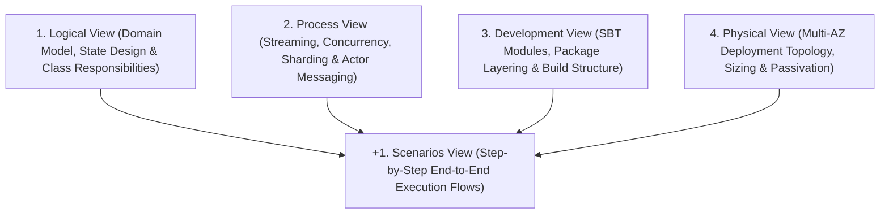
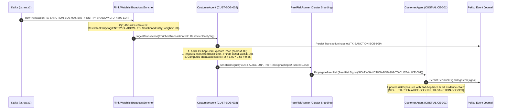
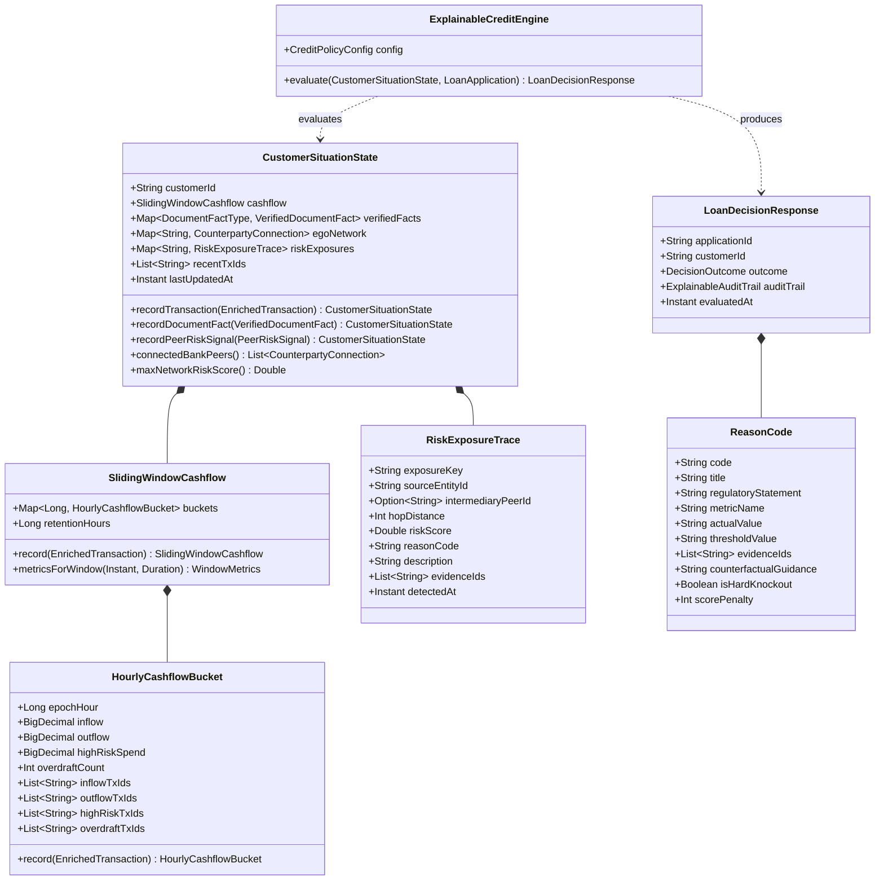
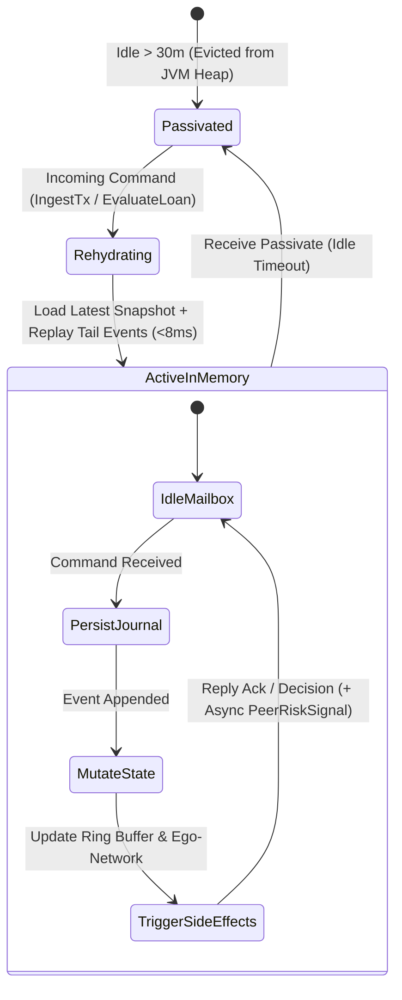
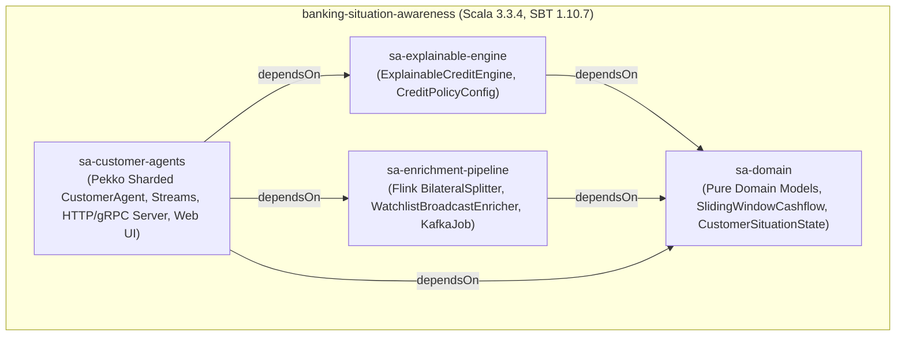
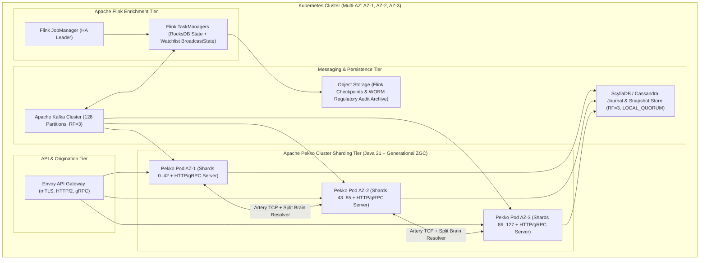

# Comprehensive Architecture Documentation: Real-Time Banking Situation Awareness & Explainable Credit Decisioning (`4+1` View Model)

## 1. Executive Summary & Architectural Drivers

Modern consumer banking requires **real-time Situation Awareness (SA)** to evaluate consumer loan applications accurately while complying with strict regulatory explainability mandates (**EU AI Act High-Risk AI requirements**, **GDPR Article 22**, and **US ECOA / Regulation B Adverse Action Notices**).

### 1.1 Why Legacy SQL & Graph Architectures Fail at Scale
Traditional bank architectures separate transaction processing from analytical decisioning using two patterns that break down under high volume:
1. **Batch / On-Demand SQL Window Aggregations:** Computing rolling 24-hour, 7-day, 30-day, and 90-day cashflow metrics, gambling velocity, and overdraft counts across billions of ledger rows either introduces hours of batch staleness or causes severe database read/write contention at loan request time.
2. **Centralized Multi-Hop Graph Queries:** Traversing a centralized graph database at loan evaluation time to check whether an applicant has 1st-hop or 2nd-hop exposure to sanctioned entities, fraud rings, or defaulting peers suffers from exponential fan-out when traversing high-degree nodes ("super-nodes" such as popular merchants or shared counterparties).

### 1.2 The Cognitive Situation Awareness Paradigm (Endsley’s Model)
This system replaces query-time computation with **continuous, stateful Digital Twin Actors** implemented in **Scala 3** across **Apache Kafka**, **Apache Flink**, and **Apache Pekko Cluster Sharding**:

| Endsley SA Level | Banking Domain Meaning | System Implementation |
| :--- | :--- | :--- |
| **Level 1: Perception** *(What is happening right now?)* | Continuous ingestion of raw payment events, verified external documents (payslips, tax returns, credit bureau liabilities), and dynamic sanctions/watchlists. | **Apache Kafka** event streams + **Apache Flink** (`BilateralTransactionSplitter` & `WatchlistBroadcastEnricher`). |
| **Level 2: Comprehension** *(What does this mean for the client’s current situation?)* | Synthesizing raw events into rolling cashflow health, debt-to-income capacity, ego-network relationships, and 1st/2nd-hop counterparty risk contagion. | **Apache Pekko Cluster Sharding** (`CustomerAgent` persistent actors holding `CustomerSituationState` and `SlidingWindowCashflow` in memory). |
| **Level 3: Projection & Explainable Decision** *(What will happen if we grant credit, and why?)* | Evaluating loan affordability and default/compliance risk in `< 5 ms`, producing a deterministic decision paired with legally verifiable reasons and counterfactuals. | **Explainable Credit Engine** (`ExplainableCreditEngine`) generating `LoanDecisionResponse`, `ExplainableAuditTrail`, and `ReasonCode` traces. |

---

## 2. Organization of This Document (Kruchten’s `4+1` View Model)

Following **Philippe Kruchten’s `4+1` Architectural View Model**, this specification is organized into five complementary views, followed by an exhaustive module/class reference catalog and an architectural trade-off evaluation:

---

## 3. The `+1` View: Scenarios View (How the System Works Step-by-Step)

This section traces the exact step-by-step runtime mechanics of the system across four core business scenarios.

### 3.1 Scenario 1: Bilateral Transaction Ingestion & 1st-Hop Watchlist Screening
**Goal:** A payment occurs between two parties (`Client Alice` transfers `500 EUR` to `Client Bob` via `TX-PEER-101`). Both clients' situational profiles must be updated in real time without SQL aggregation locks.

#### Step-by-Step Execution Flow:
1. **Raw Event Arrival (Kafka):**
   - Core payment rails publish a [`RawTransaction`](file:///home/chris/Projects/OCS/CustAgents/modules/domain/src/main/scala/com/bank/sa/domain/Models.scala#L35-L45) (`txId = "TX-PEER-101"`, `fromCustomerId = "CUST-ALICE-001"`, `toCounterpartyId = "CUST-BOB-002"`, `counterpartyIsBankClient = true`, `amount = 500.00`) to the Kafka topic `tx.raw.v1`.
2. **Bilateral Perspective Splitting (Flink):**
   - [`BilateralTransactionSplitter`](file:///home/chris/Projects/OCS/CustAgents/modules/enrichment-pipeline/src/main/scala/com/bank/sa/enrichment/FlinkTransactionEnrichment.scala#L31-L34) invokes [`EnrichmentLogic.splitBilateral`](file:///home/chris/Projects/OCS/CustAgents/modules/enrichment-pipeline/src/main/scala/com/bank/sa/enrichment/FlinkTransactionEnrichment.scala#L91-L120).
   - Because `counterpartyIsBankClient == true`, the single raw transfer is split into **two** [`CustomerDirectedTransaction`](file:///home/chris/Projects/OCS/CustAgents/modules/enrichment-pipeline/src/main/scala/com/bank/sa/enrichment/FlinkTransactionEnrichment.scala#L15-L26) records:
     - **Perspective 1:** Keyed by `customerId = "CUST-ALICE-001"`, `direction = Outflow`, `counterpartyId = "CUST-BOB-002"`.
     - **Perspective 2:** Keyed by `customerId = "CUST-BOB-002"`, `direction = Inflow`, `counterpartyId = "CUST-ALICE-001"`.
   - *(If `counterpartyIsBankClient == false`, only the initiator's perspective is emitted.)*
3. **Broadcast Watchlist Lookup (Flink):**
   - The Flink stream is `.keyBy(_.customerId)` and connected to a broadcast stream (`risk.watchlist.v1`) via [`WatchlistBroadcastEnricher`](file:///home/chris/Projects/OCS/CustAgents/modules/enrichment-pipeline/src/main/scala/com/bank/sa/enrichment/FlinkTransactionEnrichment.scala#L40-L79).
   - For each directed transaction, `processElement` performs an $O(1)$ local memory lookup in `BroadcastState` (`restricted-entities-broadcast-state`) using `tx.counterpartyId`.
   - It emits an [`EnrichedTransaction`](file:///home/chris/Projects/OCS/CustAgents/modules/domain/src/main/scala/com/bank/sa/domain/Models.scala#L51-L63) onto Kafka topic `customer.situation.events.v1` partitioned by `customerId` via [`CustomerKeySerializationSchema`](file:///home/chris/Projects/OCS/CustAgents/modules/enrichment-pipeline/src/main/scala/com/bank/sa/enrichment/FlinkKafkaEnrichmentJob.scala#L34-L36).
4. **Backpressured Stream Routing to Shards (Pekko Streams & Cluster Sharding):**
   - [`SituationStreamProcessor`](file:///home/chris/Projects/OCS/CustAgents/modules/customer-agents/src/main/scala/com/bank/sa/agent/SituationStreamProcessor.scala#L16-L48) (or [`CustomerClusterGateway.ingestTransaction`](file:///home/chris/Projects/OCS/CustAgents/modules/customer-agents/src/main/scala/com/bank/sa/agent/CustomerClusterGateway.scala#L93-L116)) computes the target shard (`math.abs(customerId.hashCode % 100)`) and sends `CustomerAgent.IngestTransaction(tx, replyTo)` to the `EntityRef[CustomerAgent.Command]` for `"CUST-ALICE-001"` and `"CUST-BOB-002"`.
5. **Idempotent Event Sourcing & Incremental Ring-Buffer Update (Pekko Actor):**
   - Inside [`CustomerAgent.handleCommand`](file:///home/chris/Projects/OCS/CustAgents/modules/customer-agents/src/main/scala/com/bank/sa/agent/CustomerAgent.scala#L106-L169):
     - The actor checks `state.hasProcessedTx(tx.txId)` against its bounded deduplication list (`recentTxIds`). If already processed, it replies immediately with `IngestionAck`.
     - Otherwise, it persists `TransactionIngested(tx)` to the Pekko Persistence Event Journal.
   - Upon journal confirmation, `handleEvent` calls [`CustomerSituationState.recordTransaction(tx)`](file:///home/chris/Projects/OCS/CustAgents/modules/domain/src/main/scala/com/bank/sa/domain/CustomerSituationState.scala#L79-L106):
     - **Cashflow Update:** [`SlidingWindowCashflow.record(tx)`](file:///home/chris/Projects/OCS/CustAgents/modules/domain/src/main/scala/com/bank/sa/domain/SlidingWindowCashflow.scala#L78-L85) hashes `tx.timestamp` into an epoch hour (`epochHour = timestamp.getEpochSecond / 3600L`), updates the [`HourlyCashflowBucket`](file:///home/chris/Projects/OCS/CustAgents/modules/domain/src/main/scala/com/bank/sa/domain/SlidingWindowCashflow.scala#L26-L65) in $O(1)$ time, and prunes buckets older than 90 days (`2160` hours).
     - **Ego-Network Update:** Updates `egoNetwork("CUST-BOB-002")` in Alice's actor (and `egoNetwork("CUST-ALICE-001")` in Bob's actor), recording `isBankClient = true`, cumulative volume, transaction count, and `recentTxIds = List("TX-PEER-101")`.

---

### 3.2 Scenario 2: Decentralized 2nd-Hop Risk Contagion Across Customer Agents
**Goal:** `Client Bob` (`CUST-BOB-002`) sends `4,800 EUR` (`TX-SANCTION-BOB-999`) to `ENTITY-SHADOW-LTD`, a shell company on the `EU-AML-SANCTIONS-2026` watchlist. Not only must Bob's profile be flagged with a 1st-hop sanction exposure, but any bank client actively linked to Bob in his Ego-Network (`Client Alice`) must immediately receive a 2nd-hop risk contagion signal—**without** running a graph database traversal query at loan evaluation time.

#### Step-by-Step Execution Flow:
1. **1st-Hop Tagging in Flink:**
   - `WatchlistBroadcastEnricher` matches `"ENTITY-SHADOW-LTD"` in `BroadcastState` and attaches `RestrictedEntityTag("ENTITY-SHADOW-LTD", RestrictionLevel.SanctionedEntity, "EU-AML-SANCTIONS-2026", ...)`.
2. **Bob’s Agent Records 1st-Hop Exposure:**
   - `CustomerAgent("CUST-BOB-002")` persists `TransactionIngested` and invokes [`RiskExposureTrace.fromDirectRestrictedTx`](file:///home/chris/Projects/OCS/CustAgents/modules/domain/src/main/scala/com/bank/sa/domain/CustomerSituationState.scala#L48-L58), storing a 1st-hop trace with `riskScore = 1.00` and `evidenceIds = List("TX-SANCTION-BOB-999")`.
3. **Automatic 2nd-Hop Risk Propagation (`thenRun` callback):**
   - After persisting `TransactionIngested`, [`CustomerAgent.propagateRiskIfApplicable`](file:///home/chris/Projects/OCS/CustAgents/modules/customer-agents/src/main/scala/com/bank/sa/agent/CustomerAgent.scala#L184-L260) inspects `updatedState.connectedBankPeers`.
   - It finds `CounterpartyConnection("CUST-ALICE-001", isBankClient = true, recentTxIds = List("TX-PEER-ALICE-BOB-101"))`.
   - It calculates the attenuated 2nd-hop risk score:
     $$R_2 = R_1 \times \text{SecondHopAttenuationFactor} = 1.00 \times 0.65 = 0.65$$
   - It constructs a [`PeerRiskSignal`](file:///home/chris/Projects/OCS/CustAgents/modules/domain/src/main/scala/com/bank/sa/domain/Models.scala#L83-L94) containing the combined provenance chain `rootEvidenceIds = List("TX-SANCTION-BOB-999", "TX-PEER-ALICE-BOB-101")` and dispatches it via [`PeerRiskRouter.sendRiskSignal`](file:///home/chris/Projects/OCS/CustAgents/modules/customer-agents/src/main/scala/com/bank/sa/agent/CustomerClusterGateway.scala#L57-L80).
4. **Order-Independence Guarantee (Reverse Temporal Ordering):**
   - What if Bob transacted with `"ENTITY-SHADOW-LTD"` **first**, and only transferred money to Alice **later**?
   - `CustomerAgent.propagateRiskIfApplicable` explicitly handles this in its second `case None if tx.counterpartyIsBankClient =>` branch ([lines 226–258](file:///home/chris/Projects/OCS/CustAgents/modules/customer-agents/src/main/scala/com/bank/sa/agent/CustomerAgent.scala#L226-L258)): whenever a transaction with a bank peer occurs, if the actor already holds any `hopDistance == 1` exposure in `updatedState.riskExposures`, it immediately emits the 2nd-hop `PeerRiskSignal` to that peer.
5. **Alice’s Agent Records 2nd-Hop Exposure & Halts Further Hops:**
   - `CustomerAgent("CUST-ALICE-001")` receives `PropagatePeerRisk(signal)`.
   - It checks `signal.hopCount <= 2 && signal.originCustomerId != customerId`, persists `PeerRiskSignalIngested(signal)`, and adds `PEER:ENTITY-SHADOW-LTD:VIA:CUST-BOB-002` to Alice's `riskExposures` map. Because `PropagatePeerRisk` does not trigger further propagation when `hopCount == 2`, cyclic amplification is impossible.

---

### 3.3 Scenario 3: Real-Time Consumer Loan Evaluation & Regulatory Explainability
**Goal:** `Client Alice` submits a loan application (`18,000 EUR` for `24 months` at `6.5%` APR) via `POST /api/v1/loans/evaluate` after receiving the 2nd-hop risk signal from Bob and experiencing two gambling overdraft transactions (`TX-GAMB-ALICE-201`, `TX-GAMB-ALICE-202`).

#### Step-by-Step Execution Flow:
1. **HTTP / gRPC Request Reception:**
   - [`LoanOriginationServer`](file:///home/chris/Projects/OCS/CustAgents/modules/customer-agents/src/main/scala/com/bank/sa/api/LoanOriginationServer.scala#L118-L127) unmarshals [`LoanOriginationRequest`](file:///home/chris/Projects/OCS/CustAgents/modules/customer-agents/src/main/scala/com/bank/sa/api/LoanOriginationProtocol.scala#L16-L32) via [`JacksonJsonSupport`](file:///home/chris/Projects/OCS/CustAgents/modules/customer-agents/src/main/scala/com/bank/sa/api/LoanOriginationProtocol.scala#L266-L284) and delegates to [`LoanOriginationGrpcServiceImpl.evaluateLoan`](file:///home/chris/Projects/OCS/CustAgents/modules/customer-agents/src/main/scala/com/bank/sa/api/LoanOriginationGrpcService.scala#L25-L29).
2. **Pekko Ask to Sharded Entity:**
   - [`CustomerClusterGateway.evaluateLoan`](file:///home/chris/Projects/OCS/CustAgents/modules/customer-agents/src/main/scala/com/bank/sa/agent/CustomerClusterGateway.scala#L138-L167) sends `CustomerAgent.EvaluateLoan(application, replyTo)` to Alice's in-memory `CustomerAgent` actor.
3. **Pure Functional Evaluation (`ExplainableCreditEngine.evaluate`):**
   - Inside Alice's actor, [`ExplainableCreditEngine.evaluate(state, application)`](file:///home/chris/Projects/OCS/CustAgents/modules/explainable-engine/src/main/scala/com/bank/sa/engine/ExplainableCreditEngine.scala#L25-L88) runs synchronously in `< 1 ms` with **zero external I/O**:
     - Computes amortized monthly installment: `801.84 EUR/month`.
     - Extracts `metrics30d` and `metrics7d` from `state.cashflow.metricsForWindow(...)`.
     - Evaluates all 5 deterministic policy/scorecard rules starting from `baseScore = 750`:
       1. `RULE_AFFORDABILITY_DTI`: Verified net income is `4,200 EUR`; DTI is `801.84 / 4200 = 19.1% <= 40.0%` $\rightarrow$ **PASS (`+25 pts`)**.
       2. `RULE_LIQUIDITY_OVERDRAFT`: 30-day overdraft count is `2 > 1` $\rightarrow$ **FAIL (`-110 pts`)**, emits `RC_201_RECENT_OVERDRAFT_EVENTS` citing `TX-GAMB-ALICE-202, TX-GAMB-ALICE-201`.
       3. `RULE_HIGH_RISK_VELOCITY`: 30-day gambling spend is `1,100 EUR` (`26.2%` of `4,200 EUR` inflow `> 15.0%` threshold) $\rightarrow$ **FAIL (`-120 pts`)**, emits `RC_204_HIGH_RISK_SPEND_VELOCITY` citing `TX-GAMB-ALICE-202, TX-GAMB-ALICE-201`.
       4. `RULE_RESTRICTED_1HOP`: No direct 1st-hop exposure $\rightarrow$ **PASS (`0 pts`)**.
       5. `RULE_NETWORK_CONTAGION_2HOP`: 2nd-hop exposure via `CUST-BOB-002` has score `0.65 >= 0.45` $\rightarrow$ **FAIL (`-150 pts`)**, emits `RC_302_INDIRECT_NETWORK_RISK_CONTAGION` citing `SIG-TX-SANCTION-BOB-999-TO-CUST-ALICE-001, TX-PEER-ALICE-BOB-101, TX-SANCTION-BOB-999`.
     - Computes `finalScore = 750 + 25 - 110 - 120 - 150 = 395 / 850` (below `620` minimum and has failed rules) $\rightarrow$ `DecisionOutcome.Denied`.
     - Builds the formatted **Statement of Reasons (Adverse Action Notice)** ordering principal reasons by knockout priority and score penalty.
4. **Immutable Audit Snapshot Persistence:**
   - Before replying to the caller, `CustomerAgent` persists `LoanDecisionAudited(decision, frozenSituationState = state)` to the event journal. This freezes the exact `CustomerSituationState` that existed at the millisecond of evaluation for future regulatory inspection.

---

## 4. View 1: Logical View (Domain Model & Class-by-Class Reference)

### 4.1 Domain & Engine Class Diagram

---

### 4.2 Complete Module-by-Module & Class-by-Class Responsibility Reference

#### Module 1: `sa-domain` (`modules/domain`)
Contains pure, zero-dependency domain data structures and state transition algorithms shared across Flink, Pekko, and the Credit Engine.

1. **[`Models.scala`](file:///home/chris/Projects/OCS/CustAgents/modules/domain/src/main/scala/com/bank/sa/domain/Models.scala)**
   - **`enum TransactionDirection`**: Distinguishes `Inflow` (credit to the customer's account) vs. `Outflow` (debit from the customer's account).
   - **`enum TransactionCategory`**: Classifies transactions into `Salary`, `EverydaySpend`, `Housing`, `Utilities`, `LoanRepayment`, `Gambling`, `CryptoExchange`, `PeerTransfer`, and `HighRiskTransfer`. Provides `isHighRiskCategory: Boolean` (`true` for `Gambling` and `HighRiskTransfer`).
   - **`enum RestrictionLevel(val baseRiskWeight: Double)`**: Defines severity tiers for watchlisted entities:
     - `SanctionedEntity` (`1.00`), `FraudWatchlist` (`0.90`), `UnlicensedLender` (`0.75`), `HighRiskWatchlist` (`0.60`).
   - **`final case class RestrictedEntityTag`**: Metadata attached to a transaction when a counterparty matches a watchlist (`entityId`, `level`, `listSource`, `reasonDescription`).
   - **`final case class RawTransaction`**: Unenriched payment event arriving from core banking rails (`txId`, `fromCustomerId`, `toCounterpartyId`, `counterpartyIsBankClient`, `amount`, `currency`, `category`, `resultsInOverdraft`, `timestamp`).
   - **`final case class EnrichedTransaction`**: Customer-keyed perspective emitted by Flink (`txId`, `customerId`, `counterpartyId`, `counterpartyIsBankClient`, `direction`, `amount`, `currency`, `category`, `resultsInOverdraft`, `restrictedTag: Option[RestrictedEntityTag]`, `timestamp`).
   - **`enum DocumentFactType`**: Types of verified external document signals (`VerifiedMonthlyNetIncome`, `EmploymentContractStatus`, `ExternalDebtObligation`, `TaxReturnAnnualIncome`, `KycVerificationStatus`).
   - **`final case class VerifiedDocumentFact`**: Structured fact extracted by the OCR/verification pipeline (`docId`, `customerId`, `factType`, `numericValue`, `textValue`, `issuer`, `verifiedAt`).
   - **`final case class PeerRiskSignal`**: Asynchronous inter-actor message carrying attenuated risk across connected bank clients (`signalId`, `originCustomerId`, `fromCustomerId`, `targetCustomerId`, `hopCount`, `attenuatedRiskScore`, `reasonCode`, `reasonDescription`, `rootEvidenceIds`, `emittedAt`).
   - **`final case class LoanApplication`**: Customer credit request (`applicationId`, `customerId`, `requestedAmount`, `termMonths`, `annualInterestRate`, `requestedAt`). Implements `estimatedMonthlyInstallment: BigDecimal` using the standard fixed-rate amortization formula.

2. **[`SlidingWindowCashflow.scala`](file:///home/chris/Projects/OCS/CustAgents/modules/domain/src/main/scala/com/bank/sa/domain/SlidingWindowCashflow.scala)**
   - **`final case class WindowMetrics`**: Aggregated financial metrics over a queried `Duration` (`totalInflow`, `totalOutflow`, `highRiskSpend`, `overdraftCount`, and bounded lists of contributing transaction IDs `inflowTxIds`, `outflowTxIds`, `highRiskTxIds`, `overdraftTxIds`). Computes `netCashflow` and `highRiskToInflowRatio`.
   - **`final case class HourlyCashflowBucket`**: Granular 1-hour aggregation cell (`epochHour: Long`). `record(tx: EnrichedTransaction)` increments inflow/outflow totals, high-risk spend, and overdraft counts while retaining up to 25 transaction IDs per category for audit attribution.
   - **`final case class SlidingWindowCashflow`**: In-memory time-bucketed ring buffer (`buckets: Map[Long, HourlyCashflowBucket]`, `retentionHours = 2160`).
     - `record(tx)`: Updates the target `epochHour` bucket in $O(1)$ time and evicts buckets older than `maxHour - retentionHours`.
     - `metricsForWindow(referenceTime, window)`: Folds all hourly buckets within `(referenceTime - window, referenceTime]` into a `WindowMetrics` summary in sub-millisecond time.

3. **[`CustomerSituationState.scala`](file:///home/chris/Projects/OCS/CustAgents/modules/domain/src/main/scala/com/bank/sa/domain/CustomerSituationState.scala)**
   - **`final case class CounterpartyConnection` & `object CounterpartyConnection`**: Tracks a 1st-hop relationship in the customer's localized Ego-Network (`counterpartyId`, `isBankClient`, `totalVolume`, `transactionCount`, `recentTxIds`, `lastInteractionAt`).
   - **`final case class RiskExposureTrace` & `object RiskExposureTrace`**: Immutable provenance record of a 1st-hop direct watchlist hit (`fromDirectRestrictedTx`) or 2nd-hop peer-propagated risk signal (`fromPeerSignal`), capturing `exposureKey`, `sourceEntityId`, `intermediaryPeerId`, `hopDistance`, `riskScore`, `reasonCode`, `description`, and `evidenceIds`.
   - **`final case class CustomerSituationState` & `object CustomerSituationState`**: The complete Level-2 Situation Awareness state held by a `CustomerAgent`. Provides pure state-transition methods `recordTransaction`, `recordDocumentFact`, `recordPeerRiskSignal`, `hasProcessedTx`, `connectedBankPeers`, and `maxNetworkRiskScore`.

4. **[`DecisionModels.scala`](file:///home/chris/Projects/OCS/CustAgents/modules/domain/src/main/scala/com/bank/sa/domain/DecisionModels.scala)**
   - **`final case class ReasonCode`**: Regulatory Adverse Action reason entry (`code`, `title`, `regulatoryStatement`, `metricName`, `actualValue`, `thresholdValue`, `evidenceIds`, `counterfactualGuidance`, `isHardKnockout`, `scorePenalty`).
   - **`final case class RuleEvaluationTrace`**: Outcome of a single policy rule (`ruleId`, `ruleName`, `passed`, `pointsDelta`, `reasonCode: Option[ReasonCode]`).
   - **`final case class ExplainableAuditTrail`**: Complete scorecard audit record (`policyVersion`, `evaluatedAt`, `baseScore`, `finalCreditScore`, `minimumRequiredScore`, `ruleTraces`, `principalAdverseReasons`, `statementOfReasons`).
   - **`enum DecisionOutcome`**: `Approved(approvedAmount, termMonths, offeredAnnualRate, monthlyInstallment, creditScore)` or `Denied(principalReasons, creditScore, statementOfReasons)`.
   - **`final case class LoanDecisionResponse`**: Top-level decision envelope returned by `CustomerAgent`.

---

#### Module 2: `sa-explainable-engine` (`modules/explainable-engine`)
Implements Level-3 Situation Awareness projection and regulatory explainability.

5. **[`ExplainableCreditEngine.scala`](file:///home/chris/Projects/OCS/CustAgents/modules/explainable-engine/src/main/scala/com/bank/sa/engine/ExplainableCreditEngine.scala)**
   - **`final case class CreditPolicyConfig`**: Externalized policy thresholds (`policyVersion = "SA-CREDIT-POLICY-2026.11"`, `baseScore = 750`, `minimumApprovalScore = 620`, `maxDebtToIncomeRatio = 0.40`, `max30DayHighRiskSpendRatio = 0.15`, `max30DayOverdraftCount = 1`, `max1HopRiskScore = 0.50`, `max2HopRiskScore = 0.45`).
   - **`class ExplainableCreditEngine`**: Pure functional rule and scorecard evaluator:
     - `evaluate(state, application)`: Runs all five policy rules, clamps the composite score to `[300, 850]`, sorts failed reasons by knockout criticality and penalty weight, and constructs the `LoanDecisionResponse`.
     - `evaluateVerifiedIncomeAndAffordability`: Checks `VerifiedMonthlyNetIncome` (or 30d inflows) and `ExternalDebtObligation` against the proposed installment (`RC_101_INSUFFICIENT_VERIFIED_INCOME`, `RC_102_EXCESSIVE_DEBT_TO_INCOME`). Computes exact counterfactual maximum installment and required monthly income.
     - `evaluateShortTermLiquidityShock`: Checks 7-day and 30-day overdraft occurrences (`RC_201_RECENT_OVERDRAFT_EVENTS`).
     - `evaluateHighRiskSpendVelocity`: Checks 30-day gambling/high-risk outflows relative to inflows (`RC_204_HIGH_RISK_SPEND_VELOCITY`).
     - `evaluateDirectRestrictedExposure`: Hard-knockout check for 1st-hop watchlist matches (`RC_301_DIRECT_RESTRICTED_COUNTERPARTY`).
     - `evaluateSecondHopPeerContagion`: Evaluates 2nd-hop propagated peer risk exposures (`RC_302_INDIRECT_NETWORK_RISK_CONTAGION`).
     - `buildRegulatoryStatement`: Generates the human-readable legal **Statement of Credit Decision / Adverse Action Notice**.

---

#### Module 3: `sa-enrichment-pipeline` (`modules/enrichment-pipeline`)
Implements Level-1 Situation Awareness perception using Apache Flink.

6. **[`FlinkTransactionEnrichment.scala`](file:///home/chris/Projects/OCS/CustAgents/modules/enrichment-pipeline/src/main/scala/com/bank/sa/enrichment/FlinkTransactionEnrichment.scala)**
   - **`final case class CustomerDirectedTransaction`**: Intermediate bilateral transaction perspective prior to watchlist enrichment.
   - **`class BilateralTransactionSplitter`**: Flink `FlatMapFunction[RawTransaction, CustomerDirectedTransaction]` delegating to `EnrichmentLogic.splitBilateral`.
   - **`class WatchlistBroadcastEnricher`**: Flink `KeyedBroadcastProcessFunction[String, CustomerDirectedTransaction, RestrictedEntityTag, EnrichedTransaction]` that joins customer-keyed transactions with dynamic `MapStateDescriptor` broadcast state in $O(1)$ local memory.
   - **`object EnrichmentLogic`**: Pure helper functions (`splitBilateral`, `toEnriched`, `enrichBatchInMemory`) and `buildFlinkTopology` wiring the Flink `StreamExecutionEnvironment`.

7. **[`FlinkKafkaEnrichmentJob.scala`](file:///home/chris/Projects/OCS/CustAgents/modules/enrichment-pipeline/src/main/scala/com/bank/sa/enrichment/FlinkKafkaEnrichmentJob.scala)**
   - **`class JsonDeserializationSchema[T]` & `class JsonValueSerializationSchema[T]`**: Jackson-backed Flink Kafka serializers configured with `DefaultScalaModule` and `JavaTimeModule`.
   - **`class CustomerKeySerializationSchema`**: Serializes `EnrichedTransaction.customerId` as UTF-8 bytes so Kafka partition assignment aligns deterministically with Pekko Cluster Shards.
   - **`object FlinkKafkaEnrichmentJob` & `final case class KafkaJobConfig`**: Configures `KafkaSource`s (`tx.raw.v1`, `risk.watchlist.v1`), `KafkaSink` (`customer.situation.events.v1`), 30-second Flink checkpointing, and the standalone Flink job `main` entrypoint.

---

#### Module 4: `sa-customer-agents` (`modules/customer-agents`)
Implements Level-2 Situation Awareness comprehension on Apache Pekko Cluster Sharding, Pekko Streams ingestion, and the Pekko HTTP / gRPC / Web UI layer.

8. **[`CborSerializable.scala`](file:///home/chris/Projects/OCS/CustAgents/modules/customer-agents/src/main/scala/com/bank/sa/agent/CborSerializable.scala)**
   - **`trait CborSerializable`**: Marker trait bound to Pekko's `jackson-cbor` serializer in `application.conf` for all actor commands, journal events, and state snapshots.

9. **[`CustomerAgent.scala`](file:///home/chris/Projects/OCS/CustAgents/modules/customer-agents/src/main/scala/com/bank/sa/agent/CustomerAgent.scala)**
   - **`trait PeerRiskRouter` & `object PeerRiskRouter`**: Abstraction for sending asynchronous `PeerRiskSignal` messages to peer actors across the Pekko cluster.
   - **`object CustomerAgent`**:
     - Defines `TypeKey = EntityTypeKey[Command]("CustomerAgent")` and `SecondHopAttenuationFactor = 0.65`.
     - **Commands (`sealed trait Command`)**: `IngestTransaction`, `IngestDocumentFact`, `PropagatePeerRisk`, `EvaluateLoan`, `GetSituationState`, `ResetState`, `Passivate`.
     - **Events (`sealed trait Event`)**: `TransactionIngested`, `DocumentFactIngested`, `PeerRiskSignalIngested`, `CustomerStateReset`, `LoanDecisionAudited`.
     - **`apply`**: Constructs the `EventSourcedBehavior[Command, Event, CustomerSituationState]` with snapshot retention (`snapshotEvery(50, keepNSnapshots = 2)`).
     - **`propagateRiskIfApplicable`**: Implements bidirectional 2nd-hop risk contagion upon 1st-hop watchlist hits or new peer links.

10. **[`CustomerClusterGateway.scala`](file:///home/chris/Projects/OCS/CustAgents/modules/customer-agents/src/main/scala/com/bank/sa/agent/CustomerClusterGateway.scala)**
    - **`class CustomerClusterGateway`**: Initializes Pekko `ClusterSharding`, wires `shardedRiskRouter` to route `PropagatePeerRisk` commands via `sharding.entityRefFor(CustomerAgent.TypeKey, targetCustomerId)`, exposes `Future`-based methods (`ingestTransaction`, `ingestDocumentFact`, `evaluateLoan`, `getSituationState`, `resetAll`), and maintains the real-time telemetry ring buffer (`workflowTraces`, `recentDecisions`, `knownCustomers`) for UI inspection.

11. **[`SituationStreamProcessor.scala`](file:///home/chris/Projects/OCS/CustAgents/modules/customer-agents/src/main/scala/com/bank/sa/agent/SituationStreamProcessor.scala)**
    - **`class SituationStreamProcessor`**: Pekko Streams (`Flow` / `Source` / `Sink`) processor using `.groupBy(maxConcurrentSubstreams, ...)` + `.mapAsync(1)` per customer substream to guarantee strict per-customer sequential event ordering with concurrent backpressured ingestion across distinct customers.

12. **[`LoanOriginationProtocol.scala`](file:///home/chris/Projects/OCS/CustAgents/modules/customer-agents/src/main/scala/com/bank/sa/api/LoanOriginationProtocol.scala)**
    - Defines all REST/gRPC wire DTOs (`LoanOriginationRequest`, `DocumentFactUploadRequest`, `RawTransactionIngestRequest`, `LoanOriginationDecisionDto`, `CustomerSituationSnapshotDto`, `ReasonCodeDto`, `RuleTraceDto`, `RiskExposureDto`, `WorkflowTraceEventDto`, `WatchlistEntryDto`, `SystemOverviewDto`) and **`object JacksonJsonSupport`** providing Scala 3 `given` Pekko HTTP `FromEntityUnmarshaller` and `ToEntityMarshaller` instances.

13. **[`LoanOriginationGrpcService.scala`](file:///home/chris/Projects/OCS/CustAgents/modules/customer-agents/src/main/scala/com/bank/sa/api/LoanOriginationGrpcService.scala) & [`loan_origination.proto`](file:///home/chris/Projects/OCS/CustAgents/modules/customer-agents/src/main/protobuf/loan_origination.proto)**
    - **`trait LoanOriginationGrpcService` & `class LoanOriginationGrpcServiceImpl`**: Typed unary RPC service implementation backing both the gRPC HTTP/2 endpoints (`/com.bank.sa.proto.v1.LoanOriginationService/*`) and REST API v1 routes.

14. **[`LoanOriginationServer.scala`](file:///home/chris/Projects/OCS/CustAgents/modules/customer-agents/src/main/scala/com/bank/sa/api/LoanOriginationServer.scala)**
    - **`class LoanOriginationServer` & `object LoanOriginationServer`**: Pekko HTTP server binding the interactive Web UI (`GET /`, `GET /ui`), cluster health check (`GET /health`), system telemetry overview (`GET /api/v1/system/overview`), guided demo runner (`POST /api/v1/demo/scenario/{step}`), loan evaluation (`POST /api/v1/loans/evaluate`), customer situation query (`GET /api/v1/customers/{id}/situation`), document upload (`POST /api/v1/customers/{id}/documents`), transaction ingestion (`POST /api/v1/transactions/ingest`), and gRPC path handlers.

15. **[`SituationAwarenessDemo.scala`](file:///home/chris/Projects/OCS/CustAgents/modules/customer-agents/src/main/scala/com/bank/sa/app/SituationAwarenessDemo.scala) & [`LoanOriginationWebApp.scala`](file:///home/chris/Projects/OCS/CustAgents/modules/customer-agents/src/main/scala/com/bank/sa/app/LoanOriginationWebApp.scala)**
    - **`object SituationAwarenessDemo`**: Standalone CLI simulation executing all three banking scenarios and printing the regulatory Adverse Action notices to stdout.
    - **`object LoanOriginationWebApp`**: Standalone cluster & HTTP/gRPC server entrypoint binding port `8088` (configurable via `SA_HTTP_PORT`).

---

## 5. View 2: Process View (Concurrency, Actors, Streams & Persistence)

### 5.1 Single-Writer Principle per Customer (`CustomerAgent` Actor)
Every customer is mapped to a single `CustomerAgent` actor instance across the entire Pekko Cluster via `EntityTypeKey[CustomerAgent.Command]("CustomerAgent")`:
- **No Database Row Locks:** Because Pekko Cluster Sharding guarantees at most one active instance of `CustomerAgent(customerId)` in the cluster at any time, all updates to a customer's cashflow buckets, document facts, and risk exposures are processed sequentially in the actor's mailbox—eliminating optimistic/pessimistic database locking.
- **Event Sourcing & Snapshots:** State mutations are persisted as append-only journal events (`TransactionIngested`, `DocumentFactIngested`, `PeerRiskSignalIngested`, `LoanDecisionAudited`). Every 50 events, Pekko Persistence writes a compact state snapshot (`RetentionCriteria.snapshotEvery(50, keepNSnapshots = 2)`), bounding actor recovery time.

---

## 6. View 3: Development View (Module Layering & Build Organization)

### 6.1 SBT Multi-Module Dependency Graph

The codebase enforces strict compile-time separation of concerns across four SBT modules in [`build.sbt`](file:///home/chris/Projects/OCS/CustAgents/build.sbt):

### 6.2 Key Engineering Standards
- **Compiler Enforcement:** Compiled with Scala `3.3.4` and strict flags (`-deprecation`, `-feature`, `-unchecked`, `-Xfatal-warnings`).
- **Pure Core, Imperative Shell:** Both `sa-domain` and `sa-explainable-engine` have **zero framework dependencies** (no Pekko, Flink, or I/O imports), making credit policy logic 100% deterministic and trivially unit-testable.

---

## 7. View 4: Physical View (Deployment Topology & Capacity Sizing)

### 7.1 Multi-AZ Production Deployment Topology

### 7.2 Memory Footprint & Passivation Sizing (10M Customers)
- **Per-Actor Memory Footprint:** Each active `CustomerAgent` holds ~90–150 populated hourly buckets (`~12 KB`), verified document facts (`~1.5 KB`), bounded ego-network links (`~6 KB`), and recent transaction IDs (`~4 KB`), totaling **$\approx 25\text{ KB}$ per active customer actor**.
- **Active vs. Passivated Population:** With a 30-minute idle passivation policy (`pekko.cluster.sharding.passivation.default-idle-strategy.idle-entity.timeout = 30m`), assuming 1.5M concurrently active customers out of 10M total retail clients, the live cluster state requires only **$1.5\text{M} \times 25\text{ KB} \approx 37.5\text{ GB}$ of JVM heap** across 12 Pekko pods (`10 GB` heap per pod with Java 21 Generational ZGC `-XX:+UseZGC -XX:+ZGenerational`).

---

## 8. Architectural Evaluation: Strengths & Weaknesses

### 8.1 Core Architectural Strengths

| Strength | Technical Mechanism | Business & Regulatory Impact |
| :--- | :--- | :--- |
| **1. Sub-10ms Deterministic Decision Latency** | Sliding-window cashflow aggregates (`SlidingWindowCashflow`) and 1st/2nd-hop risk exposures (`riskExposures`) are pre-computed in actor memory before `EvaluateLoan` arrives. | Enables instant point-of-sale and mobile consumer loan approvals with $p99 < 15\text{ ms}$ end-to-end latency. |
| **2. Elimination of SQL & Graph Contention** | Replaces multi-billion-row `GROUP BY` scans with $O(1)$ hourly ring buffers and replaces global graph queries with localized actor-to-actor `PeerRiskSignal` messaging. | Linear horizontal scalability as transaction volume and customer count grow from 1M to 50M+ clients. |
| **3. 100% Regulatory Explainability & Auditability** | `ExplainableCreditEngine` is a pure function producing exact `ReasonCode`s, contributing `evidenceIds`, and counterfactual formulas, persisted atomically via `LoanDecisionAudited`. | Full compliance with EU AI Act High-Risk AI transparency, GDPR Art. 22, and US ECOA Adverse Action rules, including point-in-time state replay. |
| **4. Order-Independent 2-Hop Risk Contagion** | `CustomerAgent.propagateRiskIfApplicable` triggers on both *Peer Link $\rightarrow$ Restricted Tx* and *Restricted Tx $\rightarrow$ Peer Link*. | Prevents race conditions between asynchronous payment rails and watchlist updates. |
| **5. Fault Isolation & Self-Healing** | Pekko Cluster Sharding + Split Brain Resolver (SBR) + Event Sourcing isolate actor failures to individual shards and automatically rebalance shards across surviving nodes. | High availability (`99.99%`) even during node restarts or AZ failovers. |

---

### 8.2 Architectural Weaknesses & Operational Risks

| Weakness / Risk | Root Cause in Current Design | Failure Mode / Impact |
| :--- | :--- | :--- |
| **1. "Super-Node" (High-Degree Peer) Fan-Out Storms** | If a bank client account is actually a high-volume merchant or payroll aggregator connected to 50,000 other bank clients, a 1st-hop restricted hit on that account will cause `propagateRiskIfApplicable` to emit 50,000 `PeerRiskSignal` messages simultaneously. | Can cause sudden mailbox backpressure spikes and inter-node Artery TCP congestion across the Pekko cluster. |
| **2. Eventual Consistency Window for 2nd-Hop Signals** | `PeerRiskRouter.sendRiskSignal` uses asynchronous fire-and-forget (`!`) messaging across shards without a distributed causal barrier. | If `Client Bob` transacts with a sanctioned entity at $t_0$ and `Client Alice` submits a loan request at $t_0 + 2\text{ ms}$, `EvaluateLoan` might reach Alice's actor a few milliseconds before `PropagatePeerRisk` arrives. |
| **3. Cold-Start Rehydration Spikes ("Thundering Herd")** | Passivated actors rehydrate from the journal/snapshot store upon receiving their first message. | If a batch job or marketing campaign triggers simultaneous events for 2M passivated customers at 09:00 AM, ScyllaDB/Cassandra will experience a sudden read spike. |
| **4. Dual-Framework Operational Overhead (Flink + Pekko)** | Maintaining both an Apache Flink cluster (for Level-1 stream enrichment) and an Apache Pekko cluster (for Level-2/3 stateful actors) requires two distinct deployment and monitoring stacks. | Higher DevOps and SRE cognitive load compared to a single-runtime architecture. |
| **5. Rigid Threshold Boundaries ("Cliff Effects")** | Deterministic threshold rules (e.g., DTI $\le 40.0\%$, High-Risk Velocity $\le 15.0\%$) treat `15.01%` as a hard `-120 pt` penalty while `14.99%` gets `+10 pts`. | Can miss subtle non-linear interaction effects across features or cause abrupt score drops near threshold boundaries. |

---

## 9. Proposed Future Architectural Changes & Roadmap

To address the weaknesses identified above and evolve the platform toward enterprise production maturity, the following six architectural enhancements are proposed:

### 9.1 Hybrid Push/Pull Protocol for High-Degree "Super-Nodes" (Solving Fan-Out Storms)
- **Proposal:** Introduce a degree threshold (`MaxPushPeersThreshold = 200`) in `CustomerSituationState.egoNetwork`.
  - For normal retail customers ($\le 200$ peers), keep the current **proactive push** (`PeerRiskRouter.sendRiskSignal`) so loan evaluation remains zero-query.
  - For high-degree accounts ($> 200$ peers, such as merchants or corporate accounts), mark them as `HighDegreeNode` and replicate their risk status into a lightweight **Replicated Cache (Pekko Distributed Data / CRDT `ORMap`)** on each cluster node so `CustomerAgent`s check high-degree counterparty risk locally in memory without generating $N$-to-$M$ message storms.

### 9.2 At-Least-Once Reliable Delivery & Causal Watermarks for Peer Risk Signals
- **Proposal:** Upgrade `PeerRiskRouter` from fire-and-forget (`!`) to **Pekko Reliable Delivery (`ShardingProducerController` / `ConsumerController`)** so inter-agent `PeerRiskSignal` messages are guaranteed against network partitions and node crashes.

### 9.3 Proactive Actor Pre-Warming on Mobile/Web Login Events
- **Proposal:** Subscribe the Pekko cluster to an authentication topic (`customer.session.started.v1`). As soon as a customer logs into the mobile banking app or opens the "Loan Calculator" screen, emit a lightweight `PreWarmCustomerAgent(customerId)` command so the actor rehydrates from ScyllaDB **seconds before** the customer clicks "Submit Loan Application", guaranteeing hot-cache ($< 5\text{ ms}$) latency even for previously passivated clients.

### 9.4 Hybrid ML + TreeSHAP Explainability Inside `ExplainableCreditEngine`
- **Proposal:** Keep the compliance/regulatory rules (`RULE_RESTRICTED_1HOP`, `RULE_AFFORDABILITY_DTI`) as deterministic hard guardrails, and replace the linear scorecard weights with an embedded **ONNX / XGBoost Monotonic Gradient Boosted Tree** model paired with **TreeSHAP**.
  - TreeSHAP computes exact, additive feature attributions in $< 2\text{ ms}$ on CPU, mapping each continuous feature contribution directly to a regulatory `ReasonCode` and smooth counterfactual delta while eliminating artificial threshold cliff effects.

### 9.5 CQRS Read-Side Projections (`pekko-projection`) for Portfolio Analytics
- **Proposal:** While `CustomerAgent` actors excel at per-customer real-time decisions, risk officers also need bank-wide SQL/OLAP queries (e.g., *"How many customers had 2nd-hop sanction exposure this week?"*). Add **Pekko Projections (`pekko-projection-eventsourced`)** reading tagged journal events (`TransactionIngested`, `PeerRiskSignalIngested`, `LoanDecisionAudited`) and streaming them into **ClickHouse / Apache Iceberg** for analytical reporting without impacting actor latency.

### 9.6 Dynamic Credit Policy Hot-Reloading via Pekko Distributed Data
- **Proposal:** Store `CreditPolicyConfig` (thresholds, weights, and policy version) in a Pekko **Distributed Data `LWWRegister`** or broadcast topic so credit risk officers can publish a new policy version from the UI and have all `CustomerAgent` actors switch to the new policy atomically without restarting the cluster.
