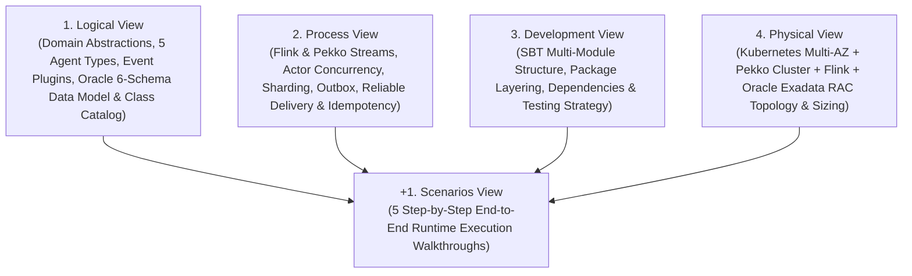
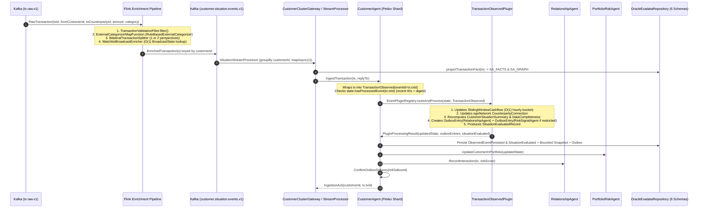
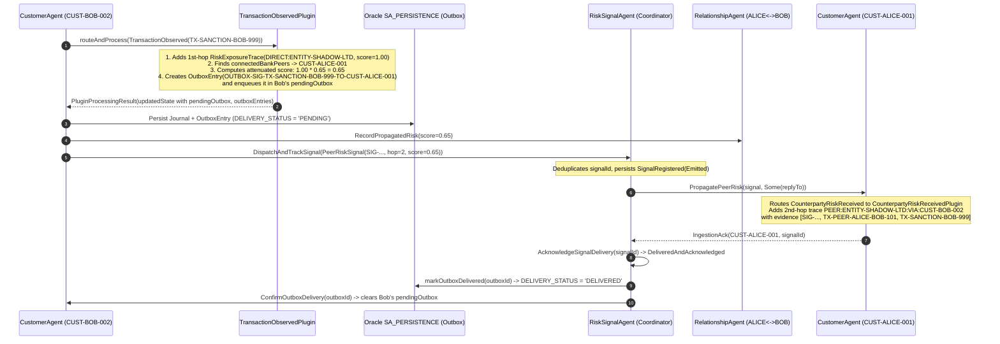
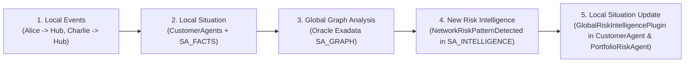
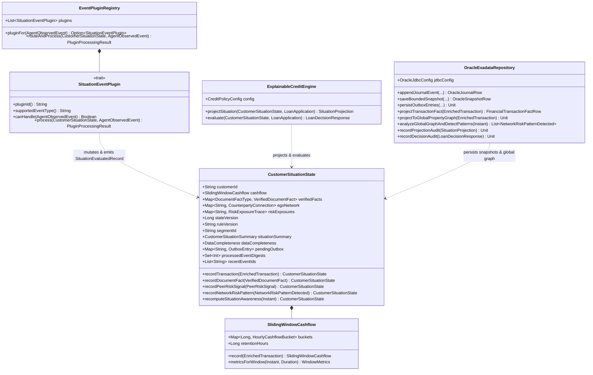
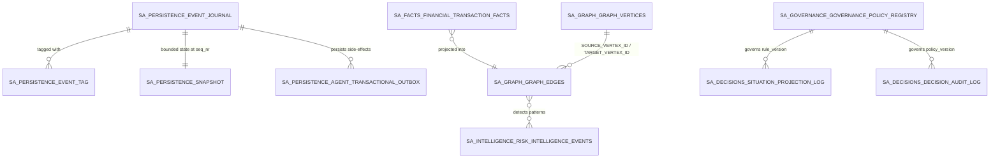
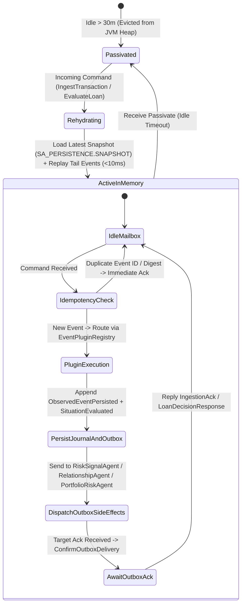
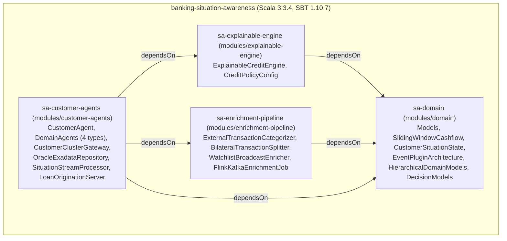
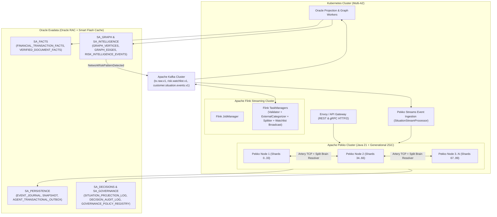

# Comprehensive Architecture Documentation: Real-Time Banking Situation Awareness & Explainable Credit Decisioning (`4+1` View Model)

## 1. Executive Summary & Architectural Drivers

Modern retail and commercial banking requires **real-time Situation Awareness (SA)** to evaluate consumer loan applications accurately while complying with strict regulatory explainability mandates (**EU AI Act High-Risk AI requirements**, **GDPR Article 22**, and **US ECOA / Regulation B Adverse Action Notices**).

### 1.1 Architectural Philosophy: Dual-Level Situation Intelligence
Traditional banking architectures suffer from a fundamental impedance mismatch when evaluating real-time credit and compliance risk:
1. **Batch / On-Demand SQL Window Aggregations:** Reconstructing a customer's rolling 24-hour, 7-day, 30-day, and 90-day cashflow velocity, overdraft frequency, and gambling spend across billions of ledger rows at loan request time causes severe database read/write contention or relies on stale overnight batch tables.
2. **Synchronous Multi-Hop Graph Queries:** Traversing a centralized graph database on the critical path of every credit decision to detect 1st-hop or 2nd-hop exposure to sanctioned entities, fraud rings, or defaulting peers suffers from exponential fan-out across high-degree nodes.

As defined in [ExaPekdoDesign.md](file:///Users/krzysztof/Projects/OCS/CustAgents/Doc/ExaPekdoDesign.md#L8-L26), this system implements a **two-tier Situation Intelligence architecture** built on **Scala 3**, **Apache Kafka**, **Apache Flink**, **Apache Pekko Cluster Sharding**, and **Oracle Exadata**:

> [!IMPORTANT]
> **Core Architectural Principle:** We do **not** use Oracle Exadata as a synchronous query engine that reconstructs a customer's situation from scratch on every request. Instead, **Apache Pekko Cluster Sharding** owns the live, incremental in-memory situation of each entity (**Local Situation Intelligence**), while **Oracle Exadata** serves as the durable event/snapshot memory, authoritative repository of canonical financial facts, and platform for bank-wide Property Graph and portfolio analysis (**Global Situation Intelligence & Memory**).

| Intelligence Tier | Primary Technology | Core Responsibility |
| :--- | :--- | :--- |
| **Level-1 Perception (Stream Enrichment)** | **Apache Kafka** + **Apache Flink** | High-throughput ingestion of raw banking transactions, validation, **External Transaction Categorizer** enrichment, bilateral P2P perspective splitting, and $O(1)$ broadcast watchlist tagging. |
| **Distributed Local Situation Intelligence** | **Apache Pekko Cluster Sharding** | Real-time stateful actors (`CustomerAgent`, `RelationshipAgent`, `RiskSignalAgent`, `DocumentVerificationAgent`, `PortfolioRiskAgent`), configurable `EventPluginRegistry`, $O(1)$ hourly cashflow ring buffers, localized Ego-Networks, 2nd-hop risk propagation, and sub-5ms Level-3 `ExplainableCreditEngine` evaluations. |
| **Global Situation Intelligence & Memory** | **Oracle Exadata (6 Schemas)** | Durable Pekko Event Journal & bounded state snapshots (`SA_PERSISTENCE`), authoritative financial & document facts (`SA_FACTS`), global multi-customer Property Graph (`SA_GRAPH`), systemic risk pattern detection (`SA_INTELLIGENCE`), immutable regulatory decision audit logs (`SA_DECISIONS`), and policy governance (`SA_GOVERNANCE`). |

### 1.2 Endsley’s Three-Level Situation Awareness Model & Hierarchical Scope
The domain model directly implements **Mica Endsley’s Situation Awareness model** ([ExaPekdoDesign.md](file:///Users/krzysztof/Projects/OCS/CustAgents/Doc/ExaPekdoDesign.md#L367-L445)) across a **four-tier banking hierarchy** ([HierarchicalDomainModels.scala](file:///Users/krzysztof/Projects/OCS/CustAgents/modules/domain/src/main/scala/com/bank/sa/domain/HierarchicalDomainModels.scala#L5-L244)):

1. **Endsley’s Three Cognitive Levels:**
   - **Level 1 — Perception (*What events occurred?*):** Detecting raw payment transfers, verified income/debt documents, counterparty watchlist matches, and global graph patterns via Kafka adapters and Flink enrichment ([FlinkTransactionEnrichment.scala](file:///Users/krzysztof/Projects/OCS/CustAgents/modules/enrichment-pipeline/src/main/scala/com/bank/sa/enrichment/FlinkTransactionEnrichment.scala#L143-L276)).
   - **Level 2 — Comprehension (*What does this mean for the current situation?*):** Routing observed events (`TransactionObserved`, `IncomeVerified`, `DebtUpdated`, `CounterpartyRiskReceived`, `ExternalDocumentReceived`, `NetworkRiskPatternDetected`) through `EventPluginRegistry` ([EventPluginArchitecture.scala](file:///Users/krzysztof/Projects/OCS/CustAgents/modules/domain/src/main/scala/com/bank/sa/domain/EventPluginArchitecture.scala#L318-L350)) to synthesize `CustomerSituationState` (`incomeStability`, `liquidityTrend`, `dataCompleteness`, `riskExposures`) and emit `SituationEvaluated`.
   - **Level 3 — Projection & Explainable Decision (*What will happen if credit is granted, and why?*):** Computing future scenario consequences (`SituationProjection`: `futureDti`, `expectedMonthlyLiquidity`, `affordabilityBuffer`, `isAffordable`) independently of formal approval authority, and executing deterministic scorecard + knockout credit evaluations (`LoanDecisionResponse`) with full regulatory provenance ([ExplainableCreditEngine.scala](file:///Users/krzysztof/Projects/OCS/CustAgents/modules/explainable-engine/src/main/scala/com/bank/sa/engine/ExplainableCreditEngine.scala#L30-L160)).
2. **Hierarchical Situation Awareness Model:**
   $$\text{Customer Situation} \longrightarrow \text{Relationship Situation} \longrightarrow \text{Portfolio Situation} \longrightarrow \text{Global Banking Situation}$$

---

## 2. Organization of This Document (Kruchten’s `4+1` View Model)

Following **Philippe Kruchten’s `4+1` Architectural View Model**, this documentation describes the system across five complementary architectural views, followed by an exhaustive module/class reference catalog, an analysis of strengths and weaknesses, and a future roadmap:



---

## 3. The `+1` View: Scenarios View (Step-by-Step System Walkthroughs)

This section traces the exact step-by-step runtime execution of the system across all five core operational workflows.

### 3.1 Scenario 1: End-to-End Bilateral Transaction Ingestion, External Categorization & Event Plugin Processing
**Business Goal:** `Client Alice` (`CUST-ALICE-001`) transfers `500.00 EUR` to `Client Bob` (`CUST-BOB-002`) via transaction `TX-PEER-ALICE-BOB-101`, or pays a merchant `CASINO-ROYALE-BET` where the raw payment rail only labels the transfer as `EverydaySpend`. Both customers' live situational states, their bilateral `RelationshipAgent`, the `PortfolioRiskAgent`, and Oracle Exadata (`SA_PERSISTENCE`, `SA_FACTS`, `SA_GRAPH`) must be updated in real time.



#### Step-by-Step Execution Flow:
1. **Raw Payment Ingestion:**
   - A [`RawTransaction`](file:///Users/krzysztof/Projects/OCS/CustAgents/modules/domain/src/main/scala/com/bank/sa/domain/Models.scala#L38-L49) arrives from core payment rails onto Kafka topic `tx.raw.v1` (or via `POST /api/v1/transactions/ingest` in [`LoanOriginationServer`](file:///Users/krzysztof/Projects/OCS/CustAgents/modules/customer-agents/src/main/scala/com/bank/sa/api/LoanOriginationServer.scala#L215-L250)).
2. **Stage 1 — Flink Validation:**
   - [`TransactionValidationFilter`](file:///Users/krzysztof/Projects/OCS/CustAgents/modules/enrichment-pipeline/src/main/scala/com/bank/sa/enrichment/FlinkTransactionEnrichment.scala#L72-L74) calls [`EnrichmentLogic.isValid`](file:///Users/krzysztof/Projects/OCS/CustAgents/modules/enrichment-pipeline/src/main/scala/com/bank/sa/enrichment/FlinkTransactionEnrichment.scala#L162-L168), verifying that `txId`, `fromCustomerId`, `toCounterpartyId`, and `currency` are non-empty and `amount > 0`.
3. **Stage 2a — External Categorizer Module Invocation:**
   - [`ExternalCategorizerMapFunction`](file:///Users/krzysztof/Projects/OCS/CustAgents/modules/enrichment-pipeline/src/main/scala/com/bank/sa/enrichment/FlinkTransactionEnrichment.scala#L80-L85) invokes [`RuleBasedExternalCategorizer.categorize`](file:///Users/krzysztof/Projects/OCS/CustAgents/modules/enrichment-pipeline/src/main/scala/com/bank/sa/enrichment/FlinkTransactionEnrichment.scala#L26-L50).
   - It inspects `toCounterpartyId` and `merchantDescription` (e.g., `"CASINO-ROYALE-BET"` / `"CASINO ROYALE BETTING TERMINAL"`) and overrides raw category `EverydaySpend` with canonical `TransactionCategory.Gambling`, tagging `categorizerSource = "ExternalCategorizerModule-v2.1"`.
4. **Stage 3 — Bilateral Perspective Splitting:**
   - [`BilateralTransactionSplitter`](file:///Users/krzysztof/Projects/OCS/CustAgents/modules/enrichment-pipeline/src/main/scala/com/bank/sa/enrichment/FlinkTransactionEnrichment.scala#L91-L97) calls [`EnrichmentLogic.splitBilateral`](file:///Users/krzysztof/Projects/OCS/CustAgents/modules/enrichment-pipeline/src/main/scala/com/bank/sa/enrichment/FlinkTransactionEnrichment.scala#L177-L210):
     - Always emits an `Outflow` [`CustomerDirectedTransaction`](file:///Users/krzysztof/Projects/OCS/CustAgents/modules/enrichment-pipeline/src/main/scala/com/bank/sa/enrichment/FlinkTransactionEnrichment.scala#L55-L67) keyed by `customerId = raw.fromCustomerId`.
     - If `raw.counterpartyIsBankClient == true` (as in `TX-PEER-ALICE-BOB-101`), it also emits an `Inflow` `CustomerDirectedTransaction` keyed by `customerId = raw.toCounterpartyId` with `counterpartyId = raw.fromCustomerId` and `resultsInOverdraft = false`.
5. **Stage 2b & 4 — Watchlist Broadcast Join & Normalization:**
   - The Flink stream is keyed by `customerId` and connected to the broadcast stream (`risk.watchlist.v1`) in [`WatchlistBroadcastEnricher`](file:///Users/krzysztof/Projects/OCS/CustAgents/modules/enrichment-pipeline/src/main/scala/com/bank/sa/enrichment/FlinkTransactionEnrichment.scala#L103-L142).
   - `processElement` performs an $O(1)$ lookup in Flink's local `BroadcastState` (`restricted-entities-broadcast-state`) for `tx.counterpartyId` and emits a canonical [`EnrichedTransaction`](file:///Users/krzysztof/Projects/OCS/CustAgents/modules/domain/src/main/scala/com/bank/sa/domain/Models.scala#L55-L68) partitioned by `customerId` via [`CustomerKeySerializationSchema`](file:///Users/krzysztof/Projects/OCS/CustAgents/modules/enrichment-pipeline/src/main/scala/com/bank/sa/enrichment/FlinkKafkaEnrichmentJob.scala#L34-L36).
6. **Oracle Exadata Fact & Graph Projection (`SA_FACTS` & `SA_GRAPH`):**
   - [`CustomerClusterGateway.ingestTransaction`](file:///Users/krzysztof/Projects/OCS/CustAgents/modules/customer-agents/src/main/scala/com/bank/sa/agent/CustomerClusterGateway.scala#L240-L266) calls [`OracleExadataRepository.projectTransactionFact(tx)`](file:///Users/krzysztof/Projects/OCS/CustAgents/modules/customer-agents/src/main/scala/com/bank/sa/oracle/OracleExadataRepository.scala#L474-L523), which merges the immutable transaction record into `SA_FACTS.FINANCIAL_TRANSACTION_FACTS` and projects the vertices and directed edge into `SA_GRAPH.GRAPH_VERTICES` and `SA_GRAPH.GRAPH_EDGES`.
7. **Idempotency Check & Plugin Routing Inside `CustomerAgent`:**
   - [`CustomerAgent`](file:///Users/krzysztof/Projects/OCS/CustAgents/modules/customer-agents/src/main/scala/com/bank/sa/agent/CustomerAgent.scala#L159-L166) wraps the transaction in [`TransactionObserved`](file:///Users/krzysztof/Projects/OCS/CustAgents/modules/domain/src/main/scala/com/bank/sa/domain/Models.scala#L148-L155) (`Event 1001`) and invokes [`processObservedEvent`](file:///Users/krzysztof/Projects/OCS/CustAgents/modules/customer-agents/src/main/scala/com/bank/sa/agent/CustomerAgent.scala#L229-L262).
   - First, [`state.hasProcessedEvent(observed.eventId)`](file:///Users/krzysztof/Projects/OCS/CustAgents/modules/domain/src/main/scala/com/bank/sa/domain/CustomerSituationState.scala#L163-L164) checks both `recentEventIds` / `recentTxIds` and the compact historical hash digest set `processedEventDigests`. If already processed, it replies immediately with `IngestionAck` without mutating state.
   - Otherwise, [`EventPluginRegistry.routeAndProcess`](file:///Users/krzysztof/Projects/OCS/CustAgents/modules/domain/src/main/scala/com/bank/sa/domain/EventPluginArchitecture.scala#L330-L337) dispatches the event to [`TransactionObservedPlugin`](file:///Users/krzysztof/Projects/OCS/CustAgents/modules/domain/src/main/scala/com/bank/sa/domain/EventPluginArchitecture.scala#L49-L169) (`plugin.sa.transaction-observed.v1`).
8. **Incremental State Update & `SituationEvaluated` Persistence:**
   - `TransactionObservedPlugin` calls [`CustomerSituationState.recordTransaction(tx)`](file:///Users/krzysztof/Projects/OCS/CustAgents/modules/domain/src/main/scala/com/bank/sa/domain/CustomerSituationState.scala#L182-L217), which updates [`SlidingWindowCashflow`](file:///Users/krzysztof/Projects/OCS/CustAgents/modules/domain/src/main/scala/com/bank/sa/domain/SlidingWindowCashflow.scala#L79-L85), updates the customer's `egoNetwork`, increments `stateVersion`, and calls [`recomputeSituationAwareness`](file:///Users/krzysztof/Projects/OCS/CustAgents/modules/domain/src/main/scala/com/bank/sa/domain/CustomerSituationState.scala#L259-L319) to refresh `CustomerSituationSummary` (`monthlyIncome`, `incomeStability`, `liquidityTrend`, `financialSituationStatus`) and `DataCompleteness`.
   - `CustomerAgent` atomically persists two journal events: `ObservedEventPersisted(observed, handledByPluginId)` and `SituationEvaluated(record)`.
   - In the `.thenRun` callback, `shardedRiskRouter.onEventProcessedByPlugin` ([CustomerClusterGateway.scala](file:///Users/krzysztof/Projects/OCS/CustAgents/modules/customer-agents/src/main/scala/com/bank/sa/agent/CustomerClusterGateway.scala#L109-L186)) persists the journal entries, bounded snapshot, and outbox rows in `SA_PERSISTENCE`, updates `PortfolioRiskAgent` and `RelationshipAgent`, and confirms outbox delivery.

---

### 3.2 Scenario 2: External Document Verification & Fact Classification (`DocumentVerificationAgent`)
**Business Goal:** An external document (e.g., verified payslip `DOC-PAYSLIP-ALICE-01` confirming `4,200.00 EUR` monthly net income, a tax return, or a credit bureau debt obligation) is uploaded for a customer.

#### Step-by-Step Execution Flow:
1. **Fact Ingestion & Oracle Projection:**
   - [`CustomerClusterGateway.ingestDocumentFact(fact)`](file:///Users/krzysztof/Projects/OCS/CustAgents/modules/customer-agents/src/main/scala/com/bank/sa/agent/CustomerClusterGateway.scala#L268-L295) first projects the raw [`VerifiedDocumentFact`](file:///Users/krzysztof/Projects/OCS/CustAgents/modules/domain/src/main/scala/com/bank/sa/domain/Models.scala#L78-L86) to `SA_FACTS.VERIFIED_DOCUMENT_FACTS` (and `SA_FACTS.DEBT_OBLIGATION_FACTS` when `factType == ExternalDebtObligation`) via [`OracleExadataRepository.projectDocumentFact`](file:///Users/krzysztof/Projects/OCS/CustAgents/modules/customer-agents/src/main/scala/com/bank/sa/oracle/OracleExadataRepository.scala#L525-L550).
2. **Sharded `DocumentVerificationAgent` Coordination:**
   - The gateway sends `VerifyAndClassifyDocument(fact, replyTo)` to the sharded [`DocumentVerificationAgent`](file:///Users/krzysztof/Projects/OCS/CustAgents/modules/customer-agents/src/main/scala/com/bank/sa/agent/DomainAgents.scala#L175-L270) for `fact.customerId`.
   - [`DocumentVerificationAgent.classifyToObservedEvent(fact)`](file:///Users/krzysztof/Projects/OCS/CustAgents/modules/customer-agents/src/main/scala/com/bank/sa/agent/DomainAgents.scala#L204-L238) translates the document into a canonical `AgentObservedEvent`:
     - `VerifiedMonthlyNetIncome` $\rightarrow$ [`IncomeVerified`](file:///Users/krzysztof/Projects/OCS/CustAgents/modules/domain/src/main/scala/com/bank/sa/domain/Models.scala#L156-L163) (`Event 1002`).
     - `TaxReturnAnnualIncome` $\rightarrow$ `IncomeVerified` with `monthlyNetIncome = numericValue / 12`.
     - `ExternalDebtObligation` $\rightarrow$ [`DebtUpdated`](file:///Users/krzysztof/Projects/OCS/CustAgents/modules/domain/src/main/scala/com/bank/sa/domain/Models.scala#L165-L173) (`Event 1003`).
     - Any other `DocumentFactType` (e.g., `EmploymentContractStatus`, `KycVerificationStatus`) $\rightarrow$ [`ExternalDocumentReceived`](file:///Users/krzysztof/Projects/OCS/CustAgents/modules/domain/src/main/scala/com/bank/sa/domain/Models.scala#L183-L189) (`Event 1005`).
   - `DocumentVerificationAgent` persists `DocumentVerifiedEvent(fact, observed.eventType)` into its own journal and replies with the classified `AgentObservedEvent`.
3. **Plugin Routing in `CustomerAgent`:**
   - The gateway forwards `IngestObservedEvent(observedEvent, replyTo)` to `CustomerAgent(fact.customerId)`, which routes it via `EventPluginRegistry` to [`IncomeVerifiedPlugin`](file:///Users/krzysztof/Projects/OCS/CustAgents/modules/domain/src/main/scala/com/bank/sa/domain/EventPluginArchitecture.scala#L173-L197), [`DebtUpdatedPlugin`](file:///Users/krzysztof/Projects/OCS/CustAgents/modules/domain/src/main/scala/com/bank/sa/domain/EventPluginArchitecture.scala#L202-L226), or [`ExternalDocumentReceivedPlugin`](file:///Users/krzysztof/Projects/OCS/CustAgents/modules/domain/src/main/scala/com/bank/sa/domain/EventPluginArchitecture.scala#L260-L284).
   - The plugin updates `state.verifiedFacts`, recalculates `DataCompleteness` (raising completeness score by `+0.50` for verified income or `+0.20` for KYC), and emits `SituationEvaluated`.

---

### 3.3 Scenario 3: Decentralized 2nd-Hop Risk Contagion with Transactional Outbox & Reliable Delivery
**Business Goal:** `Client Bob` (`CUST-BOB-002`) transfers `4,800.00 EUR` (`TX-SANCTION-BOB-999`) to `ENTITY-SHADOW-LTD`, a shell company on the `EU-AML-SANCTIONS-2026` watchlist (`RestrictionLevel.SanctionedEntity`, weight `1.00`). Bob's profile must be flagged with a 1st-hop sanction exposure, and `Client Alice` (`CUST-ALICE-001`, who is connected to Bob via `TX-PEER-ALICE-BOB-101`) must reliably receive an attenuated 2nd-hop risk signal (`0.65`) via the Transactional Outbox and `RiskSignalAgent`.



#### Step-by-Step Execution Flow:
1. **Atomic Transactional Outbox Creation:**
   - When `TransactionObservedPlugin` processes `TX-SANCTION-BOB-999` inside `CustomerAgent("CUST-BOB-002")`, [`buildOutboxEntries`](file:///Users/krzysztof/Projects/OCS/CustAgents/modules/domain/src/main/scala/com/bank/sa/domain/EventPluginArchitecture.scala#L77-L169) inspects `updatedState.connectedBankPeers`.
   - For each connected bank peer (`CUST-ALICE-001`), it computes:
     $$R_2 = R_1 \times \text{SecondHopAttenuationFactor} = 1.00 \times 0.65 = 0.65$$
   - It constructs a [`PeerRiskSignal`](file:///Users/krzysztof/Projects/OCS/CustAgents/modules/domain/src/main/scala/com/bank/sa/domain/Models.scala#L92-L104) with `hopCount = 2` and `outboxId = Some("OUTBOX-SIG-TX-SANCTION-BOB-999-TO-CUST-ALICE-001")`, wraps it in an [`OutboxEntry`](file:///Users/krzysztof/Projects/OCS/CustAgents/modules/domain/src/main/scala/com/bank/sa/domain/Models.scala#L206-L215), and stores it inside `Bob`'s `CustomerSituationState.pendingOutbox` before the journal event is persisted.
2. **Reverse Temporal Order-Independence Guarantee:**
   - What if `Bob` transacted with `ENTITY-SHADOW-LTD` **first**, and only transferred money to `Alice` **later**?
   - `TransactionObservedPlugin.buildOutboxEntries` explicitly handles this in its second `case None if tx.counterpartyIsBankClient =>` branch ([EventPluginArchitecture.scala](file:///Users/krzysztof/Projects/OCS/CustAgents/modules/domain/src/main/scala/com/bank/sa/domain/EventPluginArchitecture.scala#L132-L165)): whenever a P2P transaction with a bank client occurs, if the actor already holds any `hopDistance == 1` exposure in `updatedState.riskExposures`, it immediately generates the 2nd-hop `PeerRiskSignal` and `OutboxEntry` for the newly linked peer.
3. **Deduplicated Dispatch via `RiskSignalAgent`:**
   - `shardedRiskRouter` sends `DispatchAndTrackSignal(sig)` to [`RiskSignalAgent`](file:///Users/krzysztof/Projects/OCS/CustAgents/modules/customer-agents/src/main/scala/com/bank/sa/agent/DomainAgents.scala#L92-L170).
   - If `RiskSignalAgent` has not yet seen `sig.signalId`, it persists `SignalRegistered(sig)` with status `RiskSignalStatus.Emitted` and invokes `deliverToCustomer("CUST-ALICE-001", sig)`.
4. **Target Ingestion & Two-Way Outbox Confirmation:**
   - `shardedRiskRouter.sendRiskSignal` ([CustomerClusterGateway.scala](file:///Users/krzysztof/Projects/OCS/CustAgents/modules/customer-agents/src/main/scala/com/bank/sa/agent/CustomerClusterGateway.scala#L72-L107)) uses `.ask` to send `PropagatePeerRisk(signal, Some(replyTo))` to `CustomerAgent("CUST-ALICE-001")`.
   - Alice's agent checks `signal.hopCount <= 2 && signal.originCustomerId != customerId`, wraps the signal in [`CounterpartyRiskReceived`](file:///Users/krzysztof/Projects/OCS/CustAgents/modules/domain/src/main/scala/com/bank/sa/domain/Models.scala#L175-L181) (`Event 1004`), and routes it to [`CounterpartyRiskReceivedPlugin`](file:///Users/krzysztof/Projects/OCS/CustAgents/modules/domain/src/main/scala/com/bank/sa/domain/EventPluginArchitecture.scala#L231-L255), which records the 2nd-hop [`RiskExposureTrace`](file:///Users/krzysztof/Projects/OCS/CustAgents/modules/domain/src/main/scala/com/bank/sa/domain/CustomerSituationState.scala#L99-L111) combining Alice's connecting transaction IDs (`TX-PEER-ALICE-BOB-101`) with Bob's root evidence IDs (`TX-SANCTION-BOB-999`).
   - Upon receiving Alice's `IngestionAck`, the router:
     1. Sends `AcknowledgeSignalDelivery(signal.signalId, ackTime)` to `RiskSignalAgent` (transitioning the signal to `DeliveredAndAcknowledged`).
     2. Marks the row `DELIVERED` in `SA_PERSISTENCE.AGENT_TRANSACTIONAL_OUTBOX` (`oracleRepository.markOutboxDelivered(outboxId)`).
     3. Sends `ConfirmOutboxDelivery(outboxId)` back to `CustomerAgent("CUST-BOB-002")`, which persists `OutboxDeliveryConfirmed(outboxId)` and removes the entry from `Bob`'s `pendingOutbox`.

---

### 3.4 Scenario 4: Oracle Exadata Global Property Graph Intelligence Cycle
**Business Goal:** Two or more seemingly independent bank customers (`CUST-ALICE-001` and `CUST-CHARLIE-003`, who have **never** transacted with each other in a local P2P transfer) both send funds to the same external high-risk counterparty (`CASINO-ROYALE-BET` or `SHARED-OFFSHORE-HUB`). Local Ego-Networks cannot see this multi-account convergence, so Oracle Exadata's Global Property Graph (`SA_GRAPH`) detects the structural pattern off the critical path and feeds `NetworkRiskPatternDetected` back into the Pekko agents.



#### Step-by-Step Execution Flow:
1. **Continuous Graph Projection:**
   - Every call to `OracleExadataRepository.projectTransactionFact` invokes [`projectToGlobalPropertyGraph(tx)`](file:///Users/krzysztof/Projects/OCS/CustAgents/modules/customer-agents/src/main/scala/com/bank/sa/oracle/OracleExadataRepository.scala#L554-L631), upserting [`GraphVertex`](file:///Users/krzysztof/Projects/OCS/CustAgents/modules/domain/src/main/scala/com/bank/sa/domain/HierarchicalDomainModels.scala#L208-L216) and [`GraphEdge`](file:///Users/krzysztof/Projects/OCS/CustAgents/modules/domain/src/main/scala/com/bank/sa/domain/HierarchicalDomainModels.scala#L218-L227) records into `SA_GRAPH.GRAPH_VERTICES` and `SA_GRAPH.GRAPH_EDGES`, updating `degreeCentrality` and `intrinsicRisk`.
2. **Global Property Graph Pattern Detection:**
   - When [`CustomerClusterGateway.runGlobalGraphAnalysis`](file:///Users/krzysztof/Projects/OCS/CustAgents/modules/customer-agents/src/main/scala/com/bank/sa/agent/CustomerClusterGateway.scala#L368-L399) is triggered (via `POST /api/v1/oracle/graph/analyze` or scheduled analytical worker), [`OracleExadataRepository.analyzeGlobalGraphAndDetectPatterns`](file:///Users/krzysztof/Projects/OCS/CustAgents/modules/customer-agents/src/main/scala/com/bank/sa/oracle/OracleExadataRepository.scala#L690-L733) scans `SA_GRAPH` for counterparties where $\ge 2$ distinct `BANK_CUSTOMER` vertices converge with high intrinsic risk ($\ge 0.50$) or cumulative volume $\ge 1,000\text{ EUR}$.
   - For each affected bank customer, it emits a [`NetworkRiskPatternDetected`](file:///Users/krzysztof/Projects/OCS/CustAgents/modules/domain/src/main/scala/com/bank/sa/domain/Models.scala#L120-L131) event (`SharedHighRiskCounterparty` or `HighDegreeNodeExposure`, `reasonCode = "RC_303_GLOBAL_GRAPH_SHARED_CLUSTER"`) and persists it in `SA_INTELLIGENCE.RISK_INTELLIGENCE_EVENTS`.
3. **Closed-Loop Feedback into Pekko Agents:**
   - `CustomerClusterGateway` dispatches `IngestGlobalRiskPattern(pattern)` to [`PortfolioRiskAgent`](file:///Users/krzysztof/Projects/OCS/CustAgents/modules/customer-agents/src/main/scala/com/bank/sa/agent/DomainAgents.scala#L275-L351) and `IngestNetworkRiskPattern(pattern)` to each affected [`CustomerAgent`](file:///Users/krzysztof/Projects/OCS/CustAgents/modules/customer-agents/src/main/scala/com/bank/sa/agent/CustomerAgent.scala#L188-L196).
   - `CustomerAgent` wraps the pattern in [`GlobalRiskIntelligenceReceived`](file:///Users/krzysztof/Projects/OCS/CustAgents/modules/domain/src/main/scala/com/bank/sa/domain/Models.scala#L191-L197) (`Event 1006`) and routes it via `EventPluginRegistry` to [`GlobalRiskIntelligencePlugin`](file:///Users/krzysztof/Projects/OCS/CustAgents/modules/domain/src/main/scala/com/bank/sa/domain/EventPluginArchitecture.scala#L289-L314), adding a `GLOBAL_GRAPH:...` (`hopDistance = 3`) trace to `state.riskExposures`.

---

### 3.5 Scenario 5: Level-3 Situation Projection vs. Formal Explainable Credit Evaluation
**Business Goal:** Distinguish between (a) computing a non-binding **Level-3 Situation Projection** (`POST /api/v1/loans/project`) to see how a proposed loan would affect the customer's future DTI and liquidity, and (b) executing a **Formal Credit Evaluation** (`POST /api/v1/loans/evaluate`) that freezes the audit state and generates a legally compliant Adverse Action Notice.

#### Step-by-Step Execution Flow:
1. **Non-Binding Level-3 Situation Projection (`projectLoanSituation`):**
   - [`CustomerClusterGateway.projectLoanSituation`](file:///Users/krzysztof/Projects/OCS/CustAgents/modules/customer-agents/src/main/scala/com/bank/sa/agent/CustomerClusterGateway.scala#L301-L325) sends `CustomerAgent.ProjectLoanSituation(application, replyTo)` to the customer's actor.
   - The actor invokes [`ExplainableCreditEngine.projectSituation(state, application)`](file:///Users/krzysztof/Projects/OCS/CustAgents/modules/explainable-engine/src/main/scala/com/bank/sa/engine/ExplainableCreditEngine.scala#L36-L84), which computes:
     - `proposedInstallment` via the fixed-rate amortization formula in [`LoanApplication.estimatedMonthlyInstallment`](file:///Users/krzysztof/Projects/OCS/CustAgents/modules/domain/src/main/scala/com/bank/sa/domain/Models.scala#L227-L235).
     - `futureDti = (externalDebt + installment) / monthlyIncome`.
     - `expectedMonthlyLiquidity = monthlyIncome - metrics30d.totalOutflow - installment`.
     - `affordabilityBuffer = (monthlyIncome * maxDebtToIncomeRatio) - (externalDebt + installment)`.
     - `projectedLiquidityTrend` and `isAffordable`, stamped with `state.stateVersion`, `config.policyVersion`, and `state.dataCompleteness`.
   - `CustomerAgent` replies immediately without mutating its state, and `OracleExadataRepository.recordProjectionAudit` logs the projection in `SA_DECISIONS.SITUATION_PROJECTION_LOG`.
2. **Formal Explainable Credit Evaluation (`evaluateLoan`):**
   - [`CustomerClusterGateway.evaluateLoan`](file:///Users/krzysztof/Projects/OCS/CustAgents/modules/customer-agents/src/main/scala/com/bank/sa/agent/CustomerClusterGateway.scala#L327-L361) sends `CustomerAgent.EvaluateLoan(application, replyTo)` to the customer's actor.
   - [`ExplainableCreditEngine.evaluate(state, application)`](file:///Users/krzysztof/Projects/OCS/CustAgents/modules/explainable-engine/src/main/scala/com/bank/sa/engine/ExplainableCreditEngine.scala#L89-L160) runs synchronously in $< 1\text{ ms}$ with **zero external I/O**, evaluating up to 6 deterministic scorecard and knockout rules starting from `baseScore = 750`:
     1. `RULE_AFFORDABILITY_DTI` (`+25` pass / `-200` hard knockout `RC_101_INSUFFICIENT_VERIFIED_INCOME` if income $\le 0$ / `-140` `RC_102_EXCESSIVE_DEBT_TO_INCOME` if DTI $> 40\%$).
     2. `RULE_LIQUIDITY_OVERDRAFT` (`+15` pass / `-110` `RC_201_RECENT_OVERDRAFT_EVENTS` if 30d overdrafts $> 1$).
     3. `RULE_HIGH_RISK_VELOCITY` (`+10` pass / `-120` `RC_204_HIGH_RISK_SPEND_VELOCITY` if 30d high-risk spend ratio $> 15\%$).
     4. `RULE_RESTRICTED_1HOP` (`0` pass / `-300` hard knockout `RC_301_DIRECT_RESTRICTED_COUNTERPARTY` if 1st-hop risk $\ge 0.50$).
     5. `RULE_NETWORK_CONTAGION_2HOP` (`0` pass / `-150` `RC_302_INDIRECT_NETWORK_RISK_CONTAGION` if 2nd-hop risk $\ge 0.45$).
     6. `RULE_GLOBAL_GRAPH_PATTERN` (optional `-135` `RC_303_GLOBAL_GRAPH_RISK_PATTERN` if 3rd-hop/global graph risk $\ge 0.50$).
   - `CustomerAgent` persists `LoanDecisionAudited(decision, frozenSituationState = state)` in its journal before replying, and `OracleExadataRepository.recordDecisionAudit` writes the decision and full `STATEMENT_OF_REASONS` CLOB to `SA_DECISIONS.DECISION_AUDIT_LOG`.

---

## 4. View 1: Logical View (Domain Model, Agent Hierarchy, Oracle 6-Schema Model & Complete Class Catalog)

### 4.1 Core Domain, Plugin & Engine Class Diagram



### 4.2 The Five Sharded Domain Agent Types (`Apache Pekko Cluster Sharding`)

As designed in Section 6 of [ExaPekdoDesign.md](file:///Users/krzysztof/Projects/OCS/CustAgents/Doc/ExaPekdoDesign.md#L346-L361), the system separates domain responsibilities across five distinct `EventSourcedBehavior` sharded entity types:

| Sharded Entity Type (`EntityTypeKey`) | Implementation Object | In-Memory / Snapshot State Class | Domain Responsibility |
| :--- | :--- | :--- | :--- |
| **`CustomerAgent`** | [`CustomerAgent`](file:///Users/krzysztof/Projects/OCS/CustAgents/modules/customer-agents/src/main/scala/com/bank/sa/agent/CustomerAgent.scala#L43-L291) | [`CustomerSituationState`](file:///Users/krzysztof/Projects/OCS/CustAgents/modules/domain/src/main/scala/com/bank/sa/domain/CustomerSituationState.scala#L137-L328) | Maintains the real-time Level-2 situation of a single customer (`CustomerAgent:CUST-12345`), routes all 6 observed event types through `EventPluginRegistry`, manages the per-customer Transactional Outbox, and executes Level-3 `ProjectLoanSituation` and `EvaluateLoan` commands. |
| **`RelationshipAgent`** | [`RelationshipAgent`](file:///Users/krzysztof/Projects/OCS/CustAgents/modules/customer-agents/src/main/scala/com/bank/sa/agent/DomainAgents.scala#L15-L88) | [`RelationshipSituationState`](file:///Users/krzysztof/Projects/OCS/CustAgents/modules/domain/src/main/scala/com/bank/sa/domain/HierarchicalDomainModels.scala#L14-L44) | Tracks bilateral interaction volume, transaction count, recent transaction IDs, and shared/propagated risk scores for a specific pair of entities (`partyA<->partyB`). |
| **`RiskSignalAgent`** | [`RiskSignalAgent`](file:///Users/krzysztof/Projects/OCS/CustAgents/modules/customer-agents/src/main/scala/com/bank/sa/agent/DomainAgents.scala#L92-L170) | [`RiskSignalAgentState`](file:///Users/krzysztof/Projects/OCS/CustAgents/modules/domain/src/main/scala/com/bank/sa/domain/HierarchicalDomainModels.scala#L68-L111) | Coordinates the lifecycle, deduplication (`hasSeenSignal`), dispatch, and delivery acknowledgment (`Emitted` $\rightarrow$ `DeliveredAndAcknowledged`) of inter-agent `PeerRiskSignal`s. |
| **`DocumentVerificationAgent`** | [`DocumentVerificationAgent`](file:///Users/krzysztof/Projects/OCS/CustAgents/modules/customer-agents/src/main/scala/com/bank/sa/agent/DomainAgents.scala#L175-L270) | [`DocumentVerificationAgentState`](file:///Users/krzysztof/Projects/OCS/CustAgents/modules/domain/src/main/scala/com/bank/sa/domain/HierarchicalDomainModels.scala#L127-L149) | Coordinates verification of external documents (`VerifiedDocumentFact`), maintains an audit log of verified documents per customer, and classifies facts into domain events (`IncomeVerified`, `DebtUpdated`, `ExternalDocumentReceived`). |
| **`PortfolioRiskAgent`** | [`PortfolioRiskAgent`](file:///Users/krzysztof/Projects/OCS/CustAgents/modules/customer-agents/src/main/scala/com/bank/sa/agent/DomainAgents.scala#L275-L351) | [`PortfolioSituationState`](file:///Users/krzysztof/Projects/OCS/CustAgents/modules/domain/src/main/scala/com/bank/sa/domain/HierarchicalDomainModels.scala#L164-L204) | Aggregates customer situational summaries at the banking segment level (e.g., `RETAIL-PRIME`), tracking `highRiskCustomerCount`, `riskConcentrationRatio`, `averageMonthlyIncome`, and segment-wide `NetworkRiskPatternDetected` events. |

### 4.3 Oracle Exadata Six-Schema Logical Data Model

In accordance with Section 11 of [ExaPekdoDesign.md](file:///Users/krzysztof/Projects/OCS/CustAgents/Doc/ExaPekdoDesign.md#L520-L540) and implemented in [oracle_exadata_schemas.sql](file:///Users/krzysztof/Projects/OCS/CustAgents/sql/oracle_exadata_schemas.sql#L1-L266) and [`OracleExadataRepository`](file:///Users/krzysztof/Projects/OCS/CustAgents/modules/customer-agents/src/main/scala/com/bank/sa/oracle/OracleExadataRepository.scala#L101-L916), Oracle Exadata is partitioned into **six logical schemas** so heavy analytical/graph workloads can be isolated via Oracle RAC services and resource manager plans from latency-sensitive actor journal writes:



| Oracle Schema | Tables Defined in [oracle_exadata_schemas.sql](file:///Users/krzysztof/Projects/OCS/CustAgents/sql/oracle_exadata_schemas.sql) | Architectural Purpose |
| :--- | :--- | :--- |
| **`SA_PERSISTENCE`** | `EVENT_JOURNAL`, `EVENT_TAG`, `SNAPSHOT`, `DURABLE_STATE`, `AGENT_TRANSACTIONAL_OUTBOX` (plus telemetry projections `AGENT_EVENT_JOURNAL`, `AGENT_STATE_SNAPSHOTS`) | Pekko Persistence JDBC (`Slick OracleProfile`) storage for actor event sourcing, bounded state snapshots (without unbounded transaction history), and the Transactional Outbox. |
| **`SA_FACTS`** | `FINANCIAL_TRANSACTION_FACTS`, `VERIFIED_DOCUMENT_FACTS`, `DEBT_OBLIGATION_FACTS` | Authoritative, immutable history of what actually happened across payment rails, OCR document verifications, and bureau liabilities. |
| **`SA_GRAPH`** | `GRAPH_VERTICES`, `GRAPH_EDGES`, `SA_GLOBAL_RELATIONSHIP_GRAPH` (Oracle 23ai/26ai SQL Property Graph) | Bank-wide relationship network modeling `BANK_CUSTOMER`, `EXTERNAL_ENTITY`, and `RESTRICTED_ENTITY` vertices and transfer edges. |
| **`SA_INTELLIGENCE`** | `RISK_INTELLIGENCE_EVENTS`, `PORTFOLIO_ANALYTICS_SNAPSHOTS` | Stores global graph detections (`NetworkRiskPatternDetected`) and segment-level portfolio concentration snapshots. |
| **`SA_DECISIONS`** | `SITUATION_PROJECTION_LOG`, `DECISION_AUDIT_LOG` | Immutable WORM-compatible audit trail of Level-3 `SituationProjection` scenarios and formal `LoanDecisionResponse` evaluations (including `STATE_VERSION`, `POLICY_VERSION`, `DATA_COMPLETENESS`, and `STATEMENT_OF_REASONS` CLOB). |
| **`SA_GOVERNANCE`** | `GOVERNANCE_POLICY_REGISTRY` | Versioned registry of credit policy configurations, DTI/velocity/risk thresholds, and model metadata. |

---

### 4.4 Exhaustive Module-by-Module & Class-by-Class Responsibility Reference

#### Module 1: `sa-domain` (`modules/domain`)
Pure, zero-framework-dependency Scala 3 domain layer shared across Flink, Pekko, Oracle repositories, and the Explainable Credit Engine.

1. **[`Models.scala`](file:///Users/krzysztof/Projects/OCS/CustAgents/modules/domain/src/main/scala/com/bank/sa/domain/Models.scala)**
   - **[`enum TransactionDirection`](file:///Users/krzysztof/Projects/OCS/CustAgents/modules/domain/src/main/scala/com/bank/sa/domain/Models.scala#L5-L6)**: Distinguishes `Inflow` (credit to the customer's account) from `Outflow` (debit from the customer's account).
   - **[`enum TransactionCategory`](file:///Users/krzysztof/Projects/OCS/CustAgents/modules/domain/src/main/scala/com/bank/sa/domain/Models.scala#L8-L21)**: Canonical transaction categories (`Salary`, `EverydaySpend`, `Housing`, `Utilities`, `LoanRepayment`, `Gambling`, `CryptoExchange`, `PeerTransfer`, `HighRiskTransfer`). Defines `isHighRiskCategory: Boolean` (`true` for `Gambling` and `HighRiskTransfer`).
   - **[`enum RestrictionLevel(val baseRiskWeight: Double)`](file:///Users/krzysztof/Projects/OCS/CustAgents/modules/domain/src/main/scala/com/bank/sa/domain/Models.scala#L23-L27)**: Watchlist severity tiers and intrinsic risk weights: `SanctionedEntity` (`1.00`), `FraudWatchlist` (`0.90`), `UnlicensedLender` (`0.75`), and `HighRiskWatchlist` (`0.60`).
   - **[`final case class RestrictedEntityTag`](file:///Users/krzysztof/Projects/OCS/CustAgents/modules/domain/src/main/scala/com/bank/sa/domain/Models.scala#L30-L35)**: Watchlist metadata attached by Flink's broadcast join (`entityId`, `level`, `listSource`, `reasonDescription`).
   - **[`final case class RawTransaction`](file:///Users/krzysztof/Projects/OCS/CustAgents/modules/domain/src/main/scala/com/bank/sa/domain/Models.scala#L38-L49)**: Raw payment event arriving from core banking rails (`txId`, `fromCustomerId`, `toCounterpartyId`, `counterpartyIsBankClient`, `amount`, `currency`, `category`, `resultsInOverdraft`, `timestamp`, `merchantDescription`).
   - **[`final case class EnrichedTransaction`](file:///Users/krzysztof/Projects/OCS/CustAgents/modules/domain/src/main/scala/com/bank/sa/domain/Models.scala#L55-L68)**: Customer-directed, categorized, and watchlist-screened event emitted by Flink (`txId`, `customerId`, `counterpartyId`, `counterpartyIsBankClient`, `direction`, `amount`, `currency`, `category`, `resultsInOverdraft`, `restrictedTag`, `timestamp`, `categorizerSource`).
   - **[`enum DocumentFactType`](file:///Users/krzysztof/Projects/OCS/CustAgents/modules/domain/src/main/scala/com/bank/sa/domain/Models.scala#L70-L75)**: Supported document fact types (`VerifiedMonthlyNetIncome`, `EmploymentContractStatus`, `ExternalDebtObligation`, `TaxReturnAnnualIncome`, `KycVerificationStatus`).
   - **[`final case class VerifiedDocumentFact`](file:///Users/krzysztof/Projects/OCS/CustAgents/modules/domain/src/main/scala/com/bank/sa/domain/Models.scala#L78-L86)**: Structured fact verified by external registries (`docId`, `customerId`, `factType`, `numericValue`, `textValue`, `issuer`, `verifiedAt`).
   - **[`final case class PeerRiskSignal`](file:///Users/krzysztof/Projects/OCS/CustAgents/modules/domain/src/main/scala/com/bank/sa/domain/Models.scala#L92-L104)**: Inter-agent risk contagion message carrying `signalId`, `originCustomerId`, `fromCustomerId`, `targetCustomerId`, `hopCount`, `attenuatedRiskScore`, `reasonCode`, `reasonDescription`, `rootEvidenceIds`, `emittedAt`, and `outboxId: Option[String]`.
   - **[`enum NetworkRiskPatternType`](file:///Users/krzysztof/Projects/OCS/CustAgents/modules/domain/src/main/scala/com/bank/sa/domain/Models.scala#L109-L114)**: Global graph pattern classifications (`SharedHighRiskCounterparty`, `SimilarTransactionPattern`, `SegmentRiskConcentration`, `HighDegreeNodeExposure`, `OrganizedRiskCommunity`).
   - **[`final case class NetworkRiskPatternDetected`](file:///Users/krzysztof/Projects/OCS/CustAgents/modules/domain/src/main/scala/com/bank/sa/domain/Models.scala#L120-L131)**: Global risk intelligence event emitted by Oracle Exadata `SA_GRAPH` analysis (`patternId`, `patternType`, `affectedCustomerId`, `sharedEntityId`, `linkedCustomers`, `riskScore`, `reasonCode`, `description`, `evidenceIds`, `detectedAt`).
   - **[`sealed trait AgentObservedEvent`](file:///Users/krzysztof/Projects/OCS/CustAgents/modules/domain/src/main/scala/com/bank/sa/domain/Models.scala#L142-L197)** and its 6 concrete implementations:
     - [`TransactionObserved`](file:///Users/krzysztof/Projects/OCS/CustAgents/modules/domain/src/main/scala/com/bank/sa/domain/Models.scala#L148-L155) (`Event 1001`)
     - [`IncomeVerified`](file:///Users/krzysztof/Projects/OCS/CustAgents/modules/domain/src/main/scala/com/bank/sa/domain/Models.scala#L156-L163) (`Event 1002`)
     - [`DebtUpdated`](file:///Users/krzysztof/Projects/OCS/CustAgents/modules/domain/src/main/scala/com/bank/sa/domain/Models.scala#L165-L173) (`Event 1003`)
     - [`CounterpartyRiskReceived`](file:///Users/krzysztof/Projects/OCS/CustAgents/modules/domain/src/main/scala/com/bank/sa/domain/Models.scala#L175-L181) (`Event 1004`)
     - [`ExternalDocumentReceived`](file:///Users/krzysztof/Projects/OCS/CustAgents/modules/domain/src/main/scala/com/bank/sa/domain/Models.scala#L183-L189) (`Event 1005`)
     - [`GlobalRiskIntelligenceReceived`](file:///Users/krzysztof/Projects/OCS/CustAgents/modules/domain/src/main/scala/com/bank/sa/domain/Models.scala#L191-L197) (`Event 1006` / `NetworkRiskPatternDetected`)
   - **[`enum OutboxTargetType`](file:///Users/krzysztof/Projects/OCS/CustAgents/modules/domain/src/main/scala/com/bank/sa/domain/Models.scala#L203-L204) & [`final case class OutboxEntry`](file:///Users/krzysztof/Projects/OCS/CustAgents/modules/domain/src/main/scala/com/bank/sa/domain/Models.scala#L206-L215)**: Transactional Outbox record persisted atomically with agent state transitions to guarantee side-effect delivery to `CustomerAgent`, `RelationshipAgent`, `RiskSignalAgent`, `PortfolioRiskAgent`, or `OracleProjection`.
   - **[`final case class LoanApplication`](file:///Users/krzysztof/Projects/OCS/CustAgents/modules/domain/src/main/scala/com/bank/sa/domain/Models.scala#L218-L235)**: Consumer loan request (`applicationId`, `customerId`, `requestedAmount`, `termMonths`, `annualInterestRate`, `requestedAt`) with `estimatedMonthlyInstallment` calculation.

2. **[`SlidingWindowCashflow.scala`](file:///Users/krzysztof/Projects/OCS/CustAgents/modules/domain/src/main/scala/com/bank/sa/domain/SlidingWindowCashflow.scala)**
   - **[`final case class WindowMetrics`](file:///Users/krzysztof/Projects/OCS/CustAgents/modules/domain/src/main/scala/com/bank/sa/domain/SlidingWindowCashflow.scala#L6-L23)**: Aggregated cashflow summary over an arbitrary `Duration` (`totalInflow`, `totalOutflow`, `highRiskSpend`, `overdraftCount`, `inflowTxIds`, `outflowTxIds`, `highRiskTxIds`, `overdraftTxIds`, `netCashflow`, `highRiskToInflowRatio`).
   - **[`final case class HourlyCashflowBucket`](file:///Users/krzysztof/Projects/OCS/CustAgents/modules/domain/src/main/scala/com/bank/sa/domain/SlidingWindowCashflow.scala#L26-L65)**: 1-hour aggregation cell (`epochHour: Long`) retaining cumulative amounts and up to 25 evidence transaction IDs per category.
   - **[`final case class SlidingWindowCashflow`](file:///Users/krzysztof/Projects/OCS/CustAgents/modules/domain/src/main/scala/com/bank/sa/domain/SlidingWindowCashflow.scala#L71-L115)**: Bounded 90-day (`2160` hours) in-memory ring buffer supporting $O(1)$ `record(tx)` updates (with automatic pruning of expired buckets) and sub-millisecond `metricsForWindow(referenceTime, window)` folding.

3. **[`CustomerSituationState.scala`](file:///Users/krzysztof/Projects/OCS/CustAgents/modules/domain/src/main/scala/com/bank/sa/domain/CustomerSituationState.scala)**
   - **[`enum IncomeStability`](file:///Users/krzysztof/Projects/OCS/CustAgents/modules/domain/src/main/scala/com/bank/sa/domain/CustomerSituationState.scala#L5-L6)** (`High`, `Medium`, `Low`, `Unverified`), **[`enum LiquidityTrend`](file:///Users/krzysztof/Projects/OCS/CustAgents/modules/domain/src/main/scala/com/bank/sa/domain/CustomerSituationState.scala#L8-L9)** (`Positive`, `Stable`, `Decreasing`, `Critical`), and **[`enum CompletenessLevel`](file:///Users/krzysztof/Projects/OCS/CustAgents/modules/domain/src/main/scala/com/bank/sa/domain/CustomerSituationState.scala#L11-L12)** (`Complete`, `Partial`, `Insufficient`).
   - **[`final case class CustomerSituationSummary`](file:///Users/krzysztof/Projects/OCS/CustAgents/modules/domain/src/main/scala/com/bank/sa/domain/CustomerSituationState.scala#L18-L24)**: Synthesized Level-2 indicators (`monthlyIncome`, `incomeStability`, `liquidityTrend`, `lastSalaryObserved`, `financialSituationStatus`) allowing instant answers to *"Is the customer's financial situation currently stable?"*.
   - **[`final case class DataCompleteness`](file:///Users/krzysztof/Projects/OCS/CustAgents/modules/domain/src/main/scala/com/bank/sa/domain/CustomerSituationState.scala#L31-L38)**: Tracks `score` (`0.0` to `1.0`), `level`, `hasVerifiedIncome`, `hasKycVerification`, `hasTransactionHistory`, and `missingFacts` so missing information is never mistaken for absence of risk.
   - **[`final case class CounterpartyConnection` & `object CounterpartyConnection`](file:///Users/krzysztof/Projects/OCS/CustAgents/modules/domain/src/main/scala/com/bank/sa/domain/CustomerSituationState.scala#L41-L67)**: Represents a 1st-hop link in the customer's localized `egoNetwork`.
   - **[`final case class RiskExposureTrace` & `object RiskExposureTrace`](file:///Users/krzysztof/Projects/OCS/CustAgents/modules/domain/src/main/scala/com/bank/sa/domain/CustomerSituationState.scala#L73-L125)**: Immutable provenance trace constructed via `fromDirectRestrictedTx` (1st-hop), `fromPeerSignal` (2nd-hop), or `fromGlobalNetworkPattern` (3rd-hop / Oracle Global Graph).
   - **[`final case class CustomerSituationState` & `object CustomerSituationState`](file:///Users/krzysztof/Projects/OCS/CustAgents/modules/domain/src/main/scala/com/bank/sa/domain/CustomerSituationState.scala#L137-L331)**: Complete in-memory state of a `CustomerAgent`, providing idempotency checks (`hasProcessedTx`, `hasProcessedEvent`, `markEventProcessed`), outbox management (`enqueueOutbox`, `acknowledgeOutbox`), state transitions (`recordTransaction`, `recordDocumentFact`, `recordPeerRiskSignal`, `recordNetworkRiskPattern`), and `recomputeSituationAwareness`.

4. **[`EventPluginArchitecture.scala`](file:///Users/krzysztof/Projects/OCS/CustAgents/modules/domain/src/main/scala/com/bank/sa/domain/EventPluginArchitecture.scala)**
   - **[`final case class SituationEvaluatedRecord`](file:///Users/krzysztof/Projects/OCS/CustAgents/modules/domain/src/main/scala/com/bank/sa/domain/EventPluginArchitecture.scala#L9-L19)**: Payload of the `SituationEvaluated` journal event (`Event 1006`) recording which plugin handled the trigger event and the resulting state version, summary, and completeness.
   - **[`final case class PluginProcessingResult`](file:///Users/krzysztof/Projects/OCS/CustAgents/modules/domain/src/main/scala/com/bank/sa/domain/EventPluginArchitecture.scala#L27-L31)**: Bundles `updatedState`, `outboxEntries`, and `situationEvaluated`.
   - **[`trait SituationEventPlugin`](file:///Users/krzysztof/Projects/OCS/CustAgents/modules/domain/src/main/scala/com/bank/sa/domain/EventPluginArchitecture.scala#L38-L42)**: Pluggable event-processing contract (`pluginId`, `supportedEventType`, `canHandle`, `process`).
   - **Six Concrete Plugin Classes**:
     - [`TransactionObservedPlugin`](file:///Users/krzysztof/Projects/OCS/CustAgents/modules/domain/src/main/scala/com/bank/sa/domain/EventPluginArchitecture.scala#L49-L169) (`plugin.sa.transaction-observed.v1`)
     - [`IncomeVerifiedPlugin`](file:///Users/krzysztof/Projects/OCS/CustAgents/modules/domain/src/main/scala/com/bank/sa/domain/EventPluginArchitecture.scala#L173-L197) (`plugin.sa.income-verified.v1`)
     - [`DebtUpdatedPlugin`](file:///Users/krzysztof/Projects/OCS/CustAgents/modules/domain/src/main/scala/com/bank/sa/domain/EventPluginArchitecture.scala#L202-L226) (`plugin.sa.debt-updated.v1`)
     - [`CounterpartyRiskReceivedPlugin`](file:///Users/krzysztof/Projects/OCS/CustAgents/modules/domain/src/main/scala/com/bank/sa/domain/EventPluginArchitecture.scala#L231-L255) (`plugin.sa.counterparty-risk-received.v1`)
     - [`ExternalDocumentReceivedPlugin`](file:///Users/krzysztof/Projects/OCS/CustAgents/modules/domain/src/main/scala/com/bank/sa/domain/EventPluginArchitecture.scala#L260-L284) (`plugin.sa.external-document-received.v1`)
     - [`GlobalRiskIntelligencePlugin`](file:///Users/krzysztof/Projects/OCS/CustAgents/modules/domain/src/main/scala/com/bank/sa/domain/EventPluginArchitecture.scala#L289-L314) (`plugin.sa.global-risk-intelligence.v1`)
   - **[`class EventPluginRegistry` & `object EventPluginRegistry`](file:///Users/krzysztof/Projects/OCS/CustAgents/modules/domain/src/main/scala/com/bank/sa/domain/EventPluginArchitecture.scala#L318-L350)**: Configurable registry mapping `eventType` to its `SituationEventPlugin`.

5. **[`HierarchicalDomainModels.scala`](file:///Users/krzysztof/Projects/OCS/CustAgents/modules/domain/src/main/scala/com/bank/sa/domain/HierarchicalDomainModels.scala)**
   - **[`final case class RelationshipSituationState`](file:///Users/krzysztof/Projects/OCS/CustAgents/modules/domain/src/main/scala/com/bank/sa/domain/HierarchicalDomainModels.scala#L14-L44)**: State of `RelationshipAgent` (`recordInteraction`, `recordRiskPropagation`).
   - **[`enum RiskSignalStatus`](file:///Users/krzysztof/Projects/OCS/CustAgents/modules/domain/src/main/scala/com/bank/sa/domain/HierarchicalDomainModels.scala#L48-L49)**, **[`final case class RiskSignalLifecycleRecord`](file:///Users/krzysztof/Projects/OCS/CustAgents/modules/domain/src/main/scala/com/bank/sa/domain/HierarchicalDomainModels.scala#L51-L62)**, and **[`final case class RiskSignalAgentState`](file:///Users/krzysztof/Projects/OCS/CustAgents/modules/domain/src/main/scala/com/bank/sa/domain/HierarchicalDomainModels.scala#L68-L111)**: State of `RiskSignalAgent` (`hasSeenSignal`, `registerSignal`, `markDelivered`).
   - **[`final case class VerifiedDocumentAuditEntry`](file:///Users/krzysztof/Projects/OCS/CustAgents/modules/domain/src/main/scala/com/bank/sa/domain/HierarchicalDomainModels.scala#L117-L125)** & **[`final case class DocumentVerificationAgentState`](file:///Users/krzysztof/Projects/OCS/CustAgents/modules/domain/src/main/scala/com/bank/sa/domain/HierarchicalDomainModels.scala#L127-L149)**: State of `DocumentVerificationAgent`.
   - **[`final case class CustomerPortfolioEntry`](file:///Users/krzysztof/Projects/OCS/CustAgents/modules/domain/src/main/scala/com/bank/sa/domain/HierarchicalDomainModels.scala#L154-L162)** & **[`final case class PortfolioSituationState`](file:///Users/krzysztof/Projects/OCS/CustAgents/modules/domain/src/main/scala/com/bank/sa/domain/HierarchicalDomainModels.scala#L164-L204)**: State of `PortfolioRiskAgent` (`updateCustomerEntry`, `recordGlobalPattern`, `riskConcentrationRatio`, `averageMonthlyIncome`).
   - **[`final case class GraphVertex`](file:///Users/krzysztof/Projects/OCS/CustAgents/modules/domain/src/main/scala/com/bank/sa/domain/HierarchicalDomainModels.scala#L208-L216)** & **[`final case class GraphEdge`](file:///Users/krzysztof/Projects/OCS/CustAgents/modules/domain/src/main/scala/com/bank/sa/domain/HierarchicalDomainModels.scala#L218-L227)**: Oracle Property Graph vertex and edge models.
   - **[`final case class GlobalBankingSituation`](file:///Users/krzysztof/Projects/OCS/CustAgents/modules/domain/src/main/scala/com/bank/sa/domain/HierarchicalDomainModels.scala#L233-L244)**: Top-level bank-wide situation summary across all 5 agent types and 6 Oracle schemas.

6. **[`DecisionModels.scala`](file:///Users/krzysztof/Projects/OCS/CustAgents/modules/domain/src/main/scala/com/bank/sa/domain/DecisionModels.scala)**
   - **[`final case class SituationProjection`](file:///Users/krzysztof/Projects/OCS/CustAgents/modules/domain/src/main/scala/com/bank/sa/domain/DecisionModels.scala#L10-L24)**: Level-3 future scenario projection (`proposedInstallment`, `futureDti`, `expectedMonthlyLiquidity`, `projectedLiquidityTrend`, `riskExposureScore`, `affordabilityBuffer`, `isAffordable`, `stateVersion`, `ruleVersion`, `dataCompleteness`).
   - **[`final case class ReasonCode`](file:///Users/krzysztof/Projects/OCS/CustAgents/modules/domain/src/main/scala/com/bank/sa/domain/DecisionModels.scala#L30-L41)**: Regulatory Adverse Action reason entry with `code`, `title`, `regulatoryStatement`, `metricName`, `actualValue`, `thresholdValue`, `evidenceIds`, `counterfactualGuidance`, `isHardKnockout`, and `scorePenalty`.
   - **[`final case class RuleEvaluationTrace`](file:///Users/krzysztof/Projects/OCS/CustAgents/modules/domain/src/main/scala/com/bank/sa/domain/DecisionModels.scala#L44-L50)**: Trace of an individual scorecard rule evaluation.
   - **[`final case class ExplainableAuditTrail`](file:///Users/krzysztof/Projects/OCS/CustAgents/modules/domain/src/main/scala/com/bank/sa/domain/DecisionModels.scala#L53-L65)**: Complete decision audit record including `stateVersion`, `dataCompleteness`, and `situationProjection`.
   - **[`enum DecisionOutcome`](file:///Users/krzysztof/Projects/OCS/CustAgents/modules/domain/src/main/scala/com/bank/sa/domain/DecisionModels.scala#L67-L79)** (`Approved` / `Denied`) and **[`final case class LoanDecisionResponse`](file:///Users/krzysztof/Projects/OCS/CustAgents/modules/domain/src/main/scala/com/bank/sa/domain/DecisionModels.scala#L81-L87)**.

---

#### Module 2: `sa-explainable-engine` (`modules/explainable-engine`)
Pure functional Level-3 projection and regulatory credit decisioning engine.

7. **[`ExplainableCreditEngine.scala`](file:///Users/krzysztof/Projects/OCS/CustAgents/modules/explainable-engine/src/main/scala/com/bank/sa/engine/ExplainableCreditEngine.scala)**
   - **[`final case class CreditPolicyConfig`](file:///Users/krzysztof/Projects/OCS/CustAgents/modules/explainable-engine/src/main/scala/com/bank/sa/engine/ExplainableCreditEngine.scala#L9-L19)**: Policy parameters (`policyVersion = "SA-CREDIT-POLICY-2026.11"`, `baseScore = 750`, `minimumApprovalScore = 620`, `maxDebtToIncomeRatio = 0.40`, `max30DayHighRiskSpendRatio = 0.15`, `max30DayOverdraftCount = 1`, `max1HopRiskScore = 0.50`, `max2HopRiskScore = 0.45`, `maxGlobalGraphRiskScore = 0.50`).
   - **[`class ExplainableCreditEngine`](file:///Users/krzysztof/Projects/OCS/CustAgents/modules/explainable-engine/src/main/scala/com/bank/sa/engine/ExplainableCreditEngine.scala#L30-L392)**: Implements `projectSituation(state, application)` and `evaluate(state, application)`, evaluating the 6 deterministic rules and generating the formatted legal **Statement of Credit Decision / Adverse Action Notice**.

---

#### Module 3: `sa-enrichment-pipeline` (`modules/enrichment-pipeline`)
Apache Flink streaming pipeline for Level-1 Perception.

8. **[`FlinkTransactionEnrichment.scala`](file:///Users/krzysztof/Projects/OCS/CustAgents/modules/enrichment-pipeline/src/main/scala/com/bank/sa/enrichment/FlinkTransactionEnrichment.scala)**
   - **[`trait ExternalTransactionCategorizer`](file:///Users/krzysztof/Projects/OCS/CustAgents/modules/enrichment-pipeline/src/main/scala/com/bank/sa/enrichment/FlinkTransactionEnrichment.scala#L18-L20)** & **[`class RuleBasedExternalCategorizer`](file:///Users/krzysztof/Projects/OCS/CustAgents/modules/enrichment-pipeline/src/main/scala/com/bank/sa/enrichment/FlinkTransactionEnrichment.scala#L26-L50)**: External categorizer module interface and rule/merchant-signature implementation (`ExternalCategorizerModule-v2.1`).
   - **[`final case class CustomerDirectedTransaction`](file:///Users/krzysztof/Projects/OCS/CustAgents/modules/enrichment-pipeline/src/main/scala/com/bank/sa/enrichment/FlinkTransactionEnrichment.scala#L55-L67)**: Intermediate customer-keyed bilateral perspective.
   - **[`class TransactionValidationFilter`](file:///Users/krzysztof/Projects/OCS/CustAgents/modules/enrichment-pipeline/src/main/scala/com/bank/sa/enrichment/FlinkTransactionEnrichment.scala#L72-L74)**: Flink `FilterFunction[RawTransaction]` (Stage 1 Validation).
   - **[`class ExternalCategorizerMapFunction`](file:///Users/krzysztof/Projects/OCS/CustAgents/modules/enrichment-pipeline/src/main/scala/com/bank/sa/enrichment/FlinkTransactionEnrichment.scala#L80-L85)**: Flink `MapFunction[RawTransaction, RawTransaction]` (Stage 2a Categorization).
   - **[`class BilateralTransactionSplitter`](file:///Users/krzysztof/Projects/OCS/CustAgents/modules/enrichment-pipeline/src/main/scala/com/bank/sa/enrichment/FlinkTransactionEnrichment.scala#L91-L97)**: Flink `FlatMapFunction[RawTransaction, CustomerDirectedTransaction]` (Stage 3 Bilateral Split).
   - **[`class WatchlistBroadcastEnricher`](file:///Users/krzysztof/Projects/OCS/CustAgents/modules/enrichment-pipeline/src/main/scala/com/bank/sa/enrichment/FlinkTransactionEnrichment.scala#L103-L142)**: Flink `KeyedBroadcastProcessFunction` (Stage 2b & 4 Watchlist Broadcast Join & Normalization).
   - **[`object EnrichmentLogic`](file:///Users/krzysztof/Projects/OCS/CustAgents/modules/enrichment-pipeline/src/main/scala/com/bank/sa/enrichment/FlinkTransactionEnrichment.scala#L151-L276)**: Pure helper functions (`isValid`, `categorizeRaw`, `splitBilateral`, `toEnriched`, `enrichBatchInMemory`) and `buildFlinkTopology`.

9. **[`FlinkKafkaEnrichmentJob.scala`](file:///Users/krzysztof/Projects/OCS/CustAgents/modules/enrichment-pipeline/src/main/scala/com/bank/sa/enrichment/FlinkKafkaEnrichmentJob.scala)**
   - **[`class JsonDeserializationSchema[T]`](file:///Users/krzysztof/Projects/OCS/CustAgents/modules/enrichment-pipeline/src/main/scala/com/bank/sa/enrichment/FlinkKafkaEnrichmentJob.scala#L19-L23)**, **[`class JsonValueSerializationSchema[T]`](file:///Users/krzysztof/Projects/OCS/CustAgents/modules/enrichment-pipeline/src/main/scala/com/bank/sa/enrichment/FlinkKafkaEnrichmentJob.scala#L28-L32)**, and **[`class CustomerKeySerializationSchema`](file:///Users/krzysztof/Projects/OCS/CustAgents/modules/enrichment-pipeline/src/main/scala/com/bank/sa/enrichment/FlinkKafkaEnrichmentJob.scala#L34-L36)**: Jackson-backed Flink Kafka serde classes ensuring Kafka partition keys match Pekko shard entity IDs.
   - **[`object FlinkKafkaEnrichmentJob` & `final case class KafkaJobConfig`](file:///Users/krzysztof/Projects/OCS/CustAgents/modules/enrichment-pipeline/src/main/scala/com/bank/sa/enrichment/FlinkKafkaEnrichmentJob.scala#L45-L117)**: Wires Kafka sources (`tx.raw.v1`, `risk.watchlist.v1`), 30-second checkpointing, and Kafka sink (`customer.situation.events.v1`).

---

#### Module 4: `sa-customer-agents` (`modules/customer-agents`)
Apache Pekko Cluster Sharding agents, Oracle Exadata repository, Pekko Streams ingestion, HTTP/gRPC server, and Interactive Business Workbench UI.

10. **[`CborSerializable.scala`](file:///Users/krzysztof/Projects/OCS/CustAgents/modules/customer-agents/src/main/scala/com/bank/sa/agent/CborSerializable.scala)**
    - **[`trait CborSerializable`](file:///Users/krzysztof/Projects/OCS/CustAgents/modules/customer-agents/src/main/scala/com/bank/sa/agent/CborSerializable.scala#L4)**: Marker trait bound to Pekko's `jackson-cbor` serializer in [`application.conf`](file:///Users/krzysztof/Projects/OCS/CustAgents/modules/customer-agents/src/main/resources/application.conf#L9-L11).

11. **[`CustomerAgent.scala`](file:///Users/krzysztof/Projects/OCS/CustAgents/modules/customer-agents/src/main/scala/com/bank/sa/agent/CustomerAgent.scala)**
    - **[`trait PeerRiskRouter` & `object PeerRiskRouter`](file:///Users/krzysztof/Projects/OCS/CustAgents/modules/customer-agents/src/main/scala/com/bank/sa/agent/CustomerAgent.scala#L16-L30)**: Callback interface for dispatching `PeerRiskSignal`s and handling post-plugin persistence/outbox side effects (`onEventProcessedByPlugin`).
    - **[`object CustomerAgent`](file:///Users/krzysztof/Projects/OCS/CustAgents/modules/customer-agents/src/main/scala/com/bank/sa/agent/CustomerAgent.scala#L43-L291)**:
      - **Commands (`sealed trait Command`)**: `IngestTransaction`, `IngestDocumentFact`, `IngestObservedEvent`, `PropagatePeerRisk`, `IngestNetworkRiskPattern`, `ConfirmOutboxDelivery`, `ProjectLoanSituation`, `EvaluateLoan`, `GetSituationState`, `ResetState`, `Passivate`.
      - **Events (`sealed trait Event`)**: `ObservedEventPersisted`, `SituationEvaluated`, `OutboxDeliveryConfirmed`, `TransactionIngested`, `DocumentFactIngested`, `PeerRiskSignalIngested`, `CustomerStateReset`, `LoanDecisionAudited`.

12. **[`DomainAgents.scala`](file:///Users/krzysztof/Projects/OCS/CustAgents/modules/customer-agents/src/main/scala/com/bank/sa/agent/DomainAgents.scala)**
    - **[`object RelationshipAgent`](file:///Users/krzysztof/Projects/OCS/CustAgents/modules/customer-agents/src/main/scala/com/bank/sa/agent/DomainAgents.scala#L15-L88)**: Commands (`RecordInteraction`, `RecordPropagatedRisk`, `GetRelationshipState`, `ResetRelationship`, `Passivate`) and Events (`InteractionRecorded`, `PropagatedRiskRecorded`, `RelationshipReset`).
    - **[`object RiskSignalAgent`](file:///Users/krzysztof/Projects/OCS/CustAgents/modules/customer-agents/src/main/scala/com/bank/sa/agent/DomainAgents.scala#L92-L170)**: Commands (`DispatchAndTrackSignal`, `AcknowledgeSignalDelivery`, `GetRiskSignalState`, `ResetRiskSignals`, `Passivate`) and Events (`SignalRegistered`, `SignalAcknowledged`, `RiskSignalsReset`).
    - **[`object DocumentVerificationAgent`](file:///Users/krzysztof/Projects/OCS/CustAgents/modules/customer-agents/src/main/scala/com/bank/sa/agent/DomainAgents.scala#L175-L270)**: Commands (`VerifyAndClassifyDocument`, `GetVerificationState`, `ResetVerificationState`, `Passivate`), Events (`DocumentVerifiedEvent`, `VerificationReset`), and `classifyToObservedEvent`.
    - **[`object PortfolioRiskAgent`](file:///Users/krzysztof/Projects/OCS/CustAgents/modules/customer-agents/src/main/scala/com/bank/sa/agent/DomainAgents.scala#L275-L351)**: Commands (`UpdateCustomerInPortfolio`, `IngestGlobalRiskPattern`, `GetPortfolioSituation`, `ResetPortfolio`, `Passivate`) and Events (`CustomerPortfolioSnapshotUpdated`, `GlobalPatternAddedToPortfolio`, `PortfolioReset`).

13. **[`CustomerClusterGateway.scala`](file:///Users/krzysztof/Projects/OCS/CustAgents/modules/customer-agents/src/main/scala/com/bank/sa/agent/CustomerClusterGateway.scala)**
    - **[`class CustomerClusterGateway`](file:///Users/krzysztof/Projects/OCS/CustAgents/modules/customer-agents/src/main/scala/com/bank/sa/agent/CustomerClusterGateway.scala#L30-L476)**: Initializes all 5 sharded entity types on the Pekko cluster, implements `shardedRiskRouter` with end-to-end Reliable Delivery acknowledgment and Transactional Outbox confirmation, coordinates `OracleExadataRepository` projections, executes `runGlobalGraphAnalysis`, and exposes async APIs (`ingestTransaction`, `ingestDocumentFact`, `projectLoanSituation`, `evaluateLoan`, `getGlobalBankingSituation`, `resetAll`).

14. **[`SituationStreamProcessor.scala`](file:///Users/krzysztof/Projects/OCS/CustAgents/modules/customer-agents/src/main/scala/com/bank/sa/agent/SituationStreamProcessor.scala)**
    - **[`class SituationStreamProcessor`](file:///Users/krzysztof/Projects/OCS/CustAgents/modules/customer-agents/src/main/scala/com/bank/sa/agent/SituationStreamProcessor.scala#L17-L51)**: Backpressured Pekko Streams `Flow` processor (`transactionIngestionFlow`, `documentFactIngestionFlow`) using `.groupBy(maxConcurrentSubstreams, ...)` and `.mapAsync(1)` per customer substream.

15. **[`OracleExadataRepository.scala`](file:///Users/krzysztof/Projects/OCS/CustAgents/modules/customer-agents/src/main/scala/com/bank/sa/oracle/OracleExadataRepository.scala)**
    - **[`final case class OracleJdbcConfig`](file:///Users/krzysztof/Projects/OCS/CustAgents/modules/customer-agents/src/main/scala/com/bank/sa/oracle/OracleExadataRepository.scala#L18-L27)**, **[`final case class OracleJournalRow`](file:///Users/krzysztof/Projects/OCS/CustAgents/modules/customer-agents/src/main/scala/com/bank/sa/oracle/OracleExadataRepository.scala#L32-L39)**, **[`final case class OracleSnapshotRow`](file:///Users/krzysztof/Projects/OCS/CustAgents/modules/customer-agents/src/main/scala/com/bank/sa/oracle/OracleExadataRepository.scala#L44-L55)**, **[`final case class FinancialTransactionFactRow`](file:///Users/krzysztof/Projects/OCS/CustAgents/modules/customer-agents/src/main/scala/com/bank/sa/oracle/OracleExadataRepository.scala#L60-L74)**, and **[`final case class GovernancePolicyRow`](file:///Users/krzysztof/Projects/OCS/CustAgents/modules/customer-agents/src/main/scala/com/bank/sa/oracle/OracleExadataRepository.scala#L79-L89)**.
    - **[`class OracleExadataRepository`](file:///Users/krzysztof/Projects/OCS/CustAgents/modules/customer-agents/src/main/scala/com/bank/sa/oracle/OracleExadataRepository.scala#L101-L916)**: Dual-mode (in-memory + live Oracle JDBC `MERGE` / `INSERT` when `ORACLE_EXADATA_JDBC_ENABLED=true`) repository managing all 6 Oracle Exadata schemas (`SA_PERSISTENCE`, `SA_FACTS`, `SA_GRAPH`, `SA_INTELLIGENCE`, `SA_DECISIONS`, `SA_GOVERNANCE`) and executing `analyzeGlobalGraphAndDetectPatterns`.

16. **[`LoanOriginationProtocol.scala`](file:///Users/krzysztof/Projects/OCS/CustAgents/modules/customer-agents/src/main/scala/com/bank/sa/api/LoanOriginationProtocol.scala)**
    - Request/Response DTOs (`LoanOriginationRequest`, `DocumentFactUploadRequest`, `RawTransactionIngestRequest`, `SituationProjectionDto`, `ReasonCodeDto`, `RuleTraceDto`, `LoanOriginationDecisionDto`, `RiskExposureDto`, `CustomerSituationSnapshotDto`, `IngestionAckDto`, `HealthStatusDto`, `WorkflowTraceEventDto`, `WatchlistEntryDto`, `SystemOverviewDto`, `OracleExadataOverviewDto`) and **[`object JacksonJsonSupport`](file:///Users/krzysztof/Projects/OCS/CustAgents/modules/customer-agents/src/main/scala/com/bank/sa/api/LoanOriginationProtocol.scala#L352-L370)**.

17. **[`LoanOriginationGrpcService.scala`](file:///Users/krzysztof/Projects/OCS/CustAgents/modules/customer-agents/src/main/scala/com/bank/sa/api/LoanOriginationGrpcService.scala) & [`loan_origination.proto`](file:///Users/krzysztof/Projects/OCS/CustAgents/modules/customer-agents/src/main/protobuf/loan_origination.proto)**
    - **[`trait LoanOriginationGrpcService`](file:///Users/krzysztof/Projects/OCS/CustAgents/modules/customer-agents/src/main/scala/com/bank/sa/api/LoanOriginationGrpcService.scala#L12-L16)** & **[`class LoanOriginationGrpcServiceImpl`](file:///Users/krzysztof/Projects/OCS/CustAgents/modules/customer-agents/src/main/scala/com/bank/sa/api/LoanOriginationGrpcService.scala#L22-L52)**: Implements unary RPCs `projectLoan`, `evaluateLoan`, `getCustomerSituation`, and `ingestDocumentFact`.

18. **[`LoanOriginationServer.scala`](file:///Users/krzysztof/Projects/OCS/CustAgents/modules/customer-agents/src/main/scala/com/bank/sa/api/LoanOriginationServer.scala)**
    - **[`class LoanOriginationServer` & `object LoanOriginationServer`](file:///Users/krzysztof/Projects/OCS/CustAgents/modules/customer-agents/src/main/scala/com/bank/sa/api/LoanOriginationServer.scala#L24-L505)**: Pekko HTTP & gRPC server exposing the Interactive Workbench (`GET /`, `GET /ui` serving [`index.html`](file:///Users/krzysztof/Projects/OCS/CustAgents/modules/customer-agents/src/main/resources/ui/index.html)), `/health`, `/api/v1/system/overview`, `/api/v1/oracle/overview`, `/api/v1/oracle/graph/analyze`, `/api/v1/agents/hierarchy`, `/api/v1/demo/scenario/{step}`, `/api/v1/loans/project`, `/api/v1/loans/evaluate`, `/api/v1/customers/{id}/situation`, `/api/v1/customers/{id}/documents`, `/api/v1/transactions/ingest`, and `/com.bank.sa.proto.v1.LoanOriginationService/*`.

19. **[`SituationAwarenessDemo.scala`](file:///Users/krzysztof/Projects/OCS/CustAgents/modules/customer-agents/src/main/scala/com/bank/sa/app/SituationAwarenessDemo.scala) & [`LoanOriginationWebApp.scala`](file:///Users/krzysztof/Projects/OCS/CustAgents/modules/customer-agents/src/main/scala/com/bank/sa/app/LoanOriginationWebApp.scala)**
    - **[`object SituationAwarenessDemo`](file:///Users/krzysztof/Projects/OCS/CustAgents/modules/customer-agents/src/main/scala/com/bank/sa/app/SituationAwarenessDemo.scala#L16-L251)**: CLI simulation runner executing all end-to-end scenarios (Level-3 projection, healthy approval, 1st-hop sanction denial, 2nd-hop contagion + Oracle Global Graph pattern detection, and 6-schema summary).
    - **[`object LoanOriginationWebApp`](file:///Users/krzysztof/Projects/OCS/CustAgents/modules/customer-agents/src/main/scala/com/bank/sa/app/LoanOriginationWebApp.scala#L17-L41)**: Main HTTP/gRPC server entrypoint binding `127.0.0.1:8088`.

---

## 5. View 2: Process View (Concurrency, Actors, Streams & Reliability Guarantees)

### 5.1 Single-Writer Principle & Actor Lifecycle State Machine
Every domain entity (`CustomerAgent`, `RelationshipAgent`, `RiskSignalAgent`, `DocumentVerificationAgent`, `PortfolioRiskAgent`) is managed by Pekko Cluster Sharding with a deterministic `PersistenceId`:
- **Zero Lock Contention:** Because Pekko Cluster Sharding guarantees at most one active instance of an entity across the cluster, state mutations happen sequentially inside the actor's mailbox without database row locks.
- **Bounded Snapshot Recovery:** Every 50 events (`RetentionCriteria.snapshotEvery(numberOfEvents = 50, keepNSnapshots = 2)`), the actor saves a bounded state snapshot to `SA_PERSISTENCE.SNAPSHOT`. When an idle actor (passivated after 30 minutes via `pekko.cluster.sharding.passivation.default-idle-strategy.idle-entity.timeout = 30m`) wakes up on a new command, it loads its latest bounded snapshot from Oracle Exadata and replays at most 49 tail events from `SA_PERSISTENCE.EVENT_JOURNAL`.



### 5.2 Four Core Reliability Guarantees (Section 10 of [ExaPekdoDesign.md](file:///Users/krzysztof/Projects/OCS/CustAgents/Doc/ExaPekdoDesign.md#L507-L518))

1. **Historical & Recent Idempotency:**
   - Every `AgentObservedEvent` carries a stable `eventId`.
   - [`CustomerSituationState.hasProcessedEvent`](file:///Users/krzysztof/Projects/OCS/CustAgents/modules/domain/src/main/scala/com/bank/sa/domain/CustomerSituationState.scala#L163-L173) checks both the bounded recent lists (`recentEventIds` capped at 250, `recentTxIds` capped at 200) **and** a compact historical hash digest set (`processedEventDigests: Set[Int]`, storing up to 10,000 event hash codes). Re-delivering an older historical event cannot mutate customer cashflow or risk state twice.
2. **Transactional Outbox (`pendingOutbox` & `AGENT_TRANSACTIONAL_OUTBOX`):**
   - When `TransactionObservedPlugin` detects a 1st-hop restricted hit or a new P2P link, it creates [`OutboxEntry`](file:///Users/krzysztof/Projects/OCS/CustAgents/modules/domain/src/main/scala/com/bank/sa/domain/Models.scala#L206-L215) records that are persisted atomically inside `CustomerSituationState.pendingOutbox` (and mirrored into `SA_PERSISTENCE.AGENT_TRANSACTIONAL_OUTBOX` with `DELIVERY_STATUS = 'PENDING'`) as part of `ObservedEventPersisted`.
   - Even if a Pekko node crashes immediately after journal persistence, the unacknowledged `pendingOutbox` entries remain in the actor's recovered state until `ConfirmOutboxDelivery(outboxId)` is persisted.
3. **Reliable Inter-Agent Signal Delivery (`RiskSignalAgent`):**
   - Instead of raw fire-and-forget actor messaging, 2nd-hop `PeerRiskSignal`s are coordinated through `RiskSignalAgent` (`DispatchAndTrackSignal`) and delivered via `.ask` (`PropagatePeerRisk(signal, Some(replyTo))`), transitioning from `Emitted` to `DeliveredAndAcknowledged` only after the target `CustomerAgent` persists the event and replies with `IngestionAck`.
4. **Situation Consistency & Explicit Data Completeness:**
   - Every `SituationEvaluatedRecord`, `SituationProjection`, and `LoanDecisionResponse` stamps the exact `stateVersion`, `ruleVersion` / `policyVersion`, and [`DataCompleteness`](file:///Users/krzysztof/Projects/OCS/CustAgents/modules/domain/src/main/scala/com/bank/sa/domain/CustomerSituationState.scala#L31-L38) (`score`, `level`, `missingFacts`).
   - In [`ExplainableCreditEngine.evaluateVerifiedIncomeAndAffordability`](file:///Users/krzysztof/Projects/OCS/CustAgents/modules/explainable-engine/src/main/scala/com/bank/sa/engine/ExplainableCreditEngine.scala#L181-L196), lack of verified income triggers a hard knockout (`RC_101_INSUFFICIENT_VERIFIED_INCOME`), enforcing the rule that *absence of information is never interpreted as absence of risk*.

---

## 6. View 3: Development View (Build Organization, Module Layering & Testing)

### 6.1 SBT Multi-Module Dependency Graph

Defined in [`build.sbt`](file:///Users/krzysztof/Projects/OCS/CustAgents/build.sbt#L1-L79) (Scala `3.3.4`, SBT `1.10.7`, Pekko `1.1.2`, Pekko HTTP `1.1.0`, Flink `1.19.1`, Oracle JDBC `ojdbc11 23.6.0.24.10`):



### 6.2 Package Layering & Verification Suite
- **Strict Compiler Hygiene:** Compiled with `-deprecation`, `-feature`, `-unchecked`, and `-Xfatal-warnings` ([`build.sbt`](file:///Users/krzysztof/Projects/OCS/CustAgents/build.sbt#L5-L10)).
- **Functional Core / Imperative Shell:** `com.bank.sa.domain` and `com.bank.sa.engine` have zero dependencies on Pekko, Flink, or JDBC, enabling deterministic unit testing.
- **End-to-End Integration Suite ([`CustomerSituationAwarenessSpec.scala`](file:///Users/krzysztof/Projects/OCS/CustAgents/modules/customer-agents/src/test/scala/com/bank/sa/CustomerSituationAwarenessSpec.scala#L25-L485)):** Verifies Flink validation/categorization/splitting/watchlist broadcast enrichment, `EventPluginRegistry` routing, idempotency, Transactional Outbox confirmation, 2nd-hop risk contagion, Oracle Exadata Global Graph pattern detection (`SA_GRAPH` $\rightarrow$ `NetworkRiskPatternDetected`), and all REST/gRPC endpoints.

---

## 7. View 4: Physical View (Deployment Topology, Oracle Exadata Integration & Sizing)

### 7.1 Multi-AZ Kubernetes + Pekko Cluster + Oracle Exadata RAC Topology



### 7.2 Local Docker Compose & Runtime Modes
- **Docker Compose Stack ([`docker-compose.yml`](file:///Users/krzysztof/Projects/OCS/CustAgents/docker-compose.yml#L1-L53)):** Provisions `apache/kafka:3.8.0` (KRaft mode, 16 partitions), `flink:1.19.1-java21` (`jobmanager` + `taskmanager`), and `gvenzl/oracle-free:23-slim` mounting [`sql/oracle_exadata_schemas.sql`](file:///Users/krzysztof/Projects/OCS/CustAgents/sql/oracle_exadata_schemas.sql) on startup.
- **Dual Persistence Modes ([`application.conf`](file:///Users/krzysztof/Projects/OCS/CustAgents/modules/customer-agents/src/main/resources/application.conf#L32-L103)):**
  - *Default Test/Dev Mode:* Uses `pekko.persistence.journal.inmem` and `OracleExadataRepository` in-memory concurrent collections for sub-second startup and zero-dependency testing.
  - *Oracle Exadata JDBC Mode:* Activated via `-Dpekko.persistence.journal.plugin="jdbc-journal"`, `-Dpekko.persistence.snapshot-store.plugin="jdbc-snapshot-store"` (`Slick OracleProfile`), and `ORACLE_EXADATA_JDBC_ENABLED=true`.

### 7.3 Capacity Sizing & Write Throughput Analysis
1. **Per-Actor Memory Footprint:**
   - Each active `CustomerAgent` holds bounded 90-day hourly buckets (`~12 KB`), verified document facts (`~1.5 KB`), localized ego-network connections (`~6 KB`), recent event/tx IDs + `processedEventDigests` (`~40 KB` at max 10,000 ints), and risk exposure traces (`~2.5 KB`), totaling **$\approx 30\text{–}65\text{ KB}$ per active customer actor**.
   - With a 30-minute idle passivation timeout, 1.5M concurrently active customers require $\approx 60\text{–}95\text{ GB}$ of JVM heap across the Pekko cluster (e.g., 12 Pekko pods with 12 GB heap each using Java 21 Generational ZGC `-XX:+UseZGC -XX:+ZGenerational`).
2. **Oracle Exadata Journal Write Sizing (Section 2.1 of [ExaPekdoDesign.md](file:///Users/krzysztof/Projects/OCS/CustAgents/Doc/ExaPekdoDesign.md#L164-L167)):**
   - At `3,000` raw bilateral P2P transactions/second, Flink splits each into `2` directed events (`6,000` customer updates/sec).
   - Because `CustomerAgent.processObservedEvent` persists both `ObservedEventPersisted` and `SituationEvaluated`, plus updates to `RelationshipAgent` and `PortfolioRiskAgent`, naive per-event synchronous JDBC commits can generate `12,000–18,000` operations/sec. Sizing Oracle Exadata redo log groups on Exadata Smart Flash Log, batching journal writes, and isolating `SA_PERSISTENCE` onto dedicated RAC service nodes is therefore critical.

---

## 8. Architectural Evaluation: Strengths & Weaknesses

### 8.1 Core Architectural Strengths

| Strength | Technical Mechanism | Business & Regulatory Impact |
| :--- | :--- | :--- |
| **1. Sub-5ms Deterministic Credit Evaluation & Projection** | Rolling cashflow windows (`SlidingWindowCashflow`), synthesized indicators (`CustomerSituationSummary`), and 1st/2nd/3rd-hop risk traces are pre-computed in actor memory before `ProjectLoanSituation` or `EvaluateLoan` arrives. | Instant point-of-sale and mobile loan decisions ($p99 < 15\text{ ms}$) with zero SQL aggregation or graph traversal queries on the critical path. |
| **2. Synergistic Pekko + Oracle Exadata Separation** | Pekko owns fast, incremental local situation state (`CustomerSituationState`), while Oracle Exadata (`SA_FACTS`, `SA_GRAPH`, `SA_INTELLIGENCE`) owns authoritative history and multi-account Property Graph intelligence. | Eliminates database contention while capturing bank-wide structural risk patterns (`NetworkRiskPatternDetected`) that single-customer actors cannot see alone. |
| **3. Extensible Open-Closed Event Plugin Architecture** | `EventPluginRegistry` decouples `CustomerAgent` persistence plumbing from domain event interpretation across 6 `SituationEventPlugin` implementations. | New banking event types can be added by registering a new `SituationEventPlugin` without modifying core actor recovery or persistence code. |
| **4. 100% Regulatory Explainability & Situation Consistency** | Every projection and decision records `stateVersion`, `policyVersion`, `DataCompleteness`, exact `ReasonCode`s, `evidenceIds`, and counterfactual guidance, frozen via `LoanDecisionAudited` and `SA_DECISIONS`. | Full compliance with EU AI Act High-Risk AI requirements, GDPR Art. 22, and US ECOA Adverse Action Notices. |
| **5. End-to-End Reliability (Idempotency + Outbox + Ack)** | Combines recent IDs + `processedEventDigests`, atomic `pendingOutbox` persistence, and `RiskSignalAgent` delivery acknowledgments (`ConfirmOutboxDelivery`). | Prevents duplicate state mutations on Kafka/journal replay and prevents lost risk signals across shards. |

---

### 8.2 Architectural Weaknesses & Technical Debt in Current Implementation

| Weakness / Risk | Root Cause in Codebase | Failure Mode / Operational Impact |
| :--- | :--- | :--- |
| **1. Unpooled Connection-Per-Operation JDBC in `OracleExadataRepository`** | [`OracleExadataRepository.withJdbcConnection`](file:///Users/krzysztof/Projects/OCS/CustAgents/modules/customer-agents/src/main/scala/com/bank/sa/oracle/OracleExadataRepository.scala#L151-L161) calls `DriverManager.getConnection(...)` synchronously inside `onEventProcessedByPlugin` (`CustomerClusterGateway.scala:117-131`) for every event. | When `ORACLE_EXADATA_JDBC_ENABLED=true`, opening a physical TCP/TLS Oracle connection per event on the actor thread pool will exhaust database sessions and block Pekko dispatcher threads under load. |
| **2. Single-Entity Bottlenecks in `RiskSignalAgent` & `PortfolioRiskAgent`** | [`CustomerClusterGateway`](file:///Users/krzysztof/Projects/OCS/CustAgents/modules/customer-agents/src/main/scala/com/bank/sa/agent/CustomerClusterGateway.scala#L98-L185) routes all risk signals through a single sharded entity `"GLOBAL-RISK-SIGNAL-COORDINATOR"` and all prime customers into a single `"RETAIL-PRIME"` `PortfolioRiskAgent` holding an unbounded `customers: Map[String, CustomerPortfolioEntry]`. | Creates a single-actor mailbox hotspot and unbounded state/snapshot bloat in `PortfolioRiskAgent` when scaling to millions of customers. |
| **3. Outbox Retry Loop Not Scheduled on Actor Recovery** | While `pendingOutbox` entries are persisted in `CustomerSituationState` and cleared on `ConfirmOutboxDelivery`, `CustomerAgent` does not currently run a periodic timer (`Behaviors.withTimers`) or recovery hook to re-emit unacknowledged `pendingOutbox` entries after a node crash. | If a node crashes between journal persistence and `.thenRun` side-effect dispatch, entries remain in `pendingOutbox` until an external recovery process drains them. |
| **4. High-Degree "Super-Node" Fan-Out Amplification** | In [`TransactionObservedPlugin.buildOutboxEntries`](file:///Users/krzysztof/Projects/OCS/CustAgents/modules/domain/src/main/scala/com/bank/sa/domain/EventPluginArchitecture.scala#L102-L130) and `CustomerSituationState.egoNetwork`, every counterparty is stored in an unbounded `Map[String, CounterpartyConnection]`. If a client account has 50,000 bank peers, a 1st-hop restricted hit emits 50,000 `OutboxEntry` and `PeerRiskSignal` messages at once. | Can trigger cluster-wide mailbox backpressure and huge snapshot payloads for high-degree commercial/merchant accounts. |
| **5. Event-Hash Collision Risk in `processedEventDigests`** | [`CustomerSituationState.hasProcessedEvent`](file:///Users/krzysztof/Projects/OCS/CustAgents/modules/domain/src/main/scala/com/bank/sa/domain/CustomerSituationState.scala#L163-L173) stores 32-bit `String.hashCode` (`Set[Int]`) up to 10,000 entries and drops 1,000 arbitrary entries when full. | By the birthday paradox, 32-bit `Int` hashes have a $\sim 1.1\%$ collision probability at 10,000 events, which could falsely drop a legitimate new transaction as a duplicate. |
| **6. In-Memory Graph Scan in `analyzeGlobalGraphAndDetectPatterns`** | [`OracleExadataRepository.analyzeGlobalGraphAndDetectPatterns`](file:///Users/krzysztof/Projects/OCS/CustAgents/modules/customer-agents/src/main/scala/com/bank/sa/oracle/OracleExadataRepository.scala#L690-L733) iterates over in-memory `graphEdges` and `graphVertices` maps on the JVM rather than pushing SQL/PGQL `GRAPH_TABLE` queries down to Oracle Exadata storage cells. | Limits global graph analysis to vertices/edges cached in JVM memory and does not yet leverage Exadata Smart Scan / native SQL Property Graph execution. |

---

## 9. Proposed Future Architectural Changes & Evolution Roadmap (Implemented)

All six architectural improvements identified in Section 8.2 have been implemented and verified in [`CustomerSituationAwarenessSpec`](file:///Users/krzysztof/Projects/OCS/CustAgents/modules/customer-agents/src/test/scala/com/bank/sa/CustomerSituationAwarenessSpec.scala#L422-L545):

### 9.1 Bounded JDBC Connection Pool + Batched Journal Writes for Oracle Exadata (`Implemented`)
- **Problem Addressed:** Weakness #1 (Synchronous `DriverManager.getConnection` per event and per-event journal roundtrips).
- **Implemented Change:**
  1. Replaced unpooled `DriverManager.getConnection` calls in [`OracleExadataRepository.withJdbcConnection`](file:///Users/krzysztof/Projects/OCS/CustAgents/modules/customer-agents/src/main/scala/com/bank/sa/oracle/OracleExadataRepository.scala#L156-L197) with a bounded `LinkedBlockingQueue[Connection]` connection pool (`maxPoolSize = 8`, `acquirePooledConnection`, `releasePooledConnection`, `closeConnectionPool`, `pooledIdleConnectionsCount`) with connection validation (`isValid(2)`).
  2. Added [`OracleExadataRepository.appendJournalEventsBatch`](file:///Users/krzysztof/Projects/OCS/CustAgents/modules/customer-agents/src/main/scala/com/bank/sa/oracle/OracleExadataRepository.scala#L285-L321) using `PreparedStatement.addBatch()` + `executeBatch()` inside a single JDBC transaction (`autoCommit = false`), and updated [`CustomerClusterGateway.onEventProcessedByPlugin`](file:///Users/krzysztof/Projects/OCS/CustAgents/modules/customer-agents/src/main/scala/com/bank/sa/agent/CustomerClusterGateway.scala#L131-L154) to persist both `ObservedEventPersisted` and `SituationEvaluated` in a single atomic batch.

### 9.2 Sharded Risk Coordinators & Sub-Segment Tree Aggregation for `PortfolioRiskAgent` (`Implemented`)
- **Problem Addressed:** Weakness #2 (Single `"GLOBAL-RISK-SIGNAL-COORDINATOR"` and `"RETAIL-PRIME"` actor bottlenecks).
- **Implemented Change:**
  1. Partitioned `RiskSignalAgent` across 16 sharded coordinators via [`RiskSignalAgentState.coordinatorKeyFor(signalId)`](file:///Users/krzysztof/Projects/OCS/CustAgents/modules/domain/src/main/scala/com/bank/sa/domain/HierarchicalDomainModels.scala#L151-L185) (`RISK-SIGNAL-COORDINATOR-SHARD-0..15`) and merged them on query via [`RiskSignalAgentState.mergeShards`](file:///Users/krzysztof/Projects/OCS/CustAgents/modules/domain/src/main/scala/com/bank/sa/domain/HierarchicalDomainModels.scala#L160-L185) in [`CustomerClusterGateway.getRiskSignalAgentState`](file:///Users/krzysztof/Projects/OCS/CustAgents/modules/customer-agents/src/main/scala/com/bank/sa/agent/CustomerClusterGateway.scala#L444-L453).
  2. Partitioned `PortfolioRiskAgent` into 8 sub-segment shards per segment (`RETAIL-PRIME#SUB-0..7`) via [`PortfolioSituationState.subSegmentKeyFor(segmentId, customerId)`](file:///Users/krzysztof/Projects/OCS/CustAgents/modules/domain/src/main/scala/com/bank/sa/domain/HierarchicalDomainModels.scala#L232-L282), bounded each sub-segment's retained customer map (`MaxRetainedCustomerEntries = 500`, evicting the lowest-risk/oldest entry when full), and aggregated sub-segments via [`PortfolioSituationState.mergeSubSegments`](file:///Users/krzysztof/Projects/OCS/CustAgents/modules/domain/src/main/scala/com/bank/sa/domain/HierarchicalDomainModels.scala#L242-L282).

### 9.3 Active Outbox Sweeper Timer & Recovery Replay on `CustomerAgent` (`Implemented`)
- **Problem Addressed:** Weakness #3 (Unacknowledged `pendingOutbox` recovery after crash).
- **Implemented Change:**
  1. Wrapped [`CustomerAgent.apply`](file:///Users/krzysztof/Projects/OCS/CustAgents/modules/customer-agents/src/main/scala/com/bank/sa/agent/CustomerAgent.scala#L112-L143) in `Behaviors.withTimers` scheduling a periodic `RetryPendingOutbox` sweep (`outboxSweepInterval = 5.seconds`) and registered a `.receiveSignal { case (state, RecoveryCompleted) => ... }` handler that immediately re-dispatches any unacknowledged `OutboxEntry` in `state.pendingOutbox` via [`PeerRiskRouter.retryPendingOutbox`](file:///Users/krzysztof/Projects/OCS/CustAgents/modules/customer-agents/src/main/scala/com/bank/sa/agent/CustomerAgent.scala#L9-L17).

### 9.4 Bounded Ego-Network & High-Degree "Super-Node" Fan-Out Protection (`Implemented`)
- **Problem Addressed:** Weakness #4 (50,000-peer fan-out storms).
- **Implemented Change:**
  1. Bounded [`CustomerSituationState.egoNetwork`](file:///Users/krzysztof/Projects/OCS/CustAgents/modules/domain/src/main/scala/com/bank/sa/domain/CustomerSituationState.scala#L152-L295) to `MaxEgoNetworkPeers = 200` (prioritizing restricted peers, high risk, and transaction volume/recency) and added `isHighDegreeSuperNode: Boolean`.
  2. Capped proactive 2nd-hop actor-to-actor push fan-out in [`TransactionObservedPlugin.buildOutboxEntries`](file:///Users/krzysztof/Projects/OCS/CustAgents/modules/domain/src/main/scala/com/bank/sa/domain/EventPluginArchitecture.scala#L74-L135) to `.take(maxPushPeers)` (`MaxPushPeersThreshold = 200`).

### 9.5 64-Bit Collision-Resistant Event Digest (`Implemented`)
- **Problem Addressed:** Weakness #5 (32-bit `String.hashCode` collision risk in `processedEventDigests`).
- **Implemented Change:**
  - Replaced `processedEventDigests: Set[Int]` with `processedEventDigests: Set[Long]` backed by [`CustomerSituationState.digest64(value: String): Long`](file:///Users/krzysztof/Projects/OCS/CustAgents/modules/domain/src/main/scala/com/bank/sa/domain/CustomerSituationState.scala#L397-L413) (64-bit FNV-1a combined with MurmurHash3 64-bit finalizer avalanche mixing), reducing collision probability at 10,000 events from $\sim 10^{-2}$ to $< 10^{-11}$.

### 9.6 Native Oracle 23ai/26ai `GRAPH_TABLE` SQL/PGQ Pushdown for Global Graph Analysis (`Implemented`)
- **Problem Addressed:** Weakness #6 (In-memory graph iteration in `analyzeGlobalGraphAndDetectPatterns`).
- **Implemented Change:**
  - Provisioned `CREATE PROPERTY GRAPH SA_GRAPH.SA_GLOBAL_RELATIONSHIP_GRAPH` in [`OracleExadataRepository.initializeOracleDatabaseSchemas`](file:///Users/krzysztof/Projects/OCS/CustAgents/modules/customer-agents/src/main/scala/com/bank/sa/oracle/OracleExadataRepository.scala#L230-L246) and implemented [`OracleExadataRepository.GlobalGraphPgqSql`](file:///Users/krzysztof/Projects/OCS/CustAgents/modules/customer-agents/src/main/scala/com/bank/sa/oracle/OracleExadataRepository.scala#L728-L775) + `analyzeGlobalGraphViaSqlPushdown` in `analyzeGlobalGraphAndDetectPatterns`:
    ```sql
    SELECT shared_entity_id,
           COUNT(DISTINCT customer_id) AS linked_customers_count,
           LISTAGG(DISTINCT customer_id, ',') WITHIN GROUP (ORDER BY customer_id) AS linked_customers,
           MAX(intrinsic_risk) AS max_risk_score
    FROM GRAPH_TABLE (
      SA_GRAPH.SA_GLOBAL_RELATIONSHIP_GRAPH
      MATCH (c IS BANK_CUSTOMER) -[e]-> (hub)
      WHERE hub.intrinsic_risk >= 0.50 OR e.total_volume >= 1000
      COLUMNS (c.vertex_id AS customer_id, hub.vertex_id AS shared_entity_id, hub.intrinsic_risk AS intrinsic_risk)
    )
    GROUP BY shared_entity_id
    HAVING COUNT(DISTINCT customer_id) >= 2;
    ```
  - This pushes multi-hop community detection and hub centrality computation onto Oracle Exadata's parallel execution servers and In-Memory Graph engine while streaming only the resulting `NetworkRiskPatternDetected` rows back to Pekko.
