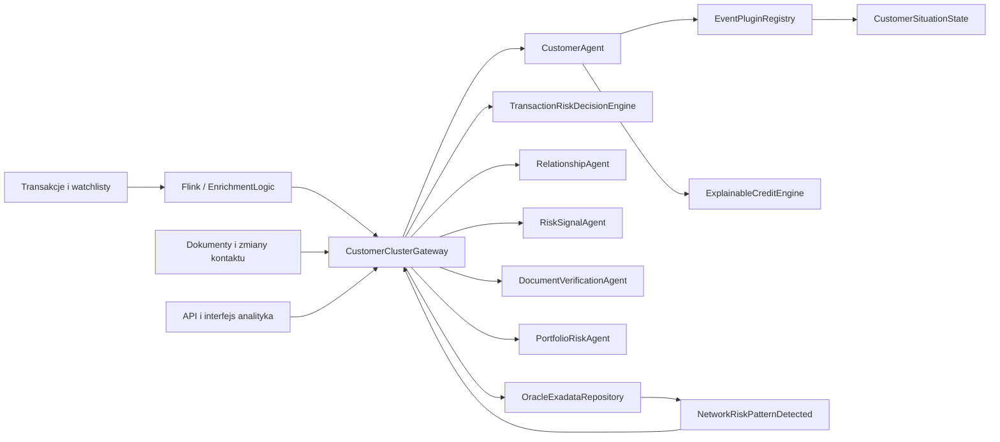
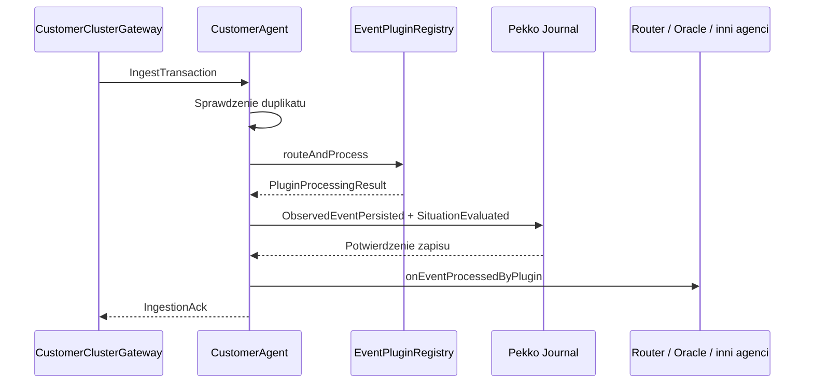
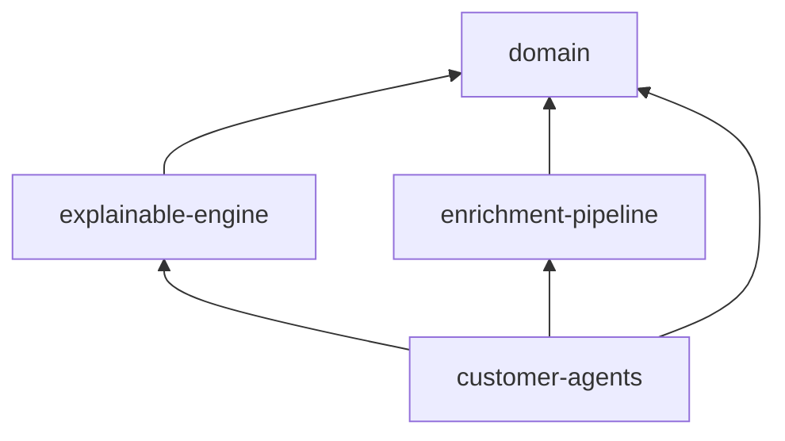
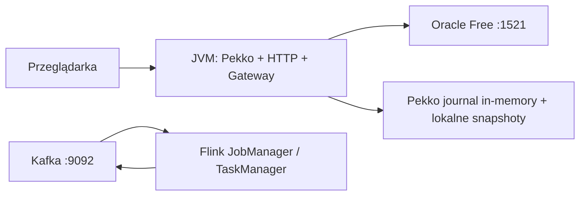
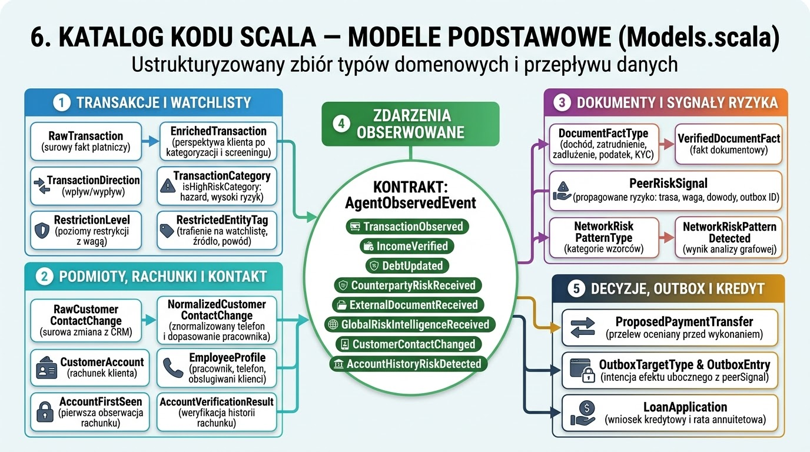
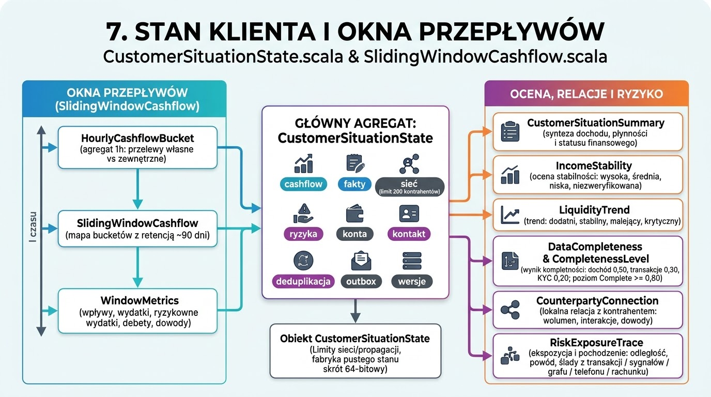
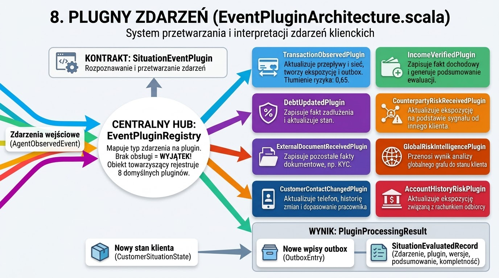
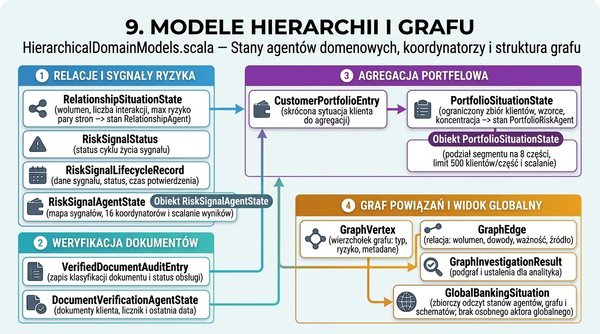
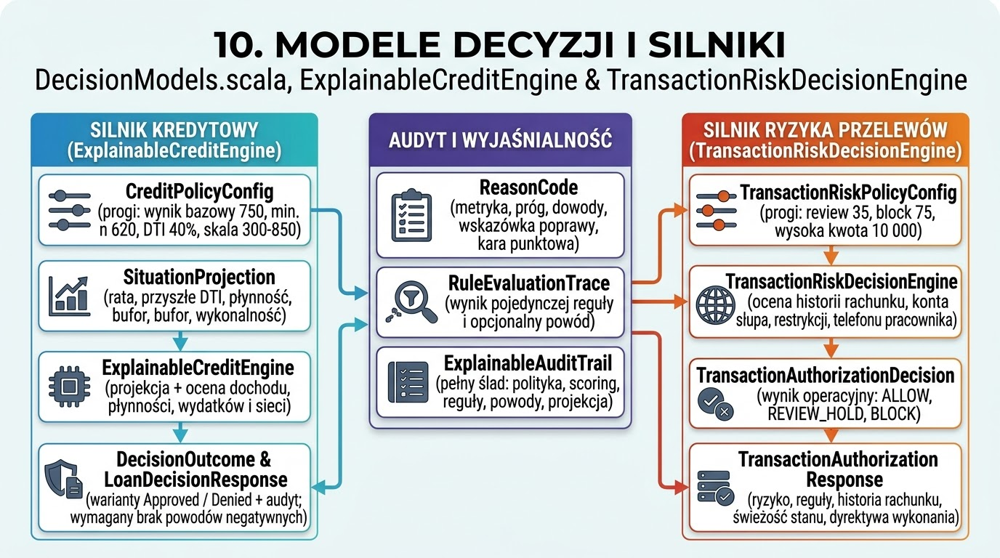

Projekt implementuje **bankowy system bieżącej oceny sytuacji klienta, wyjaśnialnych decyzji kredytowych i oceny ryzyka przelewów przed ich wykonaniem**. Jego centrum stanowią trwałe aktory Apache Pekko utrzymujące stan klientów, a warstwy Flink i Oracle odpowiadają za wzbogacanie danych oraz analizę powiązań.

Analiza opiera się na kodzie źródłowym, konfiguracji i testach. Uruchomiłem `sbt test`: **kompilacja zakończyła się poprawnie, wszystkie 6 testów przeszło**. Testy potwierdzają działanie scenariuszy demonstracyjnych; nie dowodzą gotowości wdrożenia na rzeczywistym klastrze Kafka/Flink/Oracle.

Poniżej opisuję cztery perspektywy architektury, scenariusze „+1”, a następnie katalog klas, obiektów i protokołów Scala.

**1. Perspektywa logiczna — podział odpowiedzialności**

System realizuje trzy poziomy Situation Awareness:

| Poziom | Pytanie biznesowe | Implementacja |
|---|---|---|
| Percepcja | Co się wydarzyło? | Odczyt i wzbogacanie transakcji, dokumentów, zmian telefonu oraz sygnałów ryzyka. |
| Interpretacja | Co to oznacza dla klienta? | `CustomerSituationState`, pluginy zdarzeń, lokalna sieć kontrahentów i ekspozycje ryzyka. |
| Projekcja | Co się stanie po udzieleniu kredytu? | `ExplainableCreditEngine.projectSituation`, a następnie opcjonalnie formalna decyzja kredytowa. |

Istotnym założeniem jest **utrzymywanie zagregowanej sytuacji klienta przed nadejściem zapytania o decyzję**. Silnik korzysta z istniejącego stanu i okien przepływów, zamiast odtwarzać całą historię transakcji.

Pięć typów agentów reprezentuje różne zakresy odpowiedzialności:

| Agent | Granica odpowiedzialności |
|---|---|
| `CustomerAgent` | Sytuacja jednego klienta, historia zmian, ekspozycje, outbox i decyzje kredytowe. |
| `RelationshipAgent` | Zagregowany stan relacji między dwiema stronami. |
| `RiskSignalAgent` | Rejestracja i potwierdzanie dostarczenia sygnałów ryzyka. |
| `DocumentVerificationAgent` | Klasyfikacja dostarczonych faktów dokumentowych i zapis ich obsługi. |
| `PortfolioRiskAgent` | Podsumowania klientów i wzorców ryzyka w części segmentu portfela. |

Nazwa „agent” oznacza tutaj **aktor stanowy z deterministyczną logiką**. W kodzie nie ma integracji z LLM ani autonomicznego planowania.

Oracle podzielono logicznie na sześć obszarów:

| Schemat | Odpowiedzialność |
|---|---|
| `SA_PERSISTENCE` | Pomocniczy dziennik agentów, podsumowania stanu i outbox. |
| `SA_FACTS` | Fakty transakcyjne, dokumentowe i historia rachunków. |
| `SA_GRAPH` | Wierzchołki i relacje klientów, rachunków, telefonów, pracowników i kontrahentów. |
| `SA_INTELLIGENCE` | Wykryte wzorce ryzyka i podsumowania portfela. |
| `SA_DECISIONS` | Audyt projekcji, decyzji kredytowych i autoryzacji przelewów. |
| `SA_GOVERNANCE` | Rejestr wersji polityk i progów. |

**Ważne rozróżnienie:** dziennik tworzony przez `OracleExadataRepository` jest oddzielny od mechanizmu `EventSourcedBehavior` Pekko. Nie należy traktować ich jako jednego atomowego mechanizmu trwałości.

**2. Perspektywa procesów — współbieżność, komunikacja i trwałość**

Przetwarzanie transakcji przebiega następująco:

1. `TransactionValidationFilter` odrzuca niepoprawne transakcje.
2. `ExternalCategorizerMapFunction` przypisuje kategorię.
3. `BilateralTransactionSplitter` tworzy perspektywę nadawcy oraz — dla odbiorcy będącego klientem banku — perspektywę odbiorcy.
4. `WatchlistBroadcastEnricher` oznacza kontrahenta znajdującego się na liście ryzyka.
5. `CustomerClusterGateway` zapisuje projekcję faktu i kieruje transakcję do właściwego aktora.
6. `CustomerAgent` wybiera plugin, zapisuje zdarzenia i aktualizuje stan.
7. Po zapisie uruchamiane są efekty uboczne: aktualizacja portfela, relacji i propagacja ryzyka.

Aktory przetwarzają komendy sekwencyjnie w ramach swojej tożsamości. Różni klienci mogą być obsługiwani równolegle. Stan klienta nie jest współdzielonym mutowalnym obiektem — aktualizacje tworzą nowe wartości `case class`.

`SituationStreamProcessor` dodatkowo stosuje `groupBy` i `mapAsync(1)`. Faktyczne grupowanie odbywa się po **haszowanym koszyku klienta**, domyślnie jednym z 256. Zachowuje kolejność dla klienta, ale klienci trafiający do tego samego koszyka współdzielą sekwencyjne przetwarzanie.

Mechanizmy trwałości i niezawodności:

| Mechanizm | Faktyczne działanie |
|---|---|
| Event sourcing | Stan agentów jest odtwarzany ze zdarzeń przez `EventSourcedBehavior`. |
| Snapshoty Pekko | Co 50 zdarzeń, z zachowaniem dwóch snapshotów. |
| Deduplikacja klienta | Listy ostatnich identyfikatorów i ograniczony zbiór skrótów 64-bitowych. |
| Outbox | Intencje wysłania sygnałów są częścią odtwarzanego stanu klienta. |
| Ponawianie | `CustomerAgent` ponawia pending outbox co 5 sekund oraz po `RecoveryCompleted`. |
| Potwierdzenia | Odbiorca potwierdza sygnał; źródło usuwa wpis outbox po `ConfirmOutboxDelivery`. |
| Spójność decyzji | Wyniki zawierają wersję stanu, polityki i kompletność danych. |

Spójność między klientem, relacją, portfelem i projekcjami Oracle jest **ostateczna**. Nie ma wspólnej transakcji obejmującej wszystkie te elementy.

Szczególnej uwagi wymaga odtwarzanie klienta: `ObservedEventPersisted` ponownie wykonuje plugin. Zmiana implementacji pluginu może więc zmienić wynik replay historycznych zdarzeń, mimo zapisania jego identyfikatora.

**3. Perspektywa implementacyjna — moduły i zależności**

Strukturę definiuje [build.sbt](/Users/krzysztof/Projects/OCS/CustAgents/build.sbt).

| Moduł | Zawartość | Ocena granicy |
|---|---|---|
| `domain` | Modele, stan klienta, okna czasowe, pluginy i modele hierarchii. | Samodzielna logika domenowa, bez Pekko i JDBC. |
| `explainable-engine` | Polityki oraz silniki kredytowy i transakcyjny. | Dobra separacja reguł od transportu i trwałości. |
| `enrichment-pipeline` | Operatory Flink, Kafka i wspólne funkcje wzbogacania. | Łączy algorytmy wielokrotnego użycia z infrastrukturą Flink. |
| `customer-agents` | Aktory, gateway, API, Oracle, aplikacje startowe i testy. | Najszerszy moduł; skupia wiele różnych odpowiedzialności. |

Stos zadeklarowany w projekcie obejmuje Scala 3.3.4, Pekko 1.1.2, Pekko HTTP 1.1.0, Flink 1.19.1 i Oracle JDBC.

Najsilniejsze sprzężenia występują w dwóch klasach:

- `CustomerClusterGateway` łączy routing, orkiestrację, projekcje, diagnostykę, operacje administracyjne i część prezentacji przez DTO.
- `OracleExadataRepository` łączy dostęp do bazy, cache, inicjalizację schematów, projekcje, analizę grafu i audyt.

Podział na moduły jest czytelny, ale wewnątrz `customer-agents` warto wydzielić osobno adaptery persystencji, projekcje, analizę grafową i obsługę przypadków użycia.

**4. Perspektywa fizyczna — uruchomienie i wdrożenie**

Repozytorium dostarcza [docker-compose.yml](/Users/krzysztof/Projects/OCS/CustAgents/docker-compose.yml) z:

- pojedynczym brokerem Kafka;
- Flink JobManagerem i TaskManagerem;
- Oracle Free.

Aplikacja Scala jest uruchamiana osobno. `LoanOriginationWebApp` tworzy system Pekko, dołącza do własnego klastra i udostępnia HTTP domyślnie pod `127.0.0.1:8088`.

Ten diagram pokazuje dostępne elementy lokalnego środowiska. **Połączenie wyjściowego tematu Kafka z procesem agentów wymaga dodatkowego adaptera**: `SituationStreamProcessor` przyjmuje `Source`, ale sam nie tworzy konsumenta Kafka. Ścieżki demonstracyjne korzystają z `EnrichmentLogic` w pamięci.

Konfiguracja Pekko przewiduje 100 shardów, pasywację po 30 minutach i Split Brain Resolver. Nie ma jednak w repozytorium kompletnego wdrożenia wielowęzłowego z discovery, manifestami Kubernetes i operacyjną konfiguracją trwałości.

Domyślnie:

- journal Pekko działa w pamięci;
- snapshoty są lokalne;
- repozytorium Oracle działa w pamięci, dopóki nie włączono JDBC.

Konfiguracja JDBC dla Pekko jest obecna, lecz `build.sbt` nie deklaruje implementacji pluginu `pekko-persistence-jdbc`. Sama zmiana ustawień nie wystarcza więc do uzyskania produkcyjnego journalu Oracle.

Podobnie „Exadata” opisuje docelową platformę i model integracji; kontener Oracle Free nie potwierdza zachowania na Exadata/RAC.

**5. Perspektywa „+1” — scenariusze weryfikujące architekturę**

| Scenariusz | Przebieg i współpracujące elementy |
|---|---|
| Przelew między klientami | `RawTransaction` → kategoryzacja → dwie perspektywy → gateway → dwa `CustomerAgent` → aktualizacja przepływów, relacji i portfela. |
| Przelew do podmiotu zastrzeżonego | Watchlista → `RestrictedEntityTag` → ekspozycja bezpośrednia → outbox → `RiskSignalAgent` → sygnał drugiego stopnia do powiązanego klienta. |
| Dostarczenie dokumentu | DTO → `VerifiedDocumentFact` → `DocumentVerificationAgent` → odpowiednie zdarzenie domenowe → plugin → przeliczenie sytuacji. |
| Symulacja kredytu | `LoanApplication` → `ProjectLoanSituation` → DTI, rata i przyszła płynność → `SituationProjection`. |
| Formalna decyzja kredytowa | Wniosek → reguły i scorecard → `LoanDecisionAudited` z zamrożonym stanem → odpowiedź i dodatkowy audyt Oracle. |
| Analiza globalnego grafu | Fakty i relacje → detektory grafowe → `NetworkRiskPatternDetected` → aktualizacja klienta i portfela. |
| Zmiana telefonu | Normalizacja → dopasowanie telefonu pracownika → aktualizacja grafu → `CustomerContactChangedPlugin` → ekspozycja ryzyka. |
| Weryfikacja rachunku | Historia rachunku → `AccountVerificationResult` → ewentualne `AccountHistoryRiskDetected` → aktualizacja klienta. |
| Ocena przelewu przed wykonaniem | Proponowany przelew + stan klienta + historia rachunku + watchlista → `ALLOW`, `REVIEW_HOLD` albo `BLOCK`. |

Scenariusze rozdzielają **projekcję przyszłości**, **formalną decyzję kredytową** i **operacyjną decyzję o przelewie**. To trafny podział domenowy: każda z tych operacji ma inny wynik i inną odpowiedzialność.

**6. Katalog kodu Scala — modele podstawowe**

Źródło: [Models.scala](/Users/krzysztof/Projects/OCS/CustAgents/modules/domain/src/main/scala/com/bank/sa/domain/Models.scala).

| Typ | Funkcjonalność, odpowiedzialność i powiązania |
|---|---|
| `TransactionDirection` | Rozróżnia wpływ i wypływ; używany przez splitter, agregaty i graf. |
| `TransactionCategory` | Klasyfikuje transakcje; `isHighRiskCategory` wskazuje hazard i transfer wysokiego ryzyka. |
| `RestrictionLevel` | Poziomy restrykcji z wagą ryzyka; wejście do budowania ekspozycji. |
| `RestrictedEntityTag` | Informacja o trafieniu na watchlistę, źródle i powodzie; dołączana do transakcji. |
| `RawTransaction` | Surowy fakt płatniczy; wejście wzbogacania. |
| `EnrichedTransaction` | Transakcja z perspektywy klienta, po kategoryzacji i screeningu; podstawowe wejście agenta. |
| `CustomerAccount` | Rachunek należący do klienta; rejestrowany w repozytorium i grafie. |
| `EmployeeProfile` | Pracownik, telefon i obsługiwani klienci; dane do wykrywania powiązań pracownik–klient. |
| `RawCustomerContactChange` | Surowa zmiana telefonu z CRM. |
| `NormalizedCustomerContactChange` | Znormalizowany telefon i wynik dopasowania pracownika; wejście pluginu oraz projekcji grafowej. |
| `AccountFirstSeen` | Pierwsza obserwacja rachunku wraz z transakcją i klientem. |
| `AccountVerificationResult` | Wynik sprawdzenia historii rachunku: właściciel, przepływy, powiązania i sygnały ryzyka. |
| `DocumentFactType` | Rodzaje faktów: dochód, zatrudnienie, zadłużenie, podatek i KYC. |
| `VerifiedDocumentFact` | Ustrukturyzowany fakt dokumentowy; przechowywany w stanie klienta i repozytorium. |
| `PeerRiskSignal` | Sygnał propagowanego ryzyka z trasą, wagą, dowodami i opcjonalnym outbox ID. |
| `NetworkRiskPatternType` | Kategorie wzorców grafowych; sam enum nie oznacza implementacji każdego detektora. |
| `NetworkRiskPatternDetected` | Wynik analizy grafowej dla konkretnego klienta; wraca jako zdarzenie do agentów. |
| `AgentObservedEvent` | Wspólny kontrakt zdarzeń obsługiwanych przez pluginy. |
| `TransactionObserved` | Opakowuje wzbogaconą transakcję dla `TransactionObservedPlugin`. |
| `IncomeVerified` | Zdarzenie dochodowe dla `IncomeVerifiedPlugin`. |
| `DebtUpdated` | Zdarzenie zadłużenia dla `DebtUpdatedPlugin`. |
| `CounterpartyRiskReceived` | Opakowuje `PeerRiskSignal` dla pluginu ryzyka kontrahenta. |
| `ExternalDocumentReceived` | Pozostałe fakty dokumentowe, np. KYC. |
| `GlobalRiskIntelligenceReceived` | Adapter wzorca grafowego do protokołu obserwowanych zdarzeń. |
| `CustomerContactChanged` | Zdarzenie znormalizowanej zmiany kontaktu. |
| `AccountHistoryRiskDetected` | Zdarzenie ryzyka wynikającego z historii rachunku. |
| `ProposedPaymentTransfer` | Polecenie przelewu oceniane przed wykonaniem; nie jest jeszcze faktem transakcyjnym. |
| `OutboxTargetType` | Kategorie odbiorców outbox; obsługa wszystkich wariantów nie jest jednak pełna. |
| `OutboxEntry` | Intencja efektu ubocznego; pełny payload sygnału jest dostępny przez `peerSignal`. |
| `LoanApplication` | Wniosek kredytowy i obliczenie raty annuitetowej. |

**7. Stan klienta i okna przepływów**

Źródła: [CustomerSituationState.scala](/Users/krzysztof/Projects/OCS/CustAgents/modules/domain/src/main/scala/com/bank/sa/domain/CustomerSituationState.scala), [SlidingWindowCashflow.scala](/Users/krzysztof/Projects/OCS/CustAgents/modules/domain/src/main/scala/com/bank/sa/domain/SlidingWindowCashflow.scala).

| Typ | Funkcjonalność, odpowiedzialność i powiązania |
|---|---|
| `IncomeStability` | Ocena stabilności dochodu: wysoka, średnia, niska, niezweryfikowana. |
| `LiquidityTrend` | Trend płynności: dodatni, stabilny, malejący, krytyczny. |
| `CompletenessLevel` | Poziom kompletności danych. |
| `CustomerSituationSummary` | Bieżąca synteza dochodu, płynności i statusu finansowego klienta. |
| `DataCompleteness` | Wynik kompletności, flagi dostępnych danych i lista braków; część audytu decyzji. |
| `CounterpartyConnection` | Lokalna relacja klienta z kontrahentem: wolumen, liczba transakcji, ostatnie dowody. Obiekt towarzyszący tworzy pierwsze połączenie. |
| `RiskExposureTrace` | Ekspozycja wraz z pochodzeniem, odległością, powodem i dowodami. Obiekt towarzyszący buduje ślady z transakcji, sygnałów, grafu, telefonu i rachunku. |
| `CustomerSituationState` | Główny agregat klienta: cashflow, fakty, sieć, ryzyka, konta, kontakt, deduplikacja, outbox i wersje. Udostępnia operacje aktualizacji oraz przeliczenia sytuacji. |
| Obiekt `CustomerSituationState` | Limity sieci i propagacji, fabryka pustego stanu oraz funkcja skrótu 64-bitowego. |
| `WindowMetrics` | Wynik agregacji wybranego okna: wpływy, wydatki, ryzykowne wydatki, debety i dowody. |
| `HourlyCashflowBucket` | Agregat jednej godziny; oddziela przelewy własne od przepływów zewnętrznych. |
| `SlidingWindowCashflow` | Mapa godzinowych bucketów z retencją około 90 dni; aktualizuje i wylicza metryki dla okien. |

`CustomerSituationState` jest najważniejszym agregatem domenowym. Odpowiada także za ograniczanie lokalnej sieci do 200 kontrahentów oraz przechowywanie ostatnich identyfikatorów zdarzeń.

Nazwa i komentarze sugerują ring buffer oraz O(1), ale implementacja `SlidingWindowCashflow` używa `Map`, wyszukuje maksimum i filtruje buckety. Zapytanie o okno również skanuje buckety. Koszt jest ograniczony retencją, lecz **nie jest ścisłym O(1)**.

Kompletność to heurystyka: dochód daje 0,50, historia transakcji 0,30, a KYC 0,20. Poziom `Complete` zaczyna się od 0,80, więc może wystąpić bez KYC.

**8. Pluginy zdarzeń**

Źródło: [EventPluginArchitecture.scala](/Users/krzysztof/Projects/OCS/CustAgents/modules/domain/src/main/scala/com/bank/sa/domain/EventPluginArchitecture.scala).

| Typ | Funkcjonalność, odpowiedzialność i powiązania |
|---|---|
| `SituationEvaluatedRecord` | Zapis wyniku interpretacji: zdarzenie, plugin, wersje, podsumowanie i kompletność. |
| `PluginProcessingResult` | Łączy nowy stan, nowe wpisy outbox i rekord ewaluacji. |
| `SituationEventPlugin` | Kontrakt rozpoznawania i przetwarzania zdarzeń. |
| `TransactionObservedPlugin` | Aktualizuje przepływy i sieć, tworzy bezpośrednią ekspozycję oraz outbox relacji i sygnałów drugiego stopnia. Domyślne tłumienie ryzyka: 0,65. |
| `IncomeVerifiedPlugin` | Zapisuje fakt dochodowy i generuje podsumowanie ewaluacji. |
| `DebtUpdatedPlugin` | Zapisuje fakt zadłużenia. |
| `CounterpartyRiskReceivedPlugin` | Aktualizuje ekspozycję na podstawie sygnału innego klienta. |
| `ExternalDocumentReceivedPlugin` | Zapisuje pozostałe fakty dokumentowe. |
| `GlobalRiskIntelligencePlugin` | Przenosi wynik analizy globalnego grafu do stanu klienta. |
| `CustomerContactChangedPlugin` | Aktualizuje telefon, historię zmian i ekspozycję wynikającą z dopasowania pracownika. |
| `AccountHistoryRiskPlugin` | Aktualizuje ekspozycję związaną z rachunkiem odbiorcy. |
| `EventPluginRegistry` | Mapuje typ zdarzenia na plugin; brak obsługi kończy się wyjątkiem. |
| Obiekt `EventPluginRegistry` | Buduje listę ośmiu domyślnych pluginów i wspólny rejestr. |

To dobry punkt rozszerzeń logiki interpretacyjnej. Rejestr przyjmuje listę pluginów programowo; projekt nie implementuje dynamicznego ładowania pluginów z zewnętrznych bibliotek.

**9. Modele hierarchii i grafu**

Źródło: [HierarchicalDomainModels.scala](/Users/krzysztof/Projects/OCS/CustAgents/modules/domain/src/main/scala/com/bank/sa/domain/HierarchicalDomainModels.scala).

| Typ | Funkcjonalność, odpowiedzialność i powiązania |
|---|---|
| `RelationshipSituationState` | Wolumen, liczba interakcji i maksymalne ryzyko pary stron; stan `RelationshipAgent`. |
| `RiskSignalStatus` | Status cyklu życia sygnału; nie wszystkie wartości mają pełny proces obsługi. |
| `RiskSignalLifecycleRecord` | Dane jednego sygnału, jego status i czas potwierdzenia. |
| `RiskSignalAgentState` | Mapa sygnałów i liczniki koordynatora. |
| Obiekt `RiskSignalAgentState` | Wybiera jeden z 16 koordynatorów i scala ich wyniki. |
| `VerifiedDocumentAuditEntry` | Zapis klasyfikacji dokumentu i statusu jego obsługi. |
| `DocumentVerificationAgentState` | Dokumenty obsłużone dla klienta, licznik i ostatnia data. |
| `CustomerPortfolioEntry` | Skrócona sytuacja klienta używana przez agregację portfelową. |
| `PortfolioSituationState` | Ograniczony zbiór klientów, wzorce i metryki koncentracji; stan `PortfolioRiskAgent`. |
| Obiekt `PortfolioSituationState` | Dzieli segment na osiem części, ustala limit 500 klientów na część i scala wyniki. |
| `GraphVertex` | Wierzchołek grafu z typem, ryzykiem i metadanymi. |
| `GraphEdge` | Relacja grafowa z wolumenem, dowodami, okresem ważności i źródłem. |
| `GraphInvestigationResult` | Podgraf i powiązane ustalenia zwracane analitykowi. |
| `GlobalBankingSituation` | Zbiorczy odczyt stanów agentów, grafu i schematów; nie jest osobnym aktorem globalnym. |

Ograniczanie portfela zachowuje klientów o najwyższym ryzyku i najnowszej aktualizacji. Z tego powodu metryki portfela dotyczą **wybranego podzbioru**, a nie pełnej populacji segmentu.

**10. Modele decyzji i silniki**

Źródła: [DecisionModels.scala](/Users/krzysztof/Projects/OCS/CustAgents/modules/domain/src/main/scala/com/bank/sa/domain/DecisionModels.scala), [ExplainableCreditEngine.scala](/Users/krzysztof/Projects/OCS/CustAgents/modules/explainable-engine/src/main/scala/com/bank/sa/engine/ExplainableCreditEngine.scala), [TransactionRiskDecisionEngine.scala](/Users/krzysztof/Projects/OCS/CustAgents/modules/explainable-engine/src/main/scala/com/bank/sa/engine/TransactionRiskDecisionEngine.scala).

| Typ | Funkcjonalność, odpowiedzialność i powiązania |
|---|---|
| `SituationProjection` | Rata, przyszłe DTI, płynność, bufor i wykonalność finansowa wraz z wersją stanu. |
| `ReasonCode` | Powód decyzji: metryka, próg, dowody, wskazówka poprawy i kara punktowa. |
| `RuleEvaluationTrace` | Wynik pojedynczej reguły i opcjonalny powód. |
| `ExplainableAuditTrail` | Pełny ślad oceny kredytowej: polityka, scoring, reguły, powody i projekcja. |
| `DecisionOutcome` | Warianty `Approved` oraz `Denied` z odpowiednimi danymi. |
| `LoanDecisionResponse` | Odpowiedź dla wniosku, łącząca wynik i audyt. |
| `TransactionAuthorizationDecision` | Wynik operacyjny: `ALLOW`, `REVIEW_HOLD`, `BLOCK`. |
| `TransactionAuthorizationResponse` | Wynik oceny przelewu, ryzyko, reguły, historia rachunku, świeżość stanu i dyrektywa wykonania. |
| `CreditPolicyConfig` | Progi kredytowe i wersja polityki; domyślnie wynik bazowy 750, minimum 620 i DTI 40%. |
| `ExplainableCreditEngine` | Projekcja kredytu oraz ocena dochodu, płynności, ryzykownych wydatków i ekspozycji sieciowych. |
| `TransactionRiskPolicyConfig` | Progi oceny przelewu; domyślnie review 35, block 75 i wysoka kwota 10 000. |
| `TransactionRiskDecisionEngine` | Ocena historii rachunku, podejrzenia konta słupa, restrykcji i powiązania telefonu pracownika. |

Silnik kredytowy ogranicza scoring do 300–850. Zatwierdzenie wymaga jednocześnie:

- braku twardej blokady;
- wyniku co najmniej 620;
- pustej listy powodów negatywnych.

Ostatni warunek oznacza, że **każda reguła generująca negatywny powód prowadzi do odmowy**, nawet przy wyniku powyżej progu. Scorecard nie działa więc wyłącznie jako bilans kar.

W projekcji:

`futureDti = (zadłużenie miesięczne + nowa rata) / dochód`

`expectedMonthlyLiquidity = dochód − wydatki z 30 dni − nowa rata`

Silnik transakcyjny zwraca dyrektywę dla systemu płatniczego. Sam nie wykonuje przelewu ani nie integruje się z mechanizmem księgowania.

**11. Wzbogacanie Flink i Kafka**

Źródła: [FlinkTransactionEnrichment.scala](/Users/krzysztof/Projects/OCS/CustAgents/modules/enrichment-pipeline/src/main/scala/com/bank/sa/enrichment/FlinkTransactionEnrichment.scala), [FlinkKafkaEnrichmentJob.scala](/Users/krzysztof/Projects/OCS/CustAgents/modules/enrichment-pipeline/src/main/scala/com/bank/sa/enrichment/FlinkKafkaEnrichmentJob.scala).

| Typ | Funkcjonalność, odpowiedzialność i powiązania |
|---|---|
| `ExternalTransactionCategorizer` | Interfejs kategoryzatora transakcji. |
| `RuleBasedExternalCategorizer` | Lokalna kategoryzacja na podstawie opisów i identyfikatorów; nie wywołuje zewnętrznego API. |
| `CustomerDirectedTransaction` | Pośrednia perspektywa klienta przed dołączeniem watchlisty. |
| `ContactPhoneNormalizerMapFunction` | Operator normalizacji telefonu i dopasowania do dostarczonej listy pracowników. |
| `TransactionValidationFilter` | Sprawdza podstawowe identyfikatory, walutę i dodatnią kwotę. |
| `ExternalCategorizerMapFunction` | Adapter kategoryzatora do operatora Flink. |
| `BilateralTransactionSplitter` | Tworzy jedną albo dwie perspektywy; przelew własny zapisuje raz. |
| `WatchlistBroadcastEnricher` | Utrzymuje broadcast state list restrykcyjnych i wzbogaca transakcje. |
| `EnrichmentLogic` | Wspólne funkcje walidacji, kategoryzacji, splitu, normalizacji i budowy topologii; używane też przez demo i testy. |
| `JsonDeserializationSchema[T]` | Deserializuje wiadomości Kafka z JSON przez Jacksona. |
| `JsonValueSerializationSchema[T]` | Serializuje wartości wyjściowe do JSON. |
| `CustomerKeySerializationSchema` | Buduje klucz Kafka z `customerId`. |
| `FlinkKafkaEnrichmentJob.KafkaJobConfig` | Adres brokera, nazwy tematów i grupy konsumenckiej. |
| `FlinkKafkaEnrichmentJob` | Tworzy źródła Kafka, topologię i sink; włącza checkpointing co 30 sekund. |

Checkpointing nie oznacza automatycznie gwarancji exactly-once całego procesu. Kod nie konfiguruje transakcyjnego trybu sinka Kafka ani atomowego połączenia z zapisem agentów.

**12. Aktory, gateway i protokoły**

Źródła: [CustomerAgent.scala](/Users/krzysztof/Projects/OCS/CustAgents/modules/customer-agents/src/main/scala/com/bank/sa/agent/CustomerAgent.scala), [DomainAgents.scala](/Users/krzysztof/Projects/OCS/CustAgents/modules/customer-agents/src/main/scala/com/bank/sa/agent/DomainAgents.scala), [CustomerClusterGateway.scala](/Users/krzysztof/Projects/OCS/CustAgents/modules/customer-agents/src/main/scala/com/bank/sa/agent/CustomerClusterGateway.scala).

| Typ | Funkcjonalność, odpowiedzialność i powiązania |
|---|---|
| `CborSerializable` | Marker wiążący protokoły z serializatorem Jackson CBOR. |
| `PeerRiskRouter` | Port efektów ubocznych wykonywanych po zapisie zdarzenia; wysyłanie sygnałów i retry outbox. |
| Obiekt `PeerRiskRouter` | Dostarcza implementację `NoOp`. |
| `CustomerAgent` | Fabryka trwałego aktora klienta; obsługuje pluginy, journal, outbox, projekcję i decyzję. |
| `RelationshipAgent` | Trwały aktor bilateralnej relacji. |
| `RiskSignalAgent` | Trwały rejestr sygnałów; nowe sygnały przekazuje callbackiem do odbiorcy. |
| `DocumentVerificationAgent` | Klasyfikuje fakty do zdarzeń domenowych i zapisuje ich obsługę. |
| `PortfolioRiskAgent` | Aktualizuje część segmentu i wywołuje zapis snapshotu portfela. |
| `CustomerClusterGateway` | Rejestruje pięć typów shardowanych aktorów i koordynuje wszystkie główne przypadki użycia. |
| `SituationStreamProcessor` | Adapter Pekko Streams z kontrolą równoległości i potwierdzeniami ingestii. |

Zagnieżdżone typy są pełnoprawną częścią architektury komunikacji:

| Właściciel | Typy i odpowiedzialność |
|---|---|
| `CustomerAgent.Command` | Wspólny kontrakt komend klienta. |
| `IngestionAck` | Potwierdzenie obsługi identyfikatora. |
| `IngestTransaction` | Przyjęcie wzbogaconej transakcji. |
| `IngestDocumentFact` | Bezpośrednie przyjęcie faktu dokumentowego. |
| `IngestObservedEvent` | Uniwersalne wejście zdarzenia do pluginów. |
| `PropagatePeerRisk` | Przyjęcie sygnału drugiego stopnia. |
| `IngestNetworkRiskPattern` | Przyjęcie wzorca globalnego. |
| `ConfirmOutboxDelivery` | Potwierdzenie dostarczenia efektu ubocznego. |
| `ProjectLoanSituation` | Wyliczenie projekcji. |
| `EvaluateLoan` | Formalna decyzja wraz z zapisem audytu w journalu. |
| `GetSituationState` | Odczyt stanu. |
| `ResetState` | Zapis resetu klienta. |
| `RetryPendingOutbox` | Uruchomienie ponawiania. |
| `Passivate` | Zatrzymanie aktora na potrzeby pasywacji. |
| `CustomerAgent.Event` | Wspólny kontrakt trwałych zdarzeń klienta. |
| `ObservedEventPersisted` | Zdarzenie wejściowe i identyfikator pluginu; replay ponownie uruchamia plugin. |
| `SituationEvaluated` | Utrwalenie syntezy sytuacji i wersji. |
| `OutboxDeliveryConfirmed` | Usunięcie potwierdzonej intencji ze stanu. |
| `TransactionIngested` | Bezpośrednia aktualizacja transakcji przy replay; alternatywa wobec obecnej ścieżki pluginowej. |
| `DocumentFactIngested` | Bezpośrednie odtworzenie faktu dokumentowego. |
| `PeerRiskSignalIngested` | Bezpośrednie odtworzenie sygnału. |
| `CustomerStateReset` | Odtworzenie pustego stanu klienta. |
| `LoanDecisionAudited` | Zapis odpowiedzi i zamrożonego stanu; nie zmienia bieżącej sytuacji. |

Pozostali agenci mają własne kontrakty `Command` i `Event` oraz `Passivate`:

| Agent | Typy protokołu i ich znaczenie |
|---|---|
| `RelationshipAgent` | `RecordInteraction` → `InteractionRecorded`: transakcja i ryzyko; `RecordPropagatedRisk` → `PropagatedRiskRecorded`: propagacja; `GetRelationshipState`: odczyt; `ResetRelationship` → `RelationshipReset`: reset. |
| `RiskSignalAgent` | `DispatchAndTrackSignal` → `SignalRegistered`: rejestracja i wysłanie; `AcknowledgeSignalDelivery` → `SignalAcknowledged`: potwierdzenie; `GetRiskSignalState`: odczyt; `ResetRiskSignals` → `RiskSignalsReset`: reset. |
| `DocumentVerificationAgent` | `VerifyAndClassifyDocument` → `DocumentVerifiedEvent`: klasyfikacja faktu; `GetVerificationState`: odczyt; `ResetVerificationState` → `VerificationReset`: reset. |
| `PortfolioRiskAgent` | `UpdateCustomerInPortfolio` → `CustomerPortfolioSnapshotUpdated`: aktualizacja klienta; `IngestGlobalRiskPattern` → `GlobalPatternAddedToPortfolio`: wzorzec; `GetPortfolioSituation`: odczyt; `ResetPortfolio` → `PortfolioReset`: reset. |

`DocumentVerificationAgent` nie implementuje sprawdzania autentyczności dokumentu, OCR ani integracji z wystawcą. Przyjmuje już przygotowany `VerifiedDocumentFact`, a następnie klasyfikuje go i zapisuje.

**13. Repozytorium Oracle**

Źródło: [OracleExadataRepository.scala](/Users/krzysztof/Projects/OCS/CustAgents/modules/customer-agents/src/main/scala/com/bank/sa/oracle/OracleExadataRepository.scala).

| Typ | Funkcjonalność, odpowiedzialność i powiązania |
|---|---|
| `OracleJdbcConfig` | Parametry połączenia i włączenia JDBC. |
| `OracleJournalRow` | Pomocniczy wpis journalu z opisowym podsumowaniem payloadu. |
| `OracleSnapshotRow` | Podsumowanie stanu; nie zawiera pełnego `CustomerSituationState`. |
| `FinancialTransactionFactRow` | Kanoniczny rekord perspektywy transakcji dla klienta. |
| `GovernancePolicyRow` | Wersja polityki i wybrane progi do rejestru governance. |
| `OracleExadataRepository` | Implementacja zapisu faktów, grafu, audytu, rejestrów, analizy ryzyka i trybu in-memory/JDBC. |

Repozytorium odpowiada za:

- inicjalizację schematów i struktur;
- pomocniczy journal i snapshoty;
- zapis i potwierdzanie outbox;
- projekcje transakcji i dokumentów;
- rejestrację rachunków i pracowników;
- historię telefonu i obserwacji rachunków;
- budowę grafu;
- wykrywanie wspólnych kontrahentów, powiązań telefonicznych, przepływów wieloetapowych i cykli;
- audyt wszystkich typów decyzji.

Analiza grafowa łączy zapytanie SQL `GRAPH_TABLE` z detektorami wykonywanymi na kolekcjach JVM. Nie cała analiza jest delegowana do Oracle.

**14. API i modele transportowe**

Źródła: [LoanOriginationProtocol.scala](/Users/krzysztof/Projects/OCS/CustAgents/modules/customer-agents/src/main/scala/com/bank/sa/api/LoanOriginationProtocol.scala), [LoanOriginationGrpcService.scala](/Users/krzysztof/Projects/OCS/CustAgents/modules/customer-agents/src/main/scala/com/bank/sa/api/LoanOriginationGrpcService.scala), [LoanOriginationServer.scala](/Users/krzysztof/Projects/OCS/CustAgents/modules/customer-agents/src/main/scala/com/bank/sa/api/LoanOriginationServer.scala).

| Typ | Funkcjonalność, odpowiedzialność i powiązania |
|---|---|
| `LoanOriginationRequest` | Żądanie kredytowe; konwertuje się do `LoanApplication`. |
| `DocumentFactUploadRequest` | Dane faktu dokumentowego; konwersja do `VerifiedDocumentFact`. |
| `RawTransactionIngestRequest` | Dane transakcji HTTP; konwersja do `RawTransaction`. |
| `EmployeeRegistrationRequest` | Rejestracja pracownika; konwersja do `EmployeeProfile`. |
| `CustomerAccountRegistrationRequest` | Rejestracja rachunku; konwersja do `CustomerAccount`. |
| `CustomerContactChangeRequest` | Żądanie zmiany telefonu; konwersja do surowego zdarzenia. |
| `OnePlnAccountVerificationRequest` | Parametry sprawdzenia rachunku. |
| `PreExecutionTransferRequest` | Żądanie oceny przelewu; konwersja do `ProposedPaymentTransfer`. |
| `SituationProjectionDto` | Transportowa reprezentacja projekcji; obiekt towarzyszący mapuje domenę. |
| `ReasonCodeDto` | Transportowa reprezentacja powodu; obiekt towarzyszący mapuje `ReasonCode`. |
| `RuleTraceDto` | Uproszczony transportowy wynik reguły. |
| `LoanOriginationDecisionDto` | Odpowiedź kredytowa dla API/UI; obiekt towarzyszący mapuje oba warianty decyzji. |
| `RiskExposureDto` | Ekspozycja klienta do prezentacji. |
| `CustomerSituationSnapshotDto` | Rozbudowany odczyt sytuacji; obiekt towarzyszący wylicza metryki i mapuje stan. |
| `IngestionAckDto` | Potwierdzenie HTTP. |
| `HealthStatusDto` | Status usługi i członka klastra. |
| `WorkflowTraceEventDto` | Krok przepływu do diagnostyki i UI. |
| `WatchlistEntryDto` | Pozycja watchlisty; obiekt towarzyszący mapuje tag domenowy. |
| `SystemOverviewDto` | Zbiorczy model ekranu systemu. |
| `OracleExadataOverviewDto` | Zbiorczy model podglądu repozytorium Oracle. |
| `JacksonJsonSupport` | Wspólny mapper Jackson i marshalling/unmarshalling Pekko HTTP. |
| `LoanOriginationGrpcService` | Wewnętrzny kontrakt asynchronicznych operacji kredytowych i dokumentowych. |
| `LoanOriginationGrpcServiceImpl` | Deleguje operacje do gateway i mapuje wyniki na DTO. |
| `LoanOriginationServer` | Trasy HTTP, UI, operacje demonstracyjne, podgląd grafu i decyzje. Obiekt towarzyszący dostarcza dane pomocnicze demonstracji. |

**Interfejs nazwany gRPC nie jest obecnie standardowym transportem gRPC.** Serwer obsługuje JSON przez Pekko HTTP pod ścieżkami przypominającymi nazwy metod RPC. Obecność pliku `.proto` i Scala trait nie zapewnia zgodności z klientem protobuf/gRPC.

**15. Punkty wejścia i testy**

| Typ | Odpowiedzialność |
|---|---|
| `LoanOriginationWebApp` | Tworzy system Pekko, klaster, silnik, gateway i serwer HTTP; odczytuje host i port ze środowiska. |
| `SituationAwarenessDemo` | Konsolowy scenariusz prezentujący wzbogacanie, agentów, ryzyko i decyzje. |
| `CustomerSituationAwarenessSpec` | Jedyna klasa testowa; sprawdza wzbogacanie, pluginy, decyzje, propagację, graf, HTTP i wybrane mechanizmy ograniczania stanu. |

Testy korzystają z rzeczywistych aktorów i HTTP, ale przede wszystkim z pamięciowej infrastruktury danych. Test SQL/PGQ sprawdza m.in. obecność odpowiednich fragmentów zapytania, co nie zastępuje wykonania go na Oracle.

**16. Najważniejsze ustalenia i ograniczenia architektoniczne**

| Priorytet | Ustalenie | Konsekwencja |
|---|---|---|
| Wysoki | Zapisy repozytorium Oracle są oddzielnymi efektami po zapisie Pekko. | Awaria może pozostawić różne obrazy danych w journalu i projekcjach. |
| Wysoki | Outbox relacji jest potwierdzany po `tell`, bez potwierdzenia trwałego zapisu odbiorcy. Retry wpisu bez `peerSignal` jedynie go potwierdza. | Nie ma pełnej gwarancji dostarczenia aktualizacji relacji. |
| Wysoki | `RelationshipAgent` nie deduplikuje interakcji. Dwie perspektywy tej samej transakcji trafiają do tej samej relacji. | Liczba transakcji i wolumen relacji mogą być zawyżane. |
| Wysoki | Projekcja faktu jest wykonywana przed deduplikacją przez klienta. | Idempotencja aktora nie gwarantuje idempotencji wszystkich projekcji. |
| Wysoki | „Pula” JDBC ogranicza liczbę bezczynnych połączeń; przy pustej kolejce tworzy kolejne. | `maxPoolSize` nie ogranicza liczby równocześnie aktywnych połączeń. |
| Wysoki | JDBC działa synchronicznie, także w callbackach agentów; wyjątki mogą być zamieniane na `None`. | Ryzyko blokowania dispatchera i rozbieżności pamięć–baza. |
| Średni | Portfel zachowuje maksymalnie 500 klientów na część, preferując wysokie ryzyko. | Wskaźniki koncentracji nie opisują całego portfela. |
| Średni | Deduplikacja usuwa część skrótów po osiągnięciu limitu. | Bardzo stare duplikaty mogą zostać ponownie przyjęte. |
| Średni | Replay ponownie wykonuje bieżący plugin. | Potrzebna jest strategia wersjonowania logiki i migracji zdarzeń. |
| Średni | Detektor „Rapid Pass-Through” operuje na zagregowanych przepływach bez wymuszenia krótkiego odstępu czasu. | Nazwa i opis wzorca są silniejsze niż warunki faktycznej detekcji. |
| Średni | `maxAcceptableStateStalenessSeconds` nie steruje decyzją; świeżość jest raportowana. | Nieaktualny stan nie powoduje automatycznie wstrzymania oceny. |
| Średni | Roczny dochód jest przeliczany w klasyfikacji, ale plugin zapisuje oryginalny fakt i ignoruje wyliczone pole miesięczne. | Dokument podatkowy nie zastępuje miesięcznego dochodu używanego przez silnik. |
| Średni | Fakty dokumentowe są indeksowane po typie. | Kolejne zobowiązanie może zastąpić poprzednie zamiast zwiększyć sumę zadłużenia. |
| Średni | Kwoty różnych walut trafiają do wspólnych agregatów bez przeliczenia. | Metryki wymagają założenia jednej waluty albo rozbudowy modelu. |

Najmocniejsze elementy projektu to oddzielenie domeny od infrastruktury, jawne modele dowodów i powodów decyzji, osobna projekcja kredytowa oraz rozszerzalność przez pluginy. Najpilniejsze prace przed wdrożeniem produkcyjnym dotyczą trwałości Pekko, idempotentnych projekcji, rzeczywistych potwierdzeń outbox i poprawnego zakresu agregacji finansowych.

Istniejący [ARCHITECTURE.md](/Users/krzysztof/Projects/OCS/CustAgents/ARCHITECTURE.md) wymaga uzgodnienia z kodem: zawiera zarówno historyczne ograniczenia, jak i deklaracje ich pełnego usunięcia. Dotyczy to szczególnie ograniczonej puli JDBC, niezawodności end-to-end, pełnego pushdown analizy grafowej oraz deklarowanych czasów odpowiedzi. Obecne testy nie dostarczają pomiarów pozwalających potwierdzić te gwarancje.