Projekt implementuje **bankowy system bieżącej oceny sytuacji klienta, wyjaśnialnych decyzji kredytowych, oceny ryzyka przelewów przed ich wykonaniem oraz cyklicznej syntezy opisów sytuacji klienta za pomocą modelu LLM**. Jego centrum stanowią trwałe aktory Apache Pekko utrzymujące stan klientów, zasilane automatycznie ze strumienia Apache Kafka (z obsługą ruchu *hot-partition*), a warstwy Flink, `ai-models` i Oracle odpowiadają odpowiednio za wzbogacanie danych, narracyjne podsumowania LLM oraz globalną analizę powiązań grafowych.

Analiza opiera się na kodzie źródłowym, konfiguracji i testach. Uruchomiłem `sbt test`: **kompilacja wszystkich 5 modułów zakończyła się poprawnie, wszystkie 7 testów przeszło**. Testy potwierdzają działanie pełnych scenariuszy demonstracyjnych (w tym generatora tysięcy transakcji Kafka z *hot-partition*, automatycznego konsumenta, cyklicznego podsumowania LLM oraz pasywacji i wybudzania agentów przez REST/Kafka).

Poniżej opisuję cztery perspektywy architektury, scenariusze „+1”, a następnie katalog klas, obiektów i protokołów Scala.

**1. Perspektywa logiczna — podział odpowiedzialności**

System realizuje trzy poziomy Situation Awareness oraz warstwę narracyjnej syntezy LLM:

| Poziom | Pytanie biznesowe | Implementacja |
|---|---|---|
| Percepcja | Co się wydarzyło? | Odczyt z Kafka (`KafkaTransactionPipeline`) i wzbogacanie transakcji, dokumentów, zmian telefonu oraz sygnałów ryzyka. |
| Interpretacja | Co to oznacza dla klienta? | `CustomerSituationState`, pluginy zdarzeń (`EventPluginRegistry`), lokalna sieć kontrahentów, ekspozycje ryzyka oraz cykliczne podsumowanie modelu LLM (`LlmSituationSummary`). |
| Projekcja i Decyzja | Co się stanie po udzieleniu kredytu lub zleceniu przelewu? | `ExplainableCreditEngine.projectSituation`, formalna decyzja kredytowa `evaluate` oraz ocena przelewu przed wykonaniem `TransactionRiskDecisionEngine`. |

Istotnym założeniem jest **utrzymywanie zagregowanej sytuacji klienta przed nadejściem zapytania o decyzję lub opis stanu**. Silniki decyzyjne oraz endpointy REST korzystają z wcześniej przygotowanego stanu i okien przepływów, zamiast odtwarzać całą historię transakcji przy każdym zapytaniu.

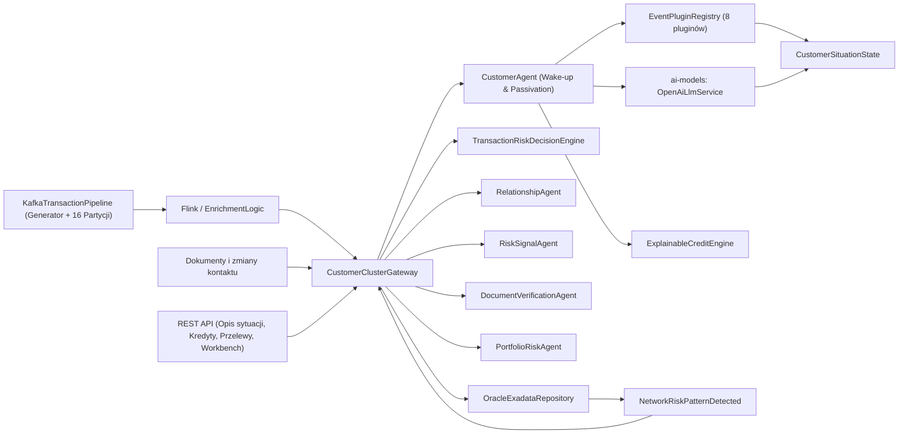

Pięć typów agentów reprezentuje różne zakresy odpowiedzialności:

| Agent | Granica odpowiedzialności |
|---|---|
| `CustomerAgent` | Sytuacja jednego klienta, historia zmian, ekspozycje, outbox, decyzje kredytowe oraz cykliczne podsumowania LLM (wstrzymywane w stanie *passivated*). |
| `RelationshipAgent` | Zagregowany stan relacji między dwiema stronami. |
| `RiskSignalAgent` | Rejestracja i potwierdzanie dostarczenia sygnałów ryzyka (16 shardowanych koordynatorów). |
| `DocumentVerificationAgent` | Klasyfikacja dostarczonych faktów dokumentowych i zapis ich obsługi. |
| `PortfolioRiskAgent` | Podsumowania klientów i wzorców ryzyka w części segmentu portfela (8 podsegmentów na segment). |

Decyzje kredytowe (`ExplainableCreditEngine`) oraz decyzje o blokowaniu przelewów (`TransactionRiskDecisionEngine`) są **w pełni deterministyczne**. Z kolei moduł `ai-models` (`OpenAiLlmService` / `CustomerSituationLlmSummarizer`) służy do **cyklicznego oraz wykonywanego na żądanie REST generowania opisowego podsumowania sytuacji klienta (`LlmSituationSummary`)** przez model LLM.

Oracle podzielono logicznie na sześć obszarów:

| Schemat | Odpowiedzialność |
|---|---|
| `SA_PERSISTENCE` | Pomocniczy dziennik agentów, podsumowania stanu i outbox. |
| `SA_FACTS` | Fakty transakcyjne, dokumentowe, rejestr historii rachunków (`ACCOUNT_HISTORY_REGISTRY`) i zmian kontaktu (`CONTACT_CHANGE_HISTORY`). |
| `SA_GRAPH` | Wierzchołki i relacje klientów, rachunków, telefonów, pracowników i kontrahentów. |
| `SA_INTELLIGENCE` | Wykryte wzorce ryzyka i podsumowania portfela. |
| `SA_DECISIONS` | Audyt projekcji, decyzji kredytowych i przedautoryzacyjnych ocen przelewów (`TRANSACTION_AUTHORIZATION_LOG`). |
| `SA_GOVERNANCE` | Rejestr wersji polityk i progów. |

**Ważne rozróżnienie:** dziennik tworzony przez `OracleExadataRepository` jest oddzielny od mechanizmu `EventSourcedBehavior` Pekko. Nie należy traktować ich jako jednego atomowego mechanizmu trwałości.

**2. Perspektywa procesów — współbieżność, komunikacja, cykl życia agenta i trwałość**

Zasilanie z Kafka, automatyczne przetwarzanie i cykl życia `CustomerAgent` przebiegają następująco:

1. `KafkaTransactionPipeline` publikuje surowe transakcje (`RawTransaction`) do tematu `sa.transactions.raw.v1` (16 partycji wyznaczanych deterministycznie skrótem `digest64(customerId) % 16`, co odwzorowuje zjawisko *hot-partition* dla klientów generujących masowy ruch).
2. Automatyczny konsument w tle cyklicznie pobiera paczki transakcji z partycji Kafka i przekazuje je do potoku wzbogacania Flink (`EnrichmentLogic`):
   - `TransactionValidationFilter` odrzuca niepoprawne transakcje,
   - `ExternalCategorizerMapFunction` przypisuje kategorię (w tym wykrywa przelewy między rachunkami własnymi `InternalOwnAccountTransfer`),
   - `BilateralTransactionSplitter` tworzy perspektywę nadawcy oraz — dla zewnętrznego klienta banku — perspektywę odbiorcy,
   - `WatchlistBroadcastEnricher` oznacza kontrahenta znajdującego się na liście restrykcyjnej.
3. `CustomerClusterGateway` zapisuje projekcję faktu i kieruje wzbogaconą transakcję do właściwego shardu `CustomerAgent` (wybudzając go automatycznie, jeśli był w stanie *passivated*).
4. `CustomerAgent` sprawdza idempotencję, wybiera plugin z `EventPluginRegistry`, utrwala zdarzenia `ObservedEventPersisted` + `SituationEvaluated` i aktualizuje `CustomerSituationState`.
5. Po zapisie uruchamiane są efekty uboczne: aktualizacja portfela, relacji, propagacja ryzyka przez `Transactional Outbox` oraz — po przekroczeniu progu liczby transakcji (`llmTxCountThreshold`) lub czasu (`llmSummaryInterval`) — asynchroniczna synteza podsumowania sytuacji przez LLM (`OpenAiLlmService`), utrwalana jako `LlmSituationSummarized`.
6. Gdy `CustomerAgent` nie przetwarza zdarzeń przez `passivationIdleTimeout` (lub otrzyma żądanie pasywacji), anuluje zegary cykliczne (`timers.cancelAll()`), zgłasza pasywację do shardu (`ClusterSharding.Passivate(context.self)`) i zatrzymuje się (`Effect.stop()`). **W stanie *passivated* podsumowania LLM nie są wykonywane.**
7. Uśpiony `CustomerAgent` jest natychmiast wybudzany przez Pekko Cluster Sharding zarówno po nadejściu nowej transakcji z Kafka, jak i w wyniku zapytania REST o stan lub opis sytuacji tego klienta (`GET /api/v1/customers/{id}/situation/description`).

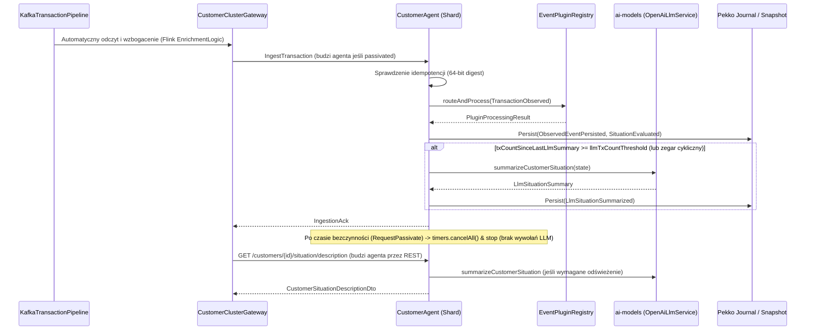

Aktory przetwarzają komendy sekwencyjnie w ramach swojej tożsamości. Różni klienci są obsługiwani równolegle. Flaga `llmInFlight` wewnątrz `CustomerAgent` gwarantuje, że podczas gwałtownego napływu tysięcy transakcji dla klienta *hot-partition* w danym momencie wykonywane jest maksymalnie jedno asynchroniczne żądanie do modelu LLM.

Mechanizmy trwałości, cyklu życia i niezawodności:

| Mechanizm | Faktyczne działanie |
|---|---|
| Event sourcing | Stan agentów jest odtwarzany ze zdarzeń przez `EventSourcedBehavior`. |
| Snapshoty Pekko | Co 50 zdarzeń, z zachowaniem dwóch snapshotów (serializacja `jackson-cbor` skonfigurowana dla wszystkich klas stanów w `application.conf`). |
| Deduplikacja klienta | Listy ostatnich identyfikatorów i ograniczony zbiór skrótów 64-bitowych (`digest64`). |
| Outbox | Intencje wysłania sygnałów są częścią odtwarzanego stanu klienta. |
| Ponawianie | `CustomerAgent` ponawia pending outbox co 5 sekund (`NotInfluenceReceiveTimeout`) oraz po `RecoveryCompleted`. |
| Cykliczne podsumowanie LLM | Wyzwalane po `llmTxCountThreshold` transakcjach lub przez zegar `TriggerCyclicLlmSummary` (`NotInfluenceReceiveTimeout`), wyłącznie gdy napłynęły nowe transakcje. |
| Pasywacja i wybudzanie | W stanie `PASSIVATED` aktor jest zatrzymany i nie wykonuje zapytań LLM; wybudza go nowa transakcja z Kafka lub zapytanie REST o sytuację klienta. |
| Spójność decyzji | Wyniki zawierają wersję stanu, polityki i kompletność danych. |

Spójność między klientem, relacją, portfelem i projekcjami Oracle jest **ostateczna**. Nie ma wspólnej transakcji obejmującej wszystkie te elementy.

Szczególnej uwagi wymaga odtwarzanie klienta: `ObservedEventPersisted` ponownie wykonuje plugin. Zmiana implementacji pluginu może więc zmienić wynik replay historycznych zdarzeń, mimo zapisania jego identyfikatora.

**3. Perspektywa implementacyjna — moduły i zależności**

Strukturę 5 modułów definiuje [build.sbt](file:///home/chris/Projects/OCS/CustAgents/build.sbt).

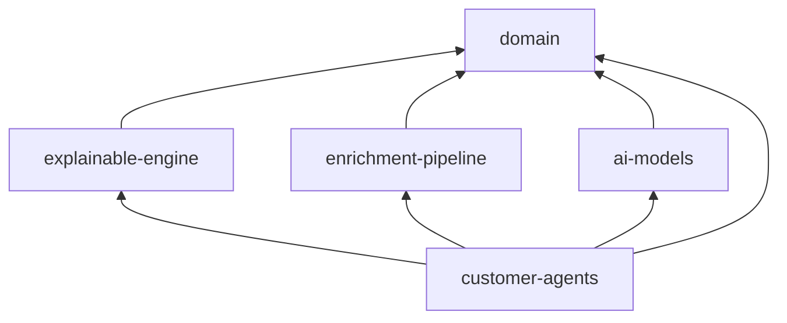

| Moduł | Zawartość | Ocena granicy |
|---|---|---|
| `domain` | Modele, stan klienta (`CustomerSituationState`, `LlmSituationSummary`), okna czasowe, pluginy i modele hierarchii. | Samodzielna logika domenowa, bez Pekko i JDBC. |
| `explainable-engine` | Polityki oraz deterministyczne silniki kredytowy (`ExplainableCreditEngine`) i transakcyjny (`TransactionRiskDecisionEngine`). | Dobra separacja reguł od transportu i trwałości. |
| `enrichment-pipeline` | Operatory Flink, Kafka i wspólne funkcje wzbogacania (`EnrichmentLogic`). | Łączy algorytmy wielokrotnego użycia z infrastrukturą Flink. |
| `ai-models` | Integracja z modelem LLM (`OpenAiLlmService`, `CustomerSituationLlmSummarizer`) przez `io.cequence:openai-scala-client`. | Czysty moduł syntezy opisów sytuacji klienta z wbudowanym lokalnym fallbackiem HTTP `/v1/chat/completions`. |
| `customer-agents` | Aktory, gateway, potok i generator Kafka (`KafkaTransactionPipeline`), REST API, Oracle, aplikacje startowe i testy. | Najszerszy moduł orkiestrujący klaster i interfejsy zewnętrzne. |

Stos zadeklarowany w projekcie obejmuje Scala 3.3.4, Pekko 1.1.2, Pekko HTTP 1.1.0, Flink 1.19.1, Kafka Clients 3.8.0, `openai-scala-client` 1.6.0 (z ujednoliconym Jackson `2.17.2`) i Oracle JDBC (`23.6.0.24.10`).

Najsilniejsze sprzężenia występują w dwóch klasach:

- `CustomerClusterGateway` łączy routing, orkiestrację, śledzenie pasywacji i podsumowań LLM, projekcje, diagnostykę i operacje administracyjne.
- `OracleExadataRepository` łączy dostęp do bazy, cache, inicjalizację schematów, projekcje, analizę grafu i audyt.

**4. Perspektywa fizyczna — uruchomienie i wdrożenie**

Repozytorium dostarcza [docker-compose.yml](file:///home/chris/Projects/OCS/CustAgents/docker-compose.yml) z:

- pojedynczym brokerem Kafka (`apache/kafka:3.8.0`, 16 partycji);
- Flink JobManagerem i TaskManagerem (`flink:1.19.1-java21`);
- Oracle Free (`gvenzl/oracle-free:23-slim`).

Aplikacja Scala jest uruchamiana osobno. `LoanOriginationWebApp` tworzy system Pekko, dołącza do własnego klastra, uruchamia `KafkaTransactionPipeline` oraz `OpenAiLlmService` i udostępnia HTTP domyślnie pod `127.0.0.1:8088`.

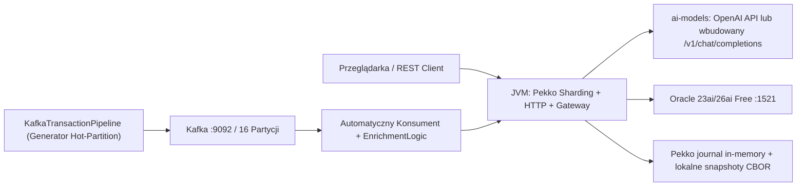

`KafkaTransactionPipeline` działa w trybie dwutorowym: jeśli broker Kafka pod adresem `127.0.0.1:9092` (lub `KAFKA_BOOTSTRAP_SERVERS`) jest osiągalny, wysyła rekordy przez `KafkaProducer` do tematu `sa.transactions.raw.v1`, a równocześnie utrzymuje 16-partycyjny potok w pamięci obsługiwany przez automatycznego konsumenta w tle. Analogicznie `OpenAiLlmService` łączy się z zewnętrznym API OpenAI (gdy ustawiono `OPENAI_SCALA_CLIENT_LIVE=true` i klucz API) lub uruchamia lokalny serwer HTTP `/v1/chat/completions` obsługiwany przez klienta `io.cequence:openai-scala-client`.

**5. Perspektywa „+1” — scenariusze weryfikujące architekturę**

| Scenariusz | Przebieg i współpracujące elementy |
|---|---|
| Generowanie tysięcy transakcji Kafka (*Hot-Partition*) | `POST /api/v1/kafka/generate` (lub `KafkaTransactionGeneratorApp`) → 16 partycji Kafka z koncentracją ruchu na klientach *hot-partition* → automatyczny konsument w tle → `EnrichmentLogic` → `CustomerAgent`. |
| Cykliczne podsumowanie sytuacji przez LLM (`ai-models`) | Przekroczenie progu `llmTxCountThreshold` transakcji lub zegar `TriggerCyclicLlmSummary` → `OpenAiLlmService.summarizeCustomerSituation` → zdarzenie `LlmSituationSummarized` w stanie klienta. |
| Pasywacja i wybudzenie przez REST lub Kafka | Bezczynność (`RequestPassivate`) → `ClusterSharding.Passivate` → zatrzymanie aktora i wstrzymanie wywołań LLM → nadejście transakcji z Kafka lub `GET /api/v1/customers/{id}/situation/description` → wybudzenie aktora i zwrócenie opisu sytuacji LLM. |
| Przelew między klientami | `RawTransaction` → kategoryzacja → dwie perspektywy → gateway → dwa `CustomerAgent` → aktualizacja przepływów, relacji i portfela. |
| Przelew między rachunkami własnymi | `RawTransaction` (`fromCustomerId == toCounterpartyId`) → kategoria `InternalOwnAccountTransfer` → brak sztucznego zawyżania przychodów/wydatków zewnętrznych w `HourlyCashflowBucket`. |
| Przelew do podmiotu zastrzeżonego | Watchlista → `RestrictedEntityTag` → ekspozycja bezpośrednia → outbox → `RiskSignalAgent` → sygnał drugiego stopnia do powiązanego klienta. |
| Dostarczenie dokumentu | DTO → `VerifiedDocumentFact` → `DocumentVerificationAgent` → odpowiednie zdarzenie domenowe → plugin → przeliczenie sytuacji. |
| Symulacja kredytu | `LoanApplication` → `ProjectLoanSituation` → DTI, rata i przyszła płynność → `SituationProjection`. |
| Formalna decyzja kredytowa | Wniosek → reguły i scorecard → `LoanDecisionAudited` z zamrożonym stanem → odpowiedź i dodatkowy audyt Oracle. |
| Analiza globalnego grafu i kont słupów | Fakty i relacje → detektory grafowe (`RapidPassThrough`, `FanInFanOut`, `MultiHopMoneyMovement`, `CircularTransfers`, `EmployeeCustomerPhoneMatch`) → `NetworkRiskPatternDetected` → aktualizacja klienta i portfela. |
| Zmiana telefonu | Normalizacja w Flink → dopasowanie telefonu pracownika → aktualizacja grafu → `CustomerContactChangedPlugin` → ekspozycja ryzyka `EMPLOYEE_CUSTOMER_PHONE_MATCH`. |
| Weryfikacja rachunku (1 PLN) | Historia rachunku → `AccountVerificationResult` → ewentualne `AccountHistoryRiskDetected` (`UNKNOWN_ACCOUNT_HISTORY`) → aktualizacja klienta. |
| Ocena przelewu przed wykonaniem | Proponowany przelew + stan klienta + historia rachunku + watchlista → `TransactionRiskDecisionEngine` → `ALLOW`, `REVIEW_HOLD` albo `BLOCK`. |

Scenariusze rozdzielają **projekcję przyszłości**, **formalną decyzję kredytową** i **operacyjną decyzję o przelewie**. To trafny podział domenowy: każda z tych operacji ma inny wynik i inną odpowiedzialność.

**6. Katalog kodu Scala — modele podstawowe**

Źródło: [Models.scala](file:///home/chris/Projects/OCS/CustAgents/modules/domain/src/main/scala/com/bank/sa/domain/Models.scala).

| Typ | Funkcjonalność, odpowiedzialność i powiązania |
|---|---|
| `TransactionDirection` | Rozróżnia wpływ i wypływ; używany przez splitter, agregaty i graf. |
| `TransactionCategory` | Klasyfikuje transakcje (w tym `InternalOwnAccountTransfer`); `isHighRiskCategory` wskazuje hazard i transfer wysokiego ryzyka. |
| `RestrictionLevel` | Poziomy restrykcji z wagą ryzyka; wejście do budowania ekspozycji. |
| `RestrictedEntityTag` | Informacja o trafieniu na watchlistę, źródle i powodzie; dołączana do transakcji. |
| `RawTransaction` | Surowy fakt płatniczy (z opcjonalnymi `fromAccountId` i `toAccountId`); wejście potoku Kafka i wzbogacania Flink. |
| `EnrichedTransaction` | Transakcja z perspektywy klienta, po kategoryzacji i screeningu (wraz z flagą `isOwnAccountTransfer`); podstawowe wejście agenta. |
| `CustomerAccount` | Rachunek należący do klienta; rejestrowany w repozytorium i grafie. |
| `EmployeeProfile` | Pracownik, telefon i obsługiwani klienci; dane do wykrywania powiązań pracownik–klient. |
| `RawCustomerContactChange` | Surowa zmiana telefonu z CRM. |
| `NormalizedCustomerContactChange` | Znormalizowany telefon i wynik dopasowania pracownika; wejście pluginu oraz projekcji grafowej. |
| `AccountFirstSeen` | Pierwsza obserwacja rachunku wraz z transakcją i klientem. |
| `AccountVerificationResult` | Wynik sprawdzenia historii rachunku: właściciel, przepływy, powiązania i sygnały ryzyka. |
| `DocumentFactType` | Rodzaje faktów: dochód, zatrudnienie, zadłużenie, podatek i KYC. |
| `VerifiedDocumentFact` | Ustrukturyzowany fakt dokumentowy; przechowywany w stanie klienta i repozytorium. |
| `PeerRiskSignal` | Sygnał propagowanego ryzyka z trasą, wagą, dowodami i opcjonalnym outbox ID. |
| `NetworkRiskPatternType` | Kategorie wzorców grafowych (`SharedHighRiskCounterparty`, `HighDegreeNodeExposure`, `RapidPassThrough`, `FanInFanOut`, `MultiHopMoneyMovement`, `CircularTransfers`, `EmployeeCustomerPhoneMatch` i inne). |
| `NetworkRiskPatternDetected` | Wynik analizy grafowej dla konkretnego klienta; wraca jako zdarzenie do agentów. |
| `AgentObservedEvent` | Wspólny kontrakt zdarzeń obsługiwanych przez pluginy. |
| `TransactionObserved` | Opakowuje wzbogaconą transakcję dla `TransactionObservedPlugin`. |
| `IncomeVerified` | Zdarzenie dochodowe dla `IncomeVerifiedPlugin`. |
| `DebtUpdated` | Zdarzenie zadłużenia dla `DebtUpdatedPlugin`. |
| `CounterpartyRiskReceived` | Opakowuje `PeerRiskSignal` dla pluginu ryzyka kontrahenta. |
| `ExternalDocumentReceived` | Pozostałe fakty dokumentowe, np. KYC. |
| `GlobalRiskIntelligenceReceived` | Adapter wzorca grafowego do protokołu obserwowanych zdarzeń. |
| `CustomerContactChanged` | Zdarzenie znormalizowanej zmiany kontaktu. |
| `AccountHistoryRiskDetected` | Zdarzenie ryzyka wynikającego z historii rachunku. |
| `ProposedPaymentTransfer` | Polecenie przelewu oceniane przed wykonaniem; nie jest jeszcze faktem transakcyjnym. |
| `OutboxTargetType` | Kategorie odbiorców outbox. |
| `OutboxEntry` | Intencja efektu ubocznego; pełny payload sygnału jest dostępny przez `peerSignal`. |
| `LoanApplication` | Wniosek kredytowy i obliczenie raty annuitetowej. |

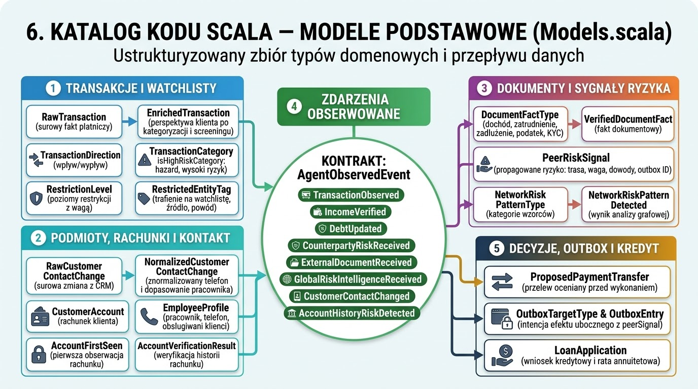

**7. Stan klienta, podsumowania LLM i okna przepływów**

Źródła: [CustomerSituationState.scala](file:///home/chris/Projects/OCS/CustAgents/modules/domain/src/main/scala/com/bank/sa/domain/CustomerSituationState.scala), [SlidingWindowCashflow.scala](file:///home/chris/Projects/OCS/CustAgents/modules/domain/src/main/scala/com/bank/sa/domain/SlidingWindowCashflow.scala).

| Typ | Funkcjonalność, odpowiedzialność i powiązania |
|---|---|
| `IncomeStability` | Ocena stabilności dochodu: wysoka, średnia, niska, niezweryfikowana. |
| `LiquidityTrend` | Trend płynności: dodatni, stabilny, malejący, krytyczny. |
| `CompletenessLevel` | Poziom kompletności danych. |
| `CustomerSituationSummary` | Bieżąca synteza dochodu, płynności i statusu finansowego klienta. |
| `LlmSituationSummary` | Opisowe podsumowanie sytuacji klienta wygenerowane przez model LLM (`ai-models`): identyfikator, treść narracyjna, powód wyzwolenia (`triggerReason`), użyty model (`modelId`), wersja stanu i liczba transakcji w momencie syntezy. |
| `DataCompleteness` | Wynik kompletności, flagi dostępnych danych i lista braków; część audytu decyzji. |
| `CounterpartyConnection` | Lokalna relacja klienta z kontrahentem: wolumen, liczba transakcji, ostatnie dowody. Obiekt towarzyszący tworzy pierwsze połączenie. |
| `RiskExposureTrace` | Ekspozycja wraz z pochodzeniem, odległością, powodem i dowodami. Obiekt towarzyszący buduje ślady z transakcji, sygnałów, grafu, telefonu i rachunku. |
| `CustomerSituationState` | Główny agregat klienta: cashflow, fakty, sieć, ryzyka, konta, kontakt, deduplikacja, outbox, wersje oraz liczniki i ostatnie podsumowanie LLM (`totalTransactionsProcessed`, `txCountSinceLastLlmSummary`, `lastLlmSummary`, `llmSummariesCount`). Udostępnia operacje aktualizacji, rejestracji podsumowania LLM (`recordLlmSituationSummary`) oraz przeliczenia sytuacji. |
| Obiekt `CustomerSituationState` | Limity sieci i propagacji, fabryka pustego stanu oraz funkcja skrótu 64-bitowego. |
| `WindowMetrics` | Wynik agregacji wybranego okna: wpływy, wydatki, ryzykowne wydatki, debety, przelewy własne (`internalOwnTransferVolume`) i dowody. |
| `HourlyCashflowBucket` | Agregat jednej godziny; oddziela przelewy własne od przepływów zewnętrznych. |
| `SlidingWindowCashflow` | Mapa godzinowych bucketów z retencją około 90 dni; aktualizuje i wylicza metryki dla okien. |

`CustomerSituationState` jest najważniejszym agregatem domenowym. Odpowiada także za ograniczanie lokalnej sieci do 200 kontrahentów oraz przechowywanie ostatnich identyfikatorów zdarzeń i historii podsumowań LLM.

Nazwa i komentarze sugerują ring buffer oraz O(1), ale implementacja `SlidingWindowCashflow` używa `Map`, wyszukuje maksimum i filtruje buckety. Zapytanie o okno również skanuje buckety. Koszt jest ograniczony retencją, lecz **nie jest ścisłym O(1)**.

Kompletność to heurystyka: dochód daje 0,50, historia transakcji 0,30, a KYC 0,20. Poziom `Complete` zaczyna się od 0,80, więc może wystąpić bez KYC.

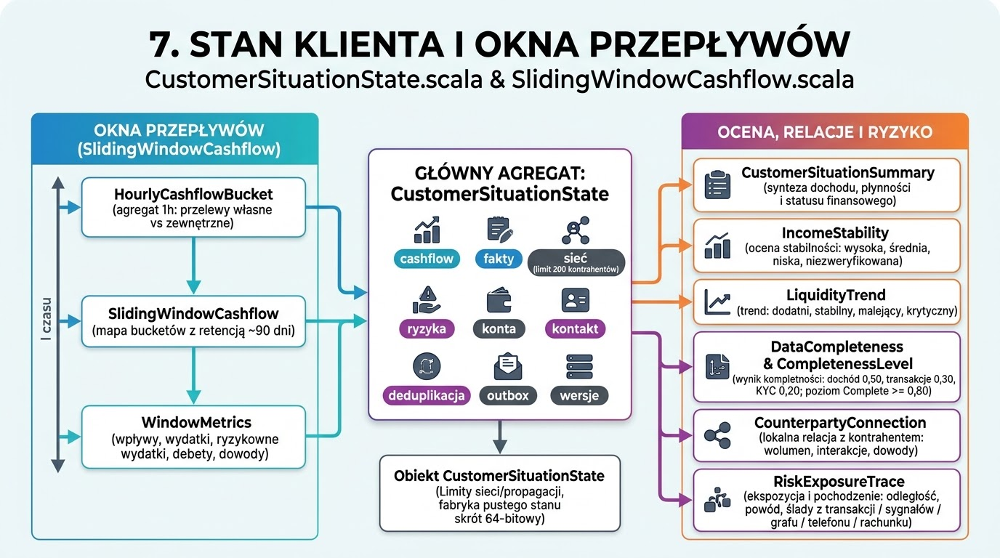

**8. Pluginy zdarzeń**

Źródło: [EventPluginArchitecture.scala](file:///home/chris/Projects/OCS/CustAgents/modules/domain/src/main/scala/com/bank/sa/domain/EventPluginArchitecture.scala).

| Typ | Funkcjonalność, odpowiedzialność i powiązania |
|---|---|
| `SituationEvaluatedRecord` | Zapis wyniku interpretacji: zdarzenie, plugin, wersje, podsumowanie i kompletność. |
| `PluginProcessingResult` | Łączy nowy stan, nowe wpisy outbox i rekord ewaluacji. |
| `SituationEventPlugin` | Kontrakt rozpoznawania i przetwarzania zdarzeń. |
| `TransactionObservedPlugin` | Aktualizuje przepływy i sieć, tworzy bezpośrednią ekspozycję oraz outbox relacji i sygnałów drugiego stopnia. Domyślne tłumienie ryzyka: 0,65. |
| `IncomeVerifiedPlugin` | Zapisuje fakt dochodowy i generuje podsumowanie ewaluacji. |
| `DebtUpdatedPlugin` | Zapisuje fakt zadłużenia. |
| `CounterpartyRiskReceivedPlugin` | Aktualizuje ekspozycję na podstawie sygnału innego klienta. |
| `ExternalDocumentReceivedPlugin` | Zapisuje pozostałe fakty dokumentowe. |
| `GlobalRiskIntelligencePlugin` | Przenosi wynik analizy globalnego grafu do stanu klienta. |
| `CustomerContactChangedPlugin` | Aktualizuje telefon, historię zmian i ekspozycję wynikającą z dopasowania pracownika. |
| `AccountHistoryRiskPlugin` | Aktualizuje ekspozycję związaną z rachunkiem odbiorcy. |
| `EventPluginRegistry` | Mapuje typ zdarzenia na plugin; brak obsługi kończy się wyjątkiem. |
| Obiekt `EventPluginRegistry` | Buduje listę ośmiu domyślnych pluginów i wspólny rejestr. |

To dobry punkt rozszerzeń logiki interpretacyjnej. Rejestr przyjmuje listę pluginów programowo; projekt nie implementuje dynamicznego ładowania pluginów z zewnętrznych bibliotek.

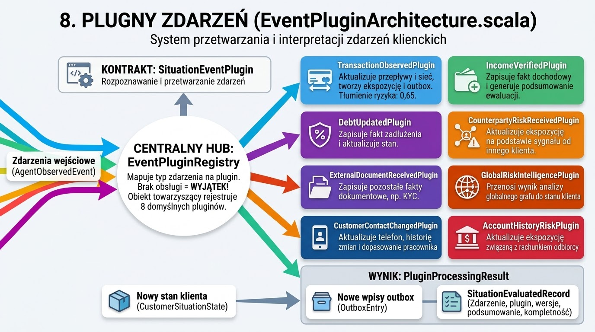

**9. Modele hierarchii i grafu**

Źródło: [HierarchicalDomainModels.scala](file:///home/chris/Projects/OCS/CustAgents/modules/domain/src/main/scala/com/bank/sa/domain/HierarchicalDomainModels.scala).

| Typ | Funkcjonalność, odpowiedzialność i powiązania |
|---|---|
| `RelationshipSituationState` | Wolumen, liczba interakcji i maksymalne ryzyko pary stron; stan `RelationshipAgent`. |
| `RiskSignalStatus` | Status cyklu życia sygnału; nie wszystkie wartości mają pełny proces obsługi. |
| `RiskSignalLifecycleRecord` | Dane jednego sygnału, jego status i czas potwierdzenia. |
| `RiskSignalAgentState` | Mapa sygnałów i liczniki koordynatora. |
| Obiekt `RiskSignalAgentState` | Wybiera jeden z 16 koordynatorów i scala ich wyniki. |
| `VerifiedDocumentAuditEntry` | Zapis klasyfikacji dokumentu i statusu jego obsługi. |
| `DocumentVerificationAgentState` | Dokumenty obsłużone dla klienta, licznik i ostatnia data. |
| `CustomerPortfolioEntry` | Skrócona sytuacja klienta używana przez agregację portfelową. |
| `PortfolioSituationState` | Ograniczony zbiór klientów, wzorce i metryki koncentracji; stan `PortfolioRiskAgent`. |
| Obiekt `PortfolioSituationState` | Dzieli segment na osiem części, ustala limit 500 klientów na część i scala wyniki. |
| `GraphVertex` | Wierzchołek grafu z typem, ryzykiem i metadanymi. |
| `GraphEdge` | Relacja grafowa z wolumenem, dowodami, okresem ważności i źródłem. |
| `GraphInvestigationResult` | Podgraf i powiązane ustalenia zwracane analitykowi. |
| `GlobalBankingSituation` | Zbiorczy odczyt stanów agentów, grafu i schematów; nie jest osobnym aktorem globalnym. |

Ograniczanie portfela zachowuje klientów o najwyższym ryzyku i najnowszej aktualizacji. Z tego powodu metryki portfela dotyczą **wybranego podzbioru**, a nie pełnej populacji segmentu.

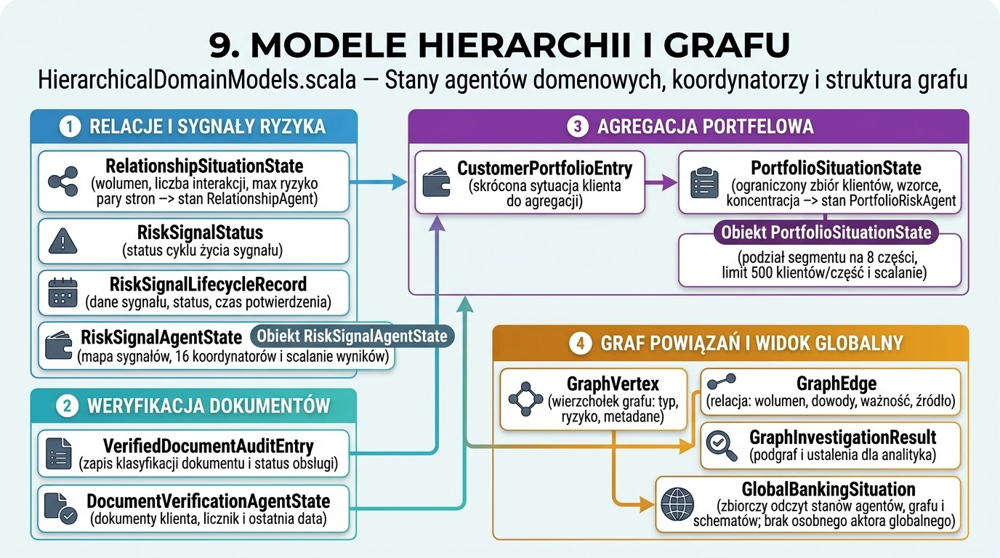

**10. Modele decyzji i silniki**

Źródła: [DecisionModels.scala](file:///home/chris/Projects/OCS/CustAgents/modules/domain/src/main/scala/com/bank/sa/domain/DecisionModels.scala), [ExplainableCreditEngine.scala](file:///home/chris/Projects/OCS/CustAgents/modules/explainable-engine/src/main/scala/com/bank/sa/engine/ExplainableCreditEngine.scala), [TransactionRiskDecisionEngine.scala](file:///home/chris/Projects/OCS/CustAgents/modules/explainable-engine/src/main/scala/com/bank/sa/engine/TransactionRiskDecisionEngine.scala).

| Typ | Funkcjonalność, odpowiedzialność i powiązania |
|---|---|
| `SituationProjection` | Rata, przyszłe DTI, płynność, bufor i wykonalność finansowa wraz z wersją stanu. |
| `ReasonCode` | Powód decyzji: metryka, próg, dowody, wskazówka poprawy i kara punktowa. |
| `RuleEvaluationTrace` | Wynik pojedynczej reguły i opcjonalny powód. |
| `ExplainableAuditTrail` | Pełny ślad oceny kredytowej: polityka, scoring, reguły, powody i projekcja. |
| `DecisionOutcome` | Warianty `Approved` oraz `Denied` z odpowiednimi danymi. |
| `LoanDecisionResponse` | Odpowiedź dla wniosku, łącząca wynik i audyt. |
| `TransactionAuthorizationDecision` | Wynik operacyjny: `ALLOW`, `REVIEW_HOLD`, `BLOCK`. |
| `TransactionAuthorizationResponse` | Wynik oceny przelewu, ryzyko, reguły, historia rachunku, świeżość stanu i dyrektywa wykonania. |
| `CreditPolicyConfig` | Progi kredytowe i wersja polityki; domyślnie wynik bazowy 750, minimum 620 i DTI 40%. |
| `ExplainableCreditEngine` | Projekcja kredytu oraz ocena dochodu, płynności, ryzykownych wydatków i ekspozycji sieciowych. |
| `TransactionRiskPolicyConfig` | Progi oceny przelewu; domyślnie review 35, block 75 i wysoka kwota 10 000. |
| `TransactionRiskDecisionEngine` | Ocena historii rachunku, podejrzenia konta słupa, restrykcji i powiązania telefonu pracownika. |

Silnik kredytowy ogranicza scoring do 300–850. Zatwierdzenie wymaga jednocześnie:

- braku twardej blokady;
- wyniku co najmniej 620;
- pustej listy powodów negatywnych.

Ostatni warunek oznacza, że **każda reguła generująca negatywny powód prowadzi do odmowy**, nawet przy wyniku powyżej progu. Scorecard nie działa więc wyłącznie jako bilans kar.

W projekcji:

`futureDti = (zadłużenie miesięczne + nowa rata) / dochód`

`expectedMonthlyLiquidity = dochód − wydatki z 30 dni − nowa rata`

Silnik transakcyjny zwraca dyrektywę dla systemu płatniczego. Sam nie wykonuje przelewu ani nie integruje się z mechanizmem księgowania.

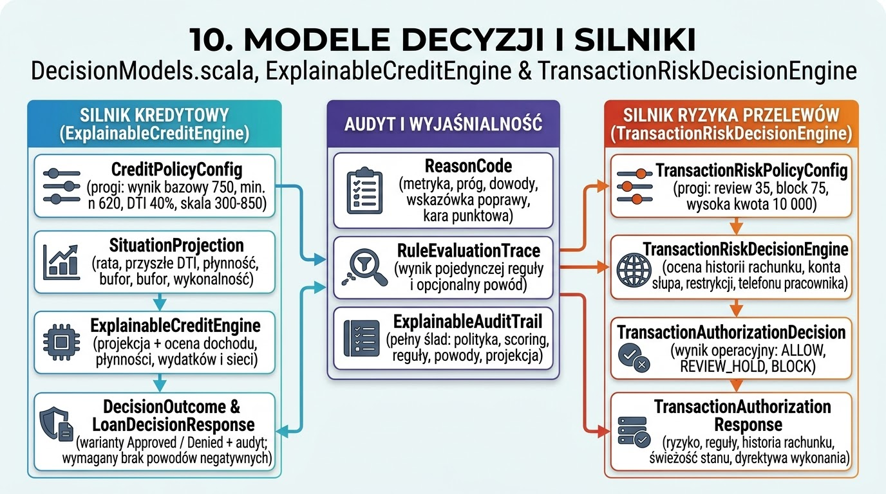

**11. Wzbogacanie Flink, potok Kafka (*Hot-Partition*) i moduł `ai-models` (LLM)**

Źródła: [FlinkTransactionEnrichment.scala](file:///home/chris/Projects/OCS/CustAgents/modules/enrichment-pipeline/src/main/scala/com/bank/sa/enrichment/FlinkTransactionEnrichment.scala), [FlinkKafkaEnrichmentJob.scala](file:///home/chris/Projects/OCS/CustAgents/modules/enrichment-pipeline/src/main/scala/com/bank/sa/enrichment/FlinkKafkaEnrichmentJob.scala), [KafkaTransactionPipeline.scala](file:///home/chris/Projects/OCS/CustAgents/modules/customer-agents/src/main/scala/com/bank/sa/kafka/KafkaTransactionPipeline.scala), [OpenAiLlmService.scala](file:///home/chris/Projects/OCS/CustAgents/modules/ai-models/src/main/scala/com/bank/sa/llm/OpenAiLlmService.scala).

| Typ | Funkcjonalność, odpowiedzialność i powiązania |
|---|---|
| `ExternalTransactionCategorizer` | Interfejs kategoryzatora transakcji. |
| `RuleBasedExternalCategorizer` | Lokalna kategoryzacja na podstawie opisów i identyfikatorów (w tym detekcja `InternalOwnAccountTransfer`). |
| `CustomerDirectedTransaction` | Pośrednia perspektywa klienta przed dołączeniem watchlisty. |
| `ContactPhoneNormalizerMapFunction` | Operator normalizacji telefonu i dopasowania do dostarczonej listy pracowników. |
| `TransactionValidationFilter` | Sprawdza podstawowe identyfikatory, walutę i dodatnią kwotę. |
| `ExternalCategorizerMapFunction` | Adapter kategoryzatora do operatora Flink. |
| `BilateralTransactionSplitter` | Tworzy jedną albo dwie perspektywy; przelew własny zapisuje raz. |
| `WatchlistBroadcastEnricher` | Utrzymuje broadcast state list restrykcyjnych i wzbogaca transakcje. |
| `EnrichmentLogic` | Wspólne funkcje walidacji, kategoryzacji, splitu, normalizacji i budowy topologii; używane też przez potok Kafka, demo i testy. |
| `JsonDeserializationSchema[T]` | Deserializuje wiadomości Kafka z JSON przez Jacksona. |
| `JsonValueSerializationSchema[T]` | Serializuje wartości wyjściowe do JSON. |
| `CustomerKeySerializationSchema` | Buduje klucz Kafka z `customerId`. |
| `FlinkKafkaEnrichmentJob.KafkaJobConfig` | Adres brokera, nazwy tematów i grupy konsumenckiej. |
| `FlinkKafkaEnrichmentJob` | Tworzy źródła Kafka, topologię i sink; włącza checkpointing co 30 sekund. |
| `KafkaGeneratorRequest` | Konfiguracja masowego generatora transakcji Kafka: liczba transakcji, pula klientów normalnych, lista klientów *hot-partition* oraz udział ruchu *hot-partition* (`hotPartitionTrafficShare`). |
| `KafkaGenerationBatchResult` | Podsumowanie wygenerowanej paczki Kafka wraz z rozkładem na 16 partycji i licznikami klientów *hot-partition*. |
| `KafkaPipelineStatusDto` | Bieżąca telemetria potoku Kafka: tryb brokera, liczba wyprodukowanych i przetworzonych zdarzeń, lag kolejki i rozkład partycji. |
| `KafkaTransactionPipeline` | Generator tysięcy transakcji (z obsługą *hot-partition*), producent Kafka (`KafkaProducer` + 16 partycji w pamięci) oraz automatyczny konsument w tle wzbogacający i kierujący transakcje do `CustomerAgent`. |
| `CustomerSituationLlmSummarizer` | Interfejs modułu `ai-models` do generowania podsumowań sytuacji klienta (`LlmSituationSummary`) na podstawie `CustomerSituationState`. |
| `OpenAiLlmService` | Implementacja `CustomerSituationLlmSummarizer` oparta na `io.cequence:openai-scala-client` (`OpenAIServiceFactory`, `createChatCompletion`), z automatycznym lokalnym endpointem `/v1/chat/completions` gdy brak zewnętrznego klucza API. |

Checkpointing Flink nie oznacza automatycznie gwarancji *exactly-once* całego procesu. Kod nie konfiguruje transakcyjnego trybu sinka Kafka ani atomowego połączenia z zapisem agentów; idempotencja jest natomiast egzekwowana po stronie `CustomerAgent` przez 64-bitowe skróty `digest64`.

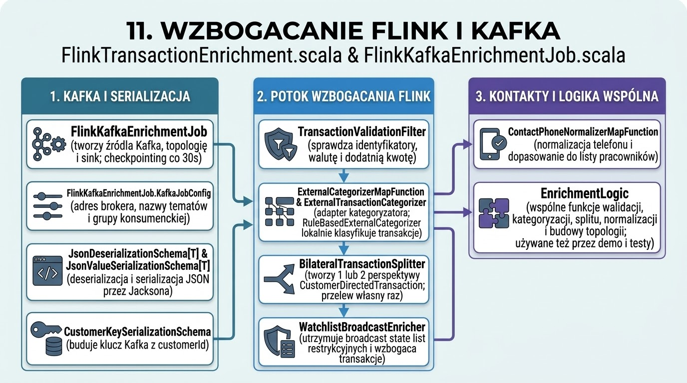

**12. Aktory, gateway i protokoły**

Źródła: [CustomerAgent.scala](file:///home/chris/Projects/OCS/CustAgents/modules/customer-agents/src/main/scala/com/bank/sa/agent/CustomerAgent.scala), [DomainAgents.scala](file:///home/chris/Projects/OCS/CustAgents/modules/customer-agents/src/main/scala/com/bank/sa/agent/DomainAgents.scala), [CustomerClusterGateway.scala](file:///home/chris/Projects/OCS/CustAgents/modules/customer-agents/src/main/scala/com/bank/sa/agent/CustomerClusterGateway.scala).

| Typ | Funkcjonalność, odpowiedzialność i powiązania |
|---|---|
| `CborSerializable` | Marker wiążący protokoły z serializatorem Jackson CBOR. |
| `PeerRiskRouter` | Port efektów ubocznych wykonywanych po zapisie zdarzenia: wysyłanie sygnałów, retry outbox, rejestracja podsumowań LLM (`onLlmSummaryCompleted`) oraz śledzenie wybudzeń (`onAgentWokenUp`) i pasywacji (`onAgentPassivated`). |
| Obiekt `PeerRiskRouter` | Dostarcza implementację `NoOp`. |
| `CustomerAgent` | Fabryka trwałego aktora klienta; obsługuje pluginy, journal, outbox, projekcję, decyzję kredytową, cykliczne podsumowania LLM oraz pasywację po bezczynności. |
| `RelationshipAgent` | Trwały aktor bilateralnej relacji. |
| `RiskSignalAgent` | Trwały rejestr sygnałów; nowe sygnały przekazuje callbackiem do odbiorcy. |
| `DocumentVerificationAgent` | Klasyfikuje fakty do zdarzeń domenowych i zapisuje ich obsługę. |
| `PortfolioRiskAgent` | Aktualizuje część segmentu i wywołuje zapis snapshotu portfela. |
| `CustomerClusterGateway` | Rejestruje pięć typów shardowanych aktorów, integruje `OpenAiLlmService`, zarządza stanem pasywacji i koordynuje wszystkie główne przypadki użycia. |
| `SituationStreamProcessor` | Adapter Pekko Streams z kontrolą równoległości i potwierdzeniami ingestii. |

Zagnieżdżone typy są pełnoprawną częścią architektury komunikacji:

| Właściciel | Typy i odpowiedzialność |
|---|---|
| `CustomerAgent.Command` | Wspólny kontrakt komend klienta. |
| `IngestionAck` | Potwierdzenie obsługi identyfikatora. |
| `IngestTransaction` | Przyjęcie wzbogaconej transakcji (wybudza agenta, jeśli był *passivated*, i po osiągnięciu `llmTxCountThreshold` wyzwala podsumowanie LLM). |
| `IngestDocumentFact` | Bezpośrednie przyjęcie faktu dokumentowego. |
| `IngestObservedEvent` | Uniwersalne wejście zdarzenia do pluginów. |
| `PropagatePeerRisk` | Przyjęcie sygnału drugiego stopnia. |
| `IngestNetworkRiskPattern` | Przyjęcie wzorca globalnego. |
| `ConfirmOutboxDelivery` | Potwierdzenie dostarczenia efektu ubocznego. |
| `ProjectLoanSituation` | Wyliczenie projekcji. |
| `EvaluateLoan` | Formalna decyzja wraz z zapisem audytu w journalu. |
| `GetSituationState` | Odczyt stanu (wybudza agenta przy bezpośrednim zapytaniu REST). |
| `GetOrGenerateSituationDescription` | Wybudza agenta w odpowiedzi na zapytanie REST o opis sytuacji i opcjonalnie zleca świeżą syntezę LLM. |
| `RecordLlmSituationSummary` | Zapisuje wygenerowane podsumowanie LLM w dzienniku zdarzeń i stanie klienta. |
| `LlmSummaryFailed` | Zwalnia blokadę `llmInFlight` i zwraca stan awaryjny w razie błędu wywołania LLM. |
| `ResetState` | Zapis resetu klienta. |
| `RetryPendingOutbox` | Uruchomienie ponawiania (`NotInfluenceReceiveTimeout`). |
| `TriggerCyclicLlmSummary` | Cykliczny wyzwalacz zegarowy podsumowania LLM (`NotInfluenceReceiveTimeout`); działa tylko wtedy, gdy od ostatniego podsumowania napłynęły nowe transakcje. |
| `RequestPassivate` | Inicjuje pasywację shardu (`shard ! ClusterSharding.Passivate(context.self)`), anulując zegary i wstrzymując wywołania LLM. |
| `Passivate` | Komunikat zatrzymania aktora dostarczany przez shard po zbuforowaniu wiadomości. |
| `CustomerAgent.Event` | Wspólny kontrakt trwałych zdarzeń klienta. |
| `ObservedEventPersisted` | Zdarzenie wejściowe i identyfikator pluginu; replay ponownie uruchamia plugin. |
| `SituationEvaluated` | Utrwalenie syntezy sytuacji i wersji. |
| `LlmSituationSummarized` | Utrwalenie wygenerowanego podsumowania sytuacji LLM (`LlmSituationSummary`) i wyzerowanie licznika `txCountSinceLastLlmSummary`. |
| `OutboxDeliveryConfirmed` | Usunięcie potwierdzonej intencji ze stanu. |
| `TransactionIngested` | Bezpośrednia aktualizacja transakcji przy replay; alternatywa wobec obecnej ścieżki pluginowej. |
| `DocumentFactIngested` | Bezpośrednie odtworzenie faktu dokumentowego. |
| `PeerRiskSignalIngested` | Bezpośrednie odtworzenie sygnału. |
| `CustomerStateReset` | Odtworzenie pustego stanu klienta. |
| `LoanDecisionAudited` | Zapis odpowiedzi i zamrożonego stanu; nie zmienia bieżącej sytuacji. |

Pozostali agenci mają własne kontrakty `Command` i `Event` oraz `Passivate`:

| Agent | Typy protokołu i ich znaczenie |
|---|---|
| `RelationshipAgent` | `RecordInteraction` → `InteractionRecorded`: transakcja i ryzyko; `RecordPropagatedRisk` → `PropagatedRiskRecorded`: propagacja; `GetRelationshipState`: odczyt; `ResetRelationship` → `RelationshipReset`: reset. |
| `RiskSignalAgent` | `DispatchAndTrackSignal` → `SignalRegistered`: rejestracja i wysłanie; `AcknowledgeSignalDelivery` → `SignalAcknowledged`: potwierdzenie; `GetRiskSignalState`: odczyt; `ResetRiskSignals` → `RiskSignalsReset`: reset. |
| `DocumentVerificationAgent` | `VerifyAndClassifyDocument` → `DocumentVerifiedEvent`: klasyfikacja faktu; `GetVerificationState`: odczyt; `ResetVerificationState` → `VerificationReset`: reset. |
| `PortfolioRiskAgent` | `UpdateCustomerInPortfolio` → `CustomerPortfolioSnapshotUpdated`: aktualizacja klienta; `IngestGlobalRiskPattern` → `GlobalPatternAddedToPortfolio`: wzorzec; `GetPortfolioSituation`: odczyt; `ResetPortfolio` → `PortfolioReset`: reset. |

`DocumentVerificationAgent` nie implementuje sprawdzania autentyczności dokumentu, OCR ani integracji z wystawcą. Przyjmuje już przygotowany `VerifiedDocumentFact`, a następnie klasyfikuje go i zapisuje.

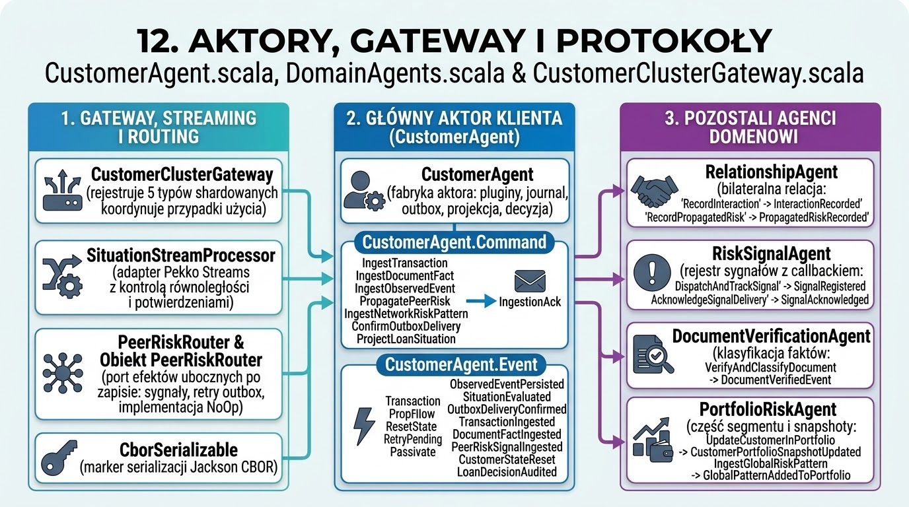

**13. Repozytorium Oracle**

Źródło: [OracleExadataRepository.scala](file:///home/chris/Projects/OCS/CustAgents/modules/customer-agents/src/main/scala/com/bank/sa/oracle/OracleExadataRepository.scala).

| Typ | Funkcjonalność, odpowiedzialność i powiązania |
|---|---|
| `OracleJdbcConfig` | Parametry połączenia i włączenia JDBC. |
| `OracleJournalRow` | Pomocniczy wpis journalu z opisowym podsumowaniem payloadu. |
| `OracleSnapshotRow` | Podsumowanie stanu; nie zawiera pełnego `CustomerSituationState`. |
| `FinancialTransactionFactRow` | Kanoniczny rekord perspektywy transakcji dla klienta. |
| `GovernancePolicyRow` | Wersja polityki i wybrane progi do rejestru governance. |
| `OracleExadataRepository` | Implementacja zapisu faktów, grafu, audytu, rejestrów, analizy ryzyka i trybu in-memory/JDBC. |

Repozytorium odpowiada za:

- inicjalizację schematów i struktur;
- pomocniczy journal i snapshoty;
- zapis i potwierdzanie outbox;
- projekcje transakcji i dokumentów;
- rejestrację rachunków i pracowników;
- historię telefonu i obserwacji rachunków;
- budowę grafu;
- wykrywanie wspólnych kontrahentów, powiązań telefonicznych, przepływów wieloetapowych i cykli;
- audyt wszystkich typów decyzji.

Analiza grafowa łączy zapytanie SQL `GRAPH_TABLE` z detektorami wykonywanymi na kolekcjach JVM. Nie cała analiza jest delegowana do Oracle.

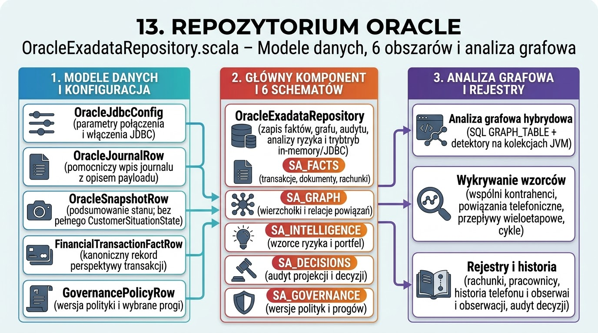

**14. API i modele transportowe**

Źródła: [LoanOriginationProtocol.scala](file:///home/chris/Projects/OCS/CustAgents/modules/customer-agents/src/main/scala/com/bank/sa/api/LoanOriginationProtocol.scala), [LoanOriginationGrpcService.scala](file:///home/chris/Projects/OCS/CustAgents/modules/customer-agents/src/main/scala/com/bank/sa/api/LoanOriginationGrpcService.scala), [LoanOriginationServer.scala](file:///home/chris/Projects/OCS/CustAgents/modules/customer-agents/src/main/scala/com/bank/sa/api/LoanOriginationServer.scala).

| Typ | Funkcjonalność, odpowiedzialność i powiązania |
|---|---|
| `LoanOriginationRequest` | Żądanie kredytowe; konwertuje się do `LoanApplication`. |
| `DocumentFactUploadRequest` | Dane faktu dokumentowego; konwersja do `VerifiedDocumentFact`. |
| `RawTransactionIngestRequest` | Dane transakcji HTTP; konwersja do `RawTransaction`. |
| `EmployeeRegistrationRequest` | Rejestracja pracownika; konwersja do `EmployeeProfile`. |
| `CustomerAccountRegistrationRequest` | Rejestracja rachunku; konwersja do `CustomerAccount`. |
| `CustomerContactChangeRequest` | Żądanie zmiany telefonu; konwersja do surowego zdarzenia. |
| `OnePlnAccountVerificationRequest` | Parametry sprawdzenia rachunku. |
| `PreExecutionTransferRequest` | Żądanie oceny przelewu; konwersja do `ProposedPaymentTransfer`. |
| `SituationProjectionDto` | Transportowa reprezentacja projekcji; obiekt towarzyszący mapuje domenę. |
| `ReasonCodeDto` | Transportowa reprezentacja powodu; obiekt towarzyszący mapuje `ReasonCode`. |
| `RuleTraceDto` | Uproszczony transportowy wynik reguły. |
| `LoanOriginationDecisionDto` | Odpowiedź kredytowa dla API/UI; obiekt towarzyszący mapuje oba warianty decyzji. |
| `RiskExposureDto` | Ekspozycja klienta do prezentacji. |
| `CustomerSituationSnapshotDto` | Rozbudowany odczyt sytuacji (wraz ze statusem cyklu życia `ACTIVE`/`PASSIVATED` i ostatnim podsumowaniem LLM); obiekt towarzyszący wylicza metryki i mapuje stan. |
| `CustomerSituationDescriptionDto` | Odpowiedź endpointu `GET /api/v1/customers/{id}/situation/description`: zawiera opis narracyjny LLM (`llmNarrativeDescription`), metadane modelu `ai-models`, informację o wybudzeniu z pasywacji (`wokenUpFromPassivationByRestQuery`) oraz wskaźniki sytuacji klienta. |
| `IngestionAckDto` | Potwierdzenie HTTP. |
| `HealthStatusDto` | Status usługi i członka klastra. |
| `WorkflowTraceEventDto` | Krok przepływu do diagnostyki i UI. |
| `WatchlistEntryDto` | Pozycja watchlisty; obiekt towarzyszący mapuje tag domenowy. |
| `SystemOverviewDto` | Zbiorczy model ekranu systemu (zawiera także `passivatedCustomerIds` oraz `recentLlmSummaries`). |
| `OracleExadataOverviewDto` | Zbiorczy model podglądu repozytorium Oracle. |
| `JacksonJsonSupport` | Wspólny mapper Jackson i marshalling/unmarshalling Pekko HTTP. |
| `LoanOriginationGrpcService` | Wewnętrzny kontrakt asynchronicznych operacji kredytowych i dokumentowych. |
| `LoanOriginationGrpcServiceImpl` | Deleguje operacje do gateway i mapuje wyniki na DTO. |
| `LoanOriginationServer` | Trasy HTTP (w tym `/api/v1/kafka/generate`, `/api/v1/kafka/status`, `/api/v1/customers/{id}/situation/description`, `/api/v1/customers/{id}/passivate`), UI, operacje demonstracyjne, podgląd grafu i decyzje. |

**Interfejs nazwany gRPC nie jest obecnie standardowym transportem gRPC.** Serwer obsługuje JSON przez Pekko HTTP pod ścieżkami przypominającymi nazwy metod RPC. Obecność pliku `.proto` i Scala trait nie zapewnia zgodności z klientem protobuf/gRPC.

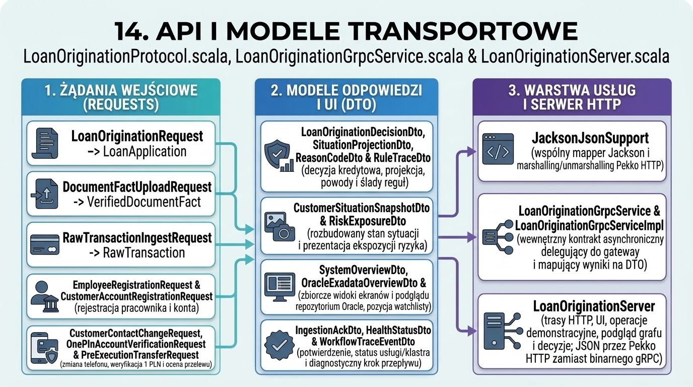

**15. Punkty wejścia i testy**

| Typ | Odpowiedzialność |
|---|---|
| `LoanOriginationWebApp` | Tworzy system Pekko, klaster, silnik, gateway i serwer HTTP (`127.0.0.1:8088`); odczytuje host i port ze środowiska. |
| `SituationAwarenessDemo` | Konsolowy scenariusz prezentujący wzbogacanie, agentów, ryzyko i decyzje. |
| `KafkaTransactionGeneratorApp` | Konsolowy generator tysięcy transakcji Kafka (z udziałem *hot-partition*), demonstrujący automatyczne przetwarzanie i syntezę opisu sytuacji przez model LLM z modułu `ai-models`. |
| `CustomerSituationAwarenessSpec` | Główna klasa testowa (7 testów); sprawdza wzbogacanie Flink, pluginy, decyzje kredytowe, propagację 2-hop, globalny graf Oracle, punkty końcowe HTTP/gRPC, mechanizmy ograniczania stanu, generator Kafka z *hot-partition*, cykliczne podsumowania LLM w `ai-models`, wstrzymanie LLM przy pasywacji oraz wybudzanie agentów przez zapytania REST. |

Testy korzystają z rzeczywistych aktorów Pekko i serwera HTTP. Test SQL/PGQ sprawdza m.in. obecność odpowiednich fragmentów zapytania, co w trybie domyślnym nie wymaga uruchomionego kontenera Oracle (chyba że włączono `ORACLE_EXADATA_JDBC_ENABLED=true`).

**16. Najważniejsze ustalenia i ograniczenia architektoniczne**

| Priorytet | Ustalenie | Konsekwencja |
|---|---|---|
| Wysoki | Zapisy repozytorium Oracle są oddzielnymi efektami po zapisie Pekko. | Awaria może pozostawić różne obrazy danych w journalu i projekcjach. |
| Wysoki | Outbox relacji jest potwierdzany po `tell`, bez potwierdzenia trwałego zapisu odbiorcy. Retry wpisu bez `peerSignal` jedynie go potwierdza. | Nie ma pełnej gwarancji dostarczenia aktualizacji relacji. |
| Wysoki | `RelationshipAgent` nie deduplikuje interakcji. Dwie perspektywy tej samej transakcji trafiają do tej samej relacji. | Liczba transakcji i wolumen relacji mogą być zawyżane. |
| Wysoki | Projekcja faktu jest wykonywana przed deduplikacją przez klienta. | Idempotencja aktora nie gwarantuje idempotencji wszystkich projekcji. |
| Wysoki | „Pula” JDBC ogranicza liczbę bezczynnych połączeń; przy pustej kolejce tworzy kolejne. | `maxPoolSize` nie ogranicza liczby równocześnie aktywnych połączeń. |
| Wysoki | JDBC działa synchronicznie, także w callbackach agentów; wyjątki mogą być zamieniane na `None`. | Ryzyko blokowania dispatchera i rozbieżności pamięć–baza. |
| Średni | Portfel zachowuje maksymalnie 500 klientów na część, preferując wysokie ryzyko. | Wskaźniki koncentracji nie opisują całego portfela. |
| Średni | Deduplikacja usuwa część skrótów po osiągnięciu limitu. | Bardzo stare duplikaty mogą zostać ponownie przyjęte. |
| Średni | Replay ponownie wykonuje bieżący plugin. | Potrzebna jest strategia wersjonowania logiki i migracji zdarzeń. |
| Średni | Detektor „Rapid Pass-Through” operuje na zagregowanych przepływach bez wymuszenia krótkiego odstępu czasu. | Nazwa i opis wzorca są silniejsze niż warunki faktycznej detekcji. |
| Średni | `maxAcceptableStateStalenessSeconds` nie steruje decyzją; świeżość jest raportowana. | Nieaktualny stan nie powoduje automatycznie wstrzymania oceny. |
| Średni | Roczny dochód jest przeliczany w klasyfikacji, ale plugin zapisuje oryginalny fakt i ignoruje wyliczone pole miesięczne. | Dokument podatkowy nie zastępuje miesięcznego dochodu używanego przez silnik. |
| Średni | Fakty dokumentowe są indeksowane po typie. | Kolejne zobowiązanie może zastąpić poprzednie zamiast zwiększyć sumę zadłużenia. |
| Średni | Kwoty różnych walut trafiają do wspólnych agregatów bez przeliczenia. | Metryki wymagają założenia jednej waluty albo rozbudowy modelu. |

Najmocniejsze elementy projektu to oddzielenie domeny od infrastruktury, jawne modele dowodów i powodów decyzji, osobna projekcja kredytowa, rozszerzalność przez pluginy oraz powiązanie cyklu życia aktora Pekko (wybudzanie przez Kafka/REST i pasywacja) z cykliczną syntezą opisów sytuacji przez LLM (`ai-models`). Najpilniejsze prace przed wdrożeniem produkcyjnym dotyczą trwałości Pekko na docelowym klastrze, idempotentnych projekcji, rzeczywistych potwierdzeń outbox i poprawnego zakresu agregacji finansowych.

Istniejący [ARCHITECTURE.md](file:///home/chris/Projects/OCS/CustAgents/ARCHITECTURE.md) wymaga uzgodnienia z kodem: zawiera zarówno historyczne ograniczenia, jak i deklaracje ich pełnego usunięcia. Dotyczy to szczególnie ograniczonej puli JDBC, niezawodności end-to-end, pełnego pushdown analizy grafowej oraz deklarowanych czasów odpowiedzi. Obecne testy nie dostarczają pomiarów pozwalających potwierdzić te gwarancje.