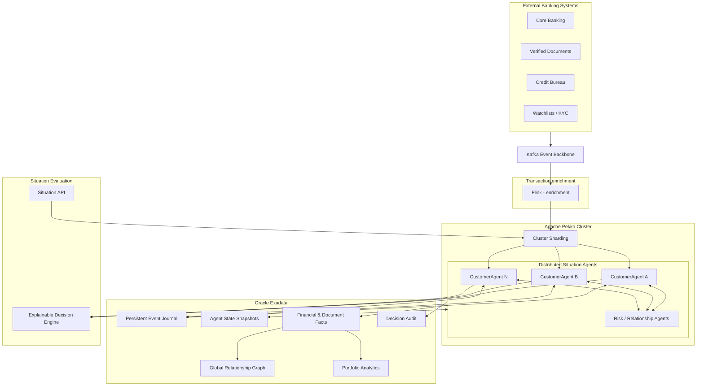
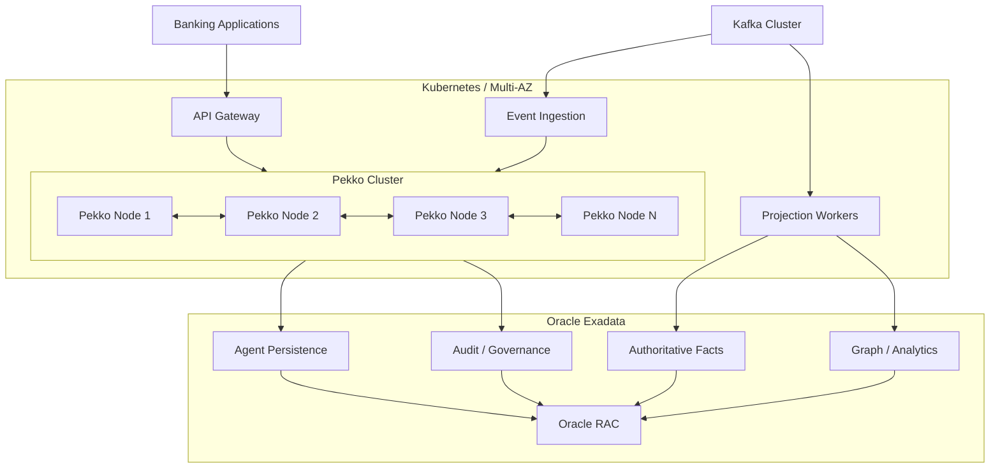

# **Banking Situation Awareness**

## **Rozproszony system agentowy oparty na Apache Pekko i Oracle Exadata**


**Budujemy od zera system Situation Awareness, którego podstawą jest klaster Apache Pekko, a Oracle Exadata jest istniejącym zasobem infrastrukturalnym, który chcemy wykorzystać w sposób naturalny dla architektury agentowej.**


W takim przypadku wykorzystamy nastepujące technologie w której:

- **Apache Pekko Cluster Sharding** jest głównym środowiskiem wykonywania rozproszonych agentów.
- **Oracle Exadata** zapewnia trwałość stanu, zapis zdarzeń, przechowywanie faktów, audyt i analitykę.
- **Kafka** stanowi magistralę komunikacyjną dla zdarzeń pochodzących z systemów zewnętrznych.
- **Apache Flink** jest warstwą intensywnego przetwarzania strumieniowego, służy do enrichment transakcji. Obecnie w tym strumieniu wywoływany jest zewnętrzny moduł kategoryzatora, który zwraca kategorię przypisana do transakcji.
- **Situation Awareness** jest podstawową abstrakcją domenową, a nie dodatkową warstwą nad agregatami w bazie relacyjnej Oracle.

Najważniejsza decyzja brzmi:

**Nie wykorzystujmy Exadaty jako silnika, który na każde żądanie rekonstruuje sytuację klienta. Wykorzystajmy ją jako trwałą pamięć rozproszonego systemu agentowego oraz platformę globalnej analizy sytuacji.**

Co istotne, nie ma konieczności wdrażania Cassandry lub ScyllaDB. Apache Pekko Persistence JDBC obsługuje profil Oracle, a więc Oracle może być również kandydatem na backend Event Sourcing. Wymaga to jednak weryfikacji konkretnego pluginu, schematów i wydajności na Exadata.  

Flink jest właściwym miejscem dla przetwarzania strumieniowego, wzbogacania zdarzeń i operacji wymagających skoordynowanego przetwarzania danych. Pekko jest natomiast naturalnym kandydatem do utrzymywania długotrwałego stanu pojedynczego klienta i obsługi komunikacji pomiędzy takimi stanami.

---

# **1. Proponowana architektura docelowa**



Jest to schemat logiczny. Poszczególne operacje zapisu do Oracle nie muszą być wykonywane bezpośrednio przez agentów — mogą być realizowane przez warstwę persystencji i projekcje.

Właśnie ten podział odpowiedzialności jest kluczowy.

---

# **2. Jak najlepiej wykorzystać Oracle Exadata?**

Wykorzystanych będzie **pięć istotnych zastosowań Oracle** w takim systemie.

|**Funkcja Oracle**|**Znaczenie**|**Rekomendacja**|
|---|---|---|
|Event Journal|Trwały zapis ewolucji stanu agentów|Tak, rozważyć Oracle Persistence JDBC|
|State Snapshots|Szybkie odtwarzanie agentów|Tak|
|Financial Facts|Autorytatywna historia transakcji i dokumentów|Tak|
|Global Graph|Analiza relacji między klientami i grupami|Tak, poza krytyczną ścieżką pojedynczej decyzji|
|Portfolio Analytics|Analiza milionów klientów i ich sytuacji|Tak|

Agent nie będzie wykonywał zapytania SQL za każdym razem, gdy zmienia się jego sytuacja. To prowadziłoby do ponownej centralizacji przetwarzania.

## **2.1. Oracle jako Event Journal**

Każdy agent posiada unikalny identyfikator:

`CustomerAgent:CUST-12345`

Agent utrzymuje stan wyliczany z kolejnych zdarzeń.

Przykład:

```text
CustomerAgent:CUST-12345

Event 1001: TransactionObserved
Event 1002: IncomeVerified
Event 1003: DebtUpdated
Event 1004: CounterpartyRiskReceived
Event 1005: ExternalDocumentReceived
Event 1006: SituationEvaluated
```

Każde zdarzenie obserwowane przez agenta powinno mieć własną logikę przetwarzania, tak aby można było je konfigurować poprzez architekturę plugin implementujący znany interfejs przetwarzania zdarzeń. Zatem w momencie, kiedy zdarzenie dociera do agenta, jest ono routowane do właściwego plugin, odpowiedzialnego za jego przetwarzanie. Oznacza to, że kolejne przetwarzane zdarzenia budują persystentny kontekst agenta, na którego podstawie cyklicznie jest uaktualniana świadomość sytuacyjna i zapisywana jako zdarzenie.

Pekko Persistence pozwala utrwalać zdarzenia oraz odtwarzać z nich stan agenta.

Oracle będzie przechowywać journal w strukturze logicznie odpowiadającej:

```sql
AGENT_EVENT_JOURNAL
-------------------------
persistence_id
sequence_nr
event_type
event_payload
event_timestamp
event_schema_version
```

To uproszczony model koncepcyjny. Faktyczny schemat musi być zgodny z użytym pluginem Pekko Persistence i nie powinien być samodzielnie zastępowany taką tabelą.

**Dlaczego to interesujące?**

Ponieważ możemy wykorzystać Exadatę do trwałości agentów bez budowania dodatkowego klastra bazodanowego.

Należy jednak sprawdzić koszt zapisu przy dużej liczbie aktywnych agentów.

Jeżeli system obsługuje 3000 transakcji na sekundę, a każda transakcja powoduje aktualizację dwóch agentów, otrzymujemy potencjalnie 6000 zapisów zdarzeń agentowych na sekundę, zanim doliczymy dokumenty, sygnały sieciowe i audyt. **To wymaganie potrzebuje przeprowadzenia testu wydajnościowego na rzeczywistym sprzęcie**.

---

# **3. Oracle jako repozytorium snapshotów agentów**

Event Sourcing umożliwia odtwarzanie stanu przez ponowne zastosowanie zapisanych zdarzeń.

Nie chcemy jednak przy każdym aktywowaniu agenta odczytywać całej jego historii.

Dlatego wykorzystujemy snapshoty.

```text
                Oracle Exadata
                      │
          ┌───────────┴───────────┐
          │                       │
       Snapshot               Event Journal
          │                       │
          ▼                       ▼
      State at N            Events N+1...M
          │                       │
          └───────────┬───────────┘
                      ▼
                CustomerAgent
                      │
                      ▼
              Current Situation
```

### **Proponowane działanie**

1. Pekko aktywuje agenta wskutek otrzymania wiadomości.
2. Agent odczytuje najnowszy snapshot z Oracle.
3. Odtwarza zdarzenia zapisane po snapshocie.
4. Rekonstruuje `CustomerSituationState`.
5. Rozpoczyna obsługę kolejnych komunikatów.

Apache Pekko Cluster Sharding odpowiada za lokalizowanie i uruchamianie encji, natomiast trwałość stanu zapewnia odpowiednio skonfigurowana persystencja.  

### **Co daje Exadata?**

Możliwość wykorzystania istniejącej infrastruktury do równoległego odtwarzania dużej liczby agentów.

Ale istnieje ważne ograniczenie.

**Snapshot nie powinien zawierać nieograniczonej historii klienta.**

Rekomenduję przechowywanie:

- bieżących wskaźników finansowych;
- ograniczonych czasowo bucketów;
- zweryfikowanych faktów;
- aktywnych ekspozycji na ryzyko;
- identyfikatorów dowodów;
- wersji stanu i reguł.

Pełna historia transakcyjna powinna pozostać w osobnym repozytorium faktów.

---

# **4. Oracle jako globalna pamięć faktów**

Tu pojawia się najważniejsza różnica między architekturą rozproszonych agentów a klasycznym systemem bazodanowym.

**Agent przechowuje to, co jest potrzebne do rozumienia aktualnej sytuacji. Oracle przechowuje to, co rzeczywiście się wydarzyło.**

Przykład:

Klient otrzymuje wypłatę w wysokości 5000 EUR.

W Oracle zapisujemy fakt:

```text
Transaction ID: TX-001
Customer: CUST-123
Amount: 5000 EUR
Category: SALARY
OccurredAt: ...
```

Agent aktualizuje swój stan:

```text
CustomerSituation:
    monthlyIncome: 5000
    incomeStability: HIGH
    liquidityTrend: POSITIVE
    lastSalaryObserved: ...
```

Istotne jest, że te dwa zapisy pełnią inne funkcje.

Oracle pozwala odtworzyć historię zdarzeń finansowych.

Agent pozwala szybko odpowiedzieć na pytanie:

**Czy sytuacja finansowa klienta jest obecnie stabilna?**

Nie chcemy wykonywać agregacji całej historii w momencie zadania tego pytania.

---

# **5. Oracle Property Graph jako globalny model relacji**

W tym miejscu Exadata może dostarczyć szczególnie interesującą funkcję.

Drugi dokument wykorzystuje lokalne `egoNetwork` w agentach.

Jest to dobre rozwiązanie dla analizy relacji konkretnego klienta, ale ma istotne ograniczenie:

Agent nie zna całej sieci zależności w banku.

Dlatego proponuję dwa uzupełniające się modele.

## **Local Ego-Network — Pekko**

Każdy agent posiada lokalną wiedzę o swoich relacjach.

```text
CustomerAgent(Alice)
    │
    ├── Bob
    ├── Charlie
    └── David
```

Ten model służy szybkiemu reagowaniu na lokalne zdarzenia.

## **Global Relationship Graph — Oracle**

Oracle utrzymuje szerszy graf relacji:

```text
Alice ── Bob ── Company X
  │       │          │
  │       └── David  │
  │                  │
Charlie ── Company Y ┘
```

Można go wykorzystać do:

- wykrywania społeczności;
- identyfikowania koncentracji ryzyka;
- rozpoznawania powiązań między wieloma klientami;
- analizy węzłów o wysokim stopniu;
- wykrywania zorganizowanych wzorców ryzyka;
- obliczania globalnych wskaźników sieciowych.

### **Proponowany przepływ**

Zatem zasoby utrzymywane w Exadata mogą stanowić również źródło zdarzeń dla agentów klienta. W tym przypadku GlobalGraph byłby źródłem wykrywania interesujących globalnych powiązań, które są znaczącą informacją do budowania świadomości sytuacyjnej.

```text
Oracle Global Graph
        │
        ▼
Graph Risk Analysis
        │
        ▼
Risk Intelligence Events
        │
        ▼
Kafka
        │
        ▼
Pekko Customer Agents
        │
        ▼
Updated Situation
```

Dzięki temu Oracle nie staje się zależnością każdego zapytania do pojedynczego agenta.

Zamiast tego dostarcza nową wiedzę, którą agenci włączają do swoich stanów.

**To jest jeden z najbardziej wartościowych sposobów wykorzystania Exadaty w architekturze Situation Awareness.**

---

# **6. Model agentów — nie ograniczałbym się do CustomerAgent**

Z punktu widzenia świadomości sytuacyjnej najważniejszą role pełni `CustomerAgent`. Jest on odpowiedzialny za dostarczenie opisu bieżącej sytuacji danego klienta. Jednak nie każdy agent musi reprezentować klienta. Możemy zastosować bogatszy model agentowy, rozdzielający odpowiedzialności domenowe. Wtedy `CustomerAgent` może korzystać z usług agentów domenowych odpowiedzialnych za informacje lub algorytmy przetwarzania wykorzystywane przez wielu agentów klienta.

Zatem będą zbudowane następujace typy agentów.

|**Typ agenta**|**Odpowiedzialność**|
|---|---|
|`CustomerAgent`|Aktualna sytuacja pojedynczego klienta|
|`RelationshipAgent`|Stan określonej relacji lub ekspozycji|
|`RiskSignalAgent`|Interpretacja i cykl życia sygnałów ryzyka|
|`DocumentVerificationAgent`|Koordynacja weryfikacji dokumentów|
|`PortfolioRiskAgent`|Interpretacja ryzyka na poziomie segmentu lub portfela|


---

# **7. Trzy poziomy Situation Awareness**

System jest projektowany bezpośrednio według modelu Endsley.

## **Level 1 — Perception**

System rozpoznaje, jakie zdarzenia nastąpiły.

Przykłady:

- wpłynęła transakcja;
- zaktualizowano dochód;
- zmienił się status zatrudnienia;
- pojawiło się nowe zobowiązanie;
- kontrahent został oznaczony jako ryzykowny.

Technologie:

Kafka, adaptery systemów bankowych, Flink.

## **Level 2 — Comprehension**

Agenci interpretują znaczenie zdarzeń.

Przykładowo:

```text
TransactionObserved
        │
        ▼
CustomerAgent
        │
        ▼
Income Pattern Updated
        │
        ▼
Income Stability Decreased
        │
        ▼
Financial Situation Changed
```

To jest podstawowa odpowiedzialność Pekko.

W tym miejscu utrzymujemy model:

`CustomerSituationState`

## **Level 3 — Projection**

System ocenia potencjalne konsekwencje.

Przykład:

Klient ma określoną sytuację finansową.

Co stanie się z jego zdolnością kredytową, jeżeli otrzyma dodatkowy kredyt?

```text
Current Situation
        │
        ▼
Proposed Loan
        │
        ▼
Situation Projection
        │
        ├── Future DTI
        ├── Expected Liquidity
        ├── Risk Exposure
        └── Affordability
        │
        ▼
Explainable Evaluation
```

Warto rozróżnić projekcję sytuacji od formalnej decyzji.

System może obliczać scenariusze przyszłego stanu niezależnie od tego, czy ma uprawnienia do automatycznego zatwierdzania wniosku.

---

# **8. Jaką rolę powinien pełnić Flink?**


### **Kafka + Flink + Pekko + Oracle**

```text
Banking Events
      │
      ▼
    Kafka
      │
      ▼
    Flink
      │
      ├── Validation
      ├── Enrichment
      ├── Bilateral Split
      └── Event Normalization
      │
      ▼
    Kafka
      │
      ▼
Pekko Cluster
      │
      ▼
Customer Agents
      │
      ▼
Oracle Exadata
```

Ma to sens ponieważ występują duże wolumeny zdarzeń, rozbudowane wzbogacanie danych, operacje event-time i wielostrumieniowe joiny.

---

# **9. Oracle zastępuje Cassandrę w Pekko Persistence**

Apache Pekko Persistence JDBC udostępnia mechanizmy journalu, snapshotów i durable state. Konfiguracja pluginu uwzględnia `OracleProfile` w Slick.  

Nie oznacza to jednak, że Oracle Exadata automatycznie będzie najlepszym backendem dla każdego profilu obciążenia.

Porównanie:

|**Właściwość**|**Oracle Exadata**|**Cassandra / ScyllaDB**|
|---|---|---|
|Integracja z istniejącą infrastrukturą|Bardzo dobra|Wymaga nowej infrastruktury|
|Relacyjny model danych|Natywny|Ograniczony|
|Transakcje ACID|Tak|Inny model transakcyjności|
|Event Journal Pekko|Możliwy przez JDBC|Dostępne podejścia oparte na bazach rozproszonych|
|Snapshoty|Możliwe przez JDBC|Tak|
|Globalna analityka SQL|Duża zaleta|Zwykle wymaga dodatkowej platformy|
|Skalowanie zapisu|Wymaga wymiarowania redo, commitów i indeksów|Architektura zoptymalizowana pod rozproszony zapis|
|Operacyjna prostota przy istniejącej Exadata|Potencjalnie wyższa|Niższa, jeśli trzeba utrzymywać dodatkowy klaster|

---

# **10. Istotne decyzje dotyczące niezawodności**


**Idempotencja.** Każde zdarzenie ma stabilny identyfikator. Ponowne dostarczenie komunikatu nie może dwukrotnie zmienić stanu klienta. Dotyczy to również zdarzeń historycznych, które wykraczają poza krótką listę ostatnich identyfikatorów.

**Reliable Delivery.** Zdarzenia ryzyka propagowane między agentami wymagają mechanizmu niezawodnego dostarczania i deduplikacji. Sama komunikacja przez Pekko Cluster Sharding nie zapewnia exactly-once delivery.

**Transactional Outbox.** Jeśli zmiana stanu agenta powoduje wysłanie krytycznego sygnału, należy zapewnić trwałość zamiaru jego publikacji. W przeciwnym razie agent może zapisać zdarzenie do journalu, a następnie ulec awarii przed wysłaniem wiadomości. Outbox lub równoważny wzorzec trwałych efektów ubocznych powinien być częścią projektu.

**Situation Consistency.** Każda ewaluacja powinna wskazywać wersję sytuacji i stopień kompletności danych. Agent nie może interpretować braku informacji jako potwierdzenia braku ryzyka.

W tym zakresie Oracle jest potencjalnie bardzo użyteczny dzięki możliwościom transakcyjnym.

---

# **11. Model danych w Oracle — proponowany podział**


Schematy w bazie Oracle. Nie trzymamy wszystkich tabel w jednym schemacie.

|**Schemat**|**Zawartość**|
|---|---|
|`SA_PERSISTENCE`|Pekko Event Journal, snapshoty, durable state|
|`SA_FACTS`|Kanoniczne transakcje, dokumenty, zobowiązania|
|`SA_GRAPH`|Globalne relacje i projekcje sieci|
|`SA_INTELLIGENCE`|Globalne sygnały i wyniki analizy ryzyka|
|`SA_DECISIONS`|Utrwalone ewaluacje i dowody decyzji|
|`SA_GOVERNANCE`|Wersje reguł, modeli, polityk i metadane kontroli|

To podział odpowiedzialności, nie koniecznie sześć osobnych baz danych.

W ramach Exadaty można wykorzystać jedną bazę z odpowiednią separacją uprawnień, usług i obciążeń.

Szczególnie ważne jest, aby ciężkie analizy portfelowe nie blokowały zapisów journalu agentów.

---

# **12. Proponowana architektura wdrożeniowa**



Nie zakładałbym od razu, że trzy węzły Pekko wystarczą do obsługi określonej liczby klientów.

Wymiarowanie zależy od liczby aktywnych agentów, ich stanu, liczby zdarzeń, czasu odtwarzania, fan-out komunikacji i pojemności zapisu Oracle.

---

# **13. Co jest najważniejsze w projekcie greenfield?**

Pięć fundamentalnych zasad architektonicznych.

**1. Customer Situation jest główną abstrakcją domenową.** Nie tabela, nie agregat i nie pojedyncza transakcja.

**2. Pekko jest właścicielem bieżącego stanu sytuacyjnego.** Oracle służy do jego trwałego odtworzenia, ale nie wykonuje interpretacji każdego zdarzenia.

**3. Oracle jest globalną pamięcią systemu.** Przechowuje historię, fakty i wyniki analiz przekraczających wiedzę pojedynczego agenta.

**4. Agenci komunikują się za pomocą zdarzeń domenowych.** Nie powinni współdzielić mutowalnego stanu ani wykonywać synchronicznych wywołań do wielu agentów dla każdej transakcji.

**5. Projekcje i decyzje są deterministyczne oraz audytowalne.** Każdy wynik musi być powiązany z konkretną wersją stanu, reguł i danych.

---

# **14. Co zyskujemy dzięki Exadata?**

W porównaniu z czysto agentową architekturą wykorzystującą wyłącznie Pekko i Cassandrę, dodanie Exadaty umożliwia połączenie dwóch sposobów przetwarzania.

### **Local Intelligence — Pekko**

Każdy agent zna sytuację swojego klienta.

Reaguje szybko, lokalnie i inkrementalnie.

### **Global Intelligence — Oracle Exadata**

Oracle analizuje relacje i wzorce, których pojedynczy agent nie jest w stanie rozpoznać.

Przykładowo:

- grupa klientów wykazuje podobny wzorzec transakcyjny;
- wiele pozornie niezależnych rachunków ma wspólnych kontrahentów;
- rośnie koncentracja ryzyka w określonym segmencie;
- pojawia się nowy wzorzec powiązań między klientami.

Oracle może wykryć takie zjawisko i opublikować zdarzenie:

`NetworkRiskPatternDetected`

Następnie odpowiedni agenci aktualizują swoje sytuacje.

Powstaje cykl:

**Local Events → Local Situation → Global Analysis → New Risk Intelligence → Local Situation Update**

To jest moim zdaniem najbardziej interesujący element proponowanej architektury.

---

# **15. Rekomendacja końcowa**

Oracle nie jest jedynie archiwum snapshotów agentów, również Pekko nie jest tylko warstwą cache dla zapytań Oracle.

**Budujemy dwupoziomowy model inteligencji sytuacyjnej:**

|**Poziom**|**Technologia**|**Odpowiedzialność**|
|---|---|---|
|**Distributed Local Situation Intelligence**|Apache Pekko Cluster|Aktualny stan klientów, lokalne relacje, reakcje na zdarzenia, projekcje|
|**Global Situation Intelligence & Memory**|Oracle Exadata|Trwałość agentów, globalne fakty, graf relacji, analizy systemowe i audyt|

Kafka łączy te warstwy i dostarcza zdarzenia z systemów zewnętrznych.

W ten sposób Oracle i Pekko nie konkurują o odpowiedzialność za ten sam fragment systemu, lecz wzajemnie się uzupełniają.

## **Jeden element, który szczególnie warto rozwinąć**

Budujemy **hierarchiczny, rozproszony model Situation Awareness**, w którym istnieją:

**Customer Situation → Relationship Situation → Portfolio Situation → Global Banking Situation**

Każdy poziom ma inny zakres odpowiedzialności i inny horyzont wiedzy.

Pekko zapewnia lokalne, reaktywne rozumienie sytuacji, natomiast Exadata umożliwia analizowanie powiązań i zjawisk o znacznie większym zasięgu.

**To pozwala zbudować nie tylko szybszy system oceny kredytowej, ale platformę Situation Awareness dla całego banku — wykorzystującą rozproszonych agentów do interpretowania lokalnych zdarzeń oraz Exadatę do budowania globalnego kontekstu.**